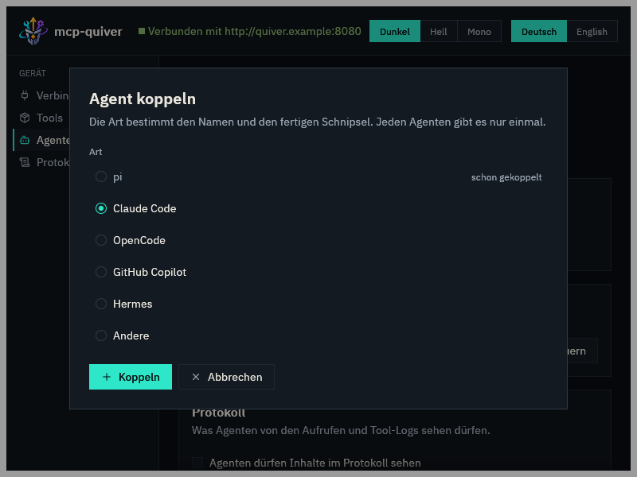
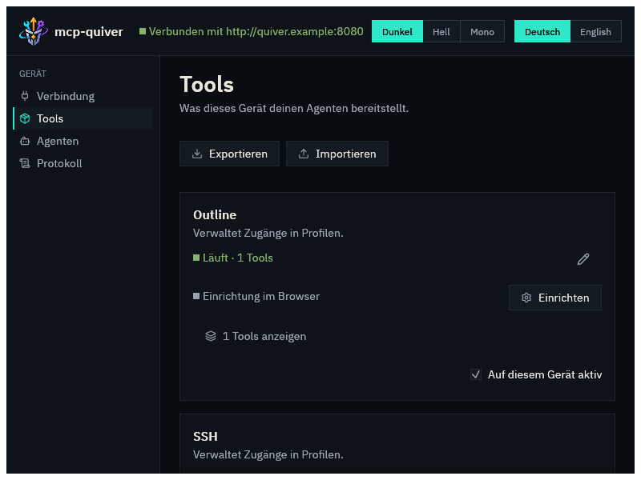
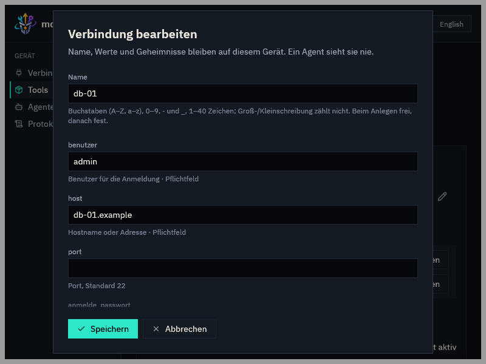
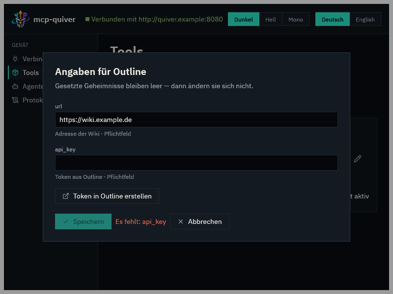
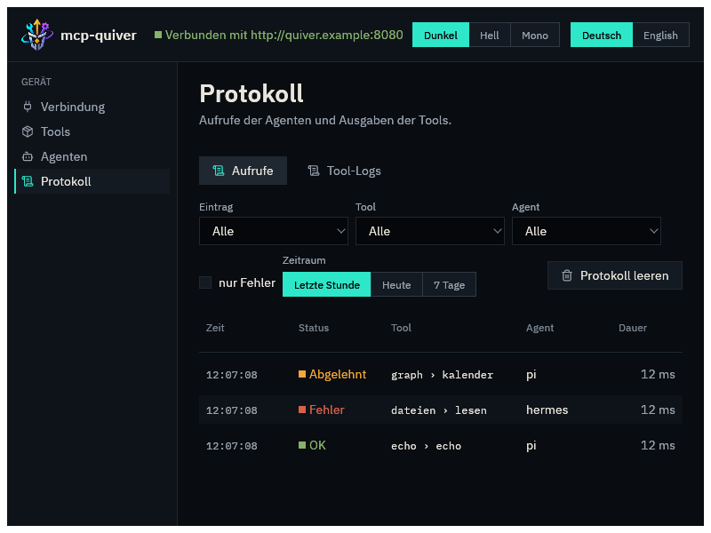
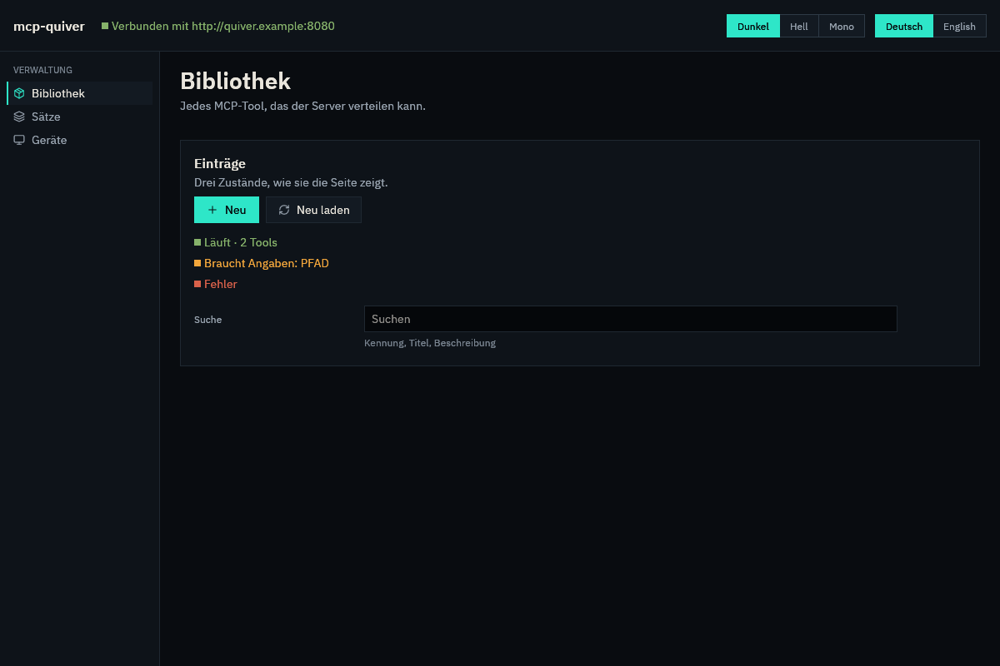
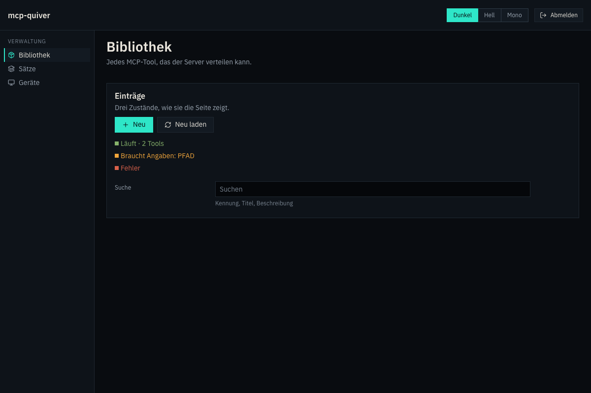
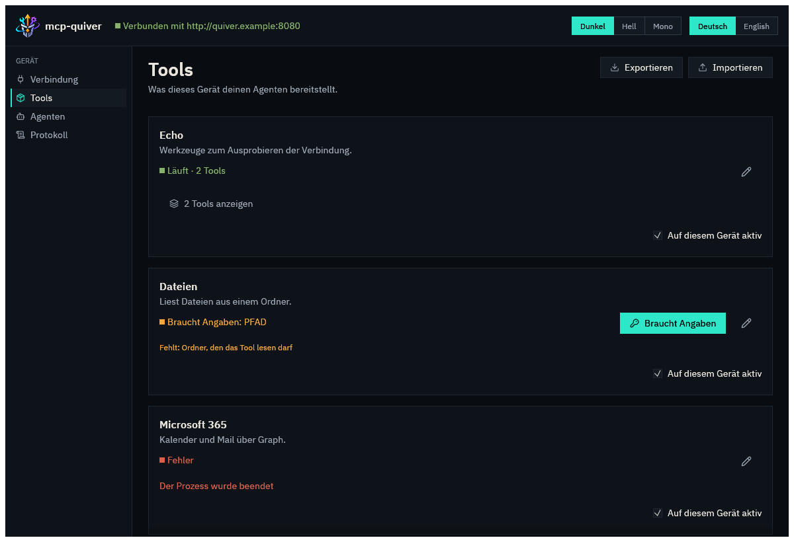
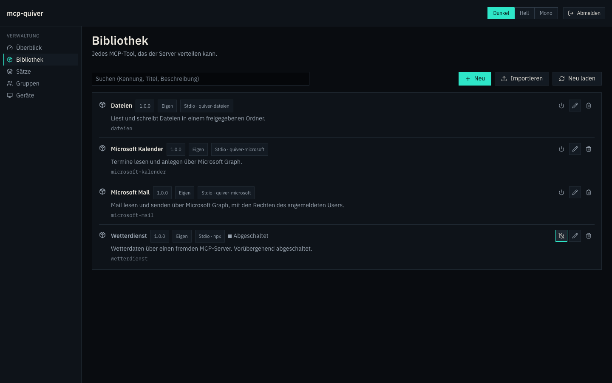

# mcp-quiver

**English:** [README.md](README.md)

> **Stand: MVP in Arbeit.** Server, Client und Admin-Oberfläche funktionieren Ende zu Ende;
> Umfang in [SPEC.md](SPEC.md) §0, bekannte Lücken in [docs/offen.md](docs/offen.md).

**Ein Köcher voller Tools für alle deine Agenten.** mcp-quiver ist eine zentrale
Bibliothek von [MCP](https://modelcontextprotocol.io/)-Tools und ein kleiner
Client auf jedem Gerät. Admins legen in einer Weboberfläche fest, welche Tools
eine Gruppe bekommt. Der Client installiert und konfiguriert sie, und jeder
Agent auf dem Gerät – pi, Hermes und weitere – spricht mit genau einem
Endpunkt. Anmeldungen passieren einmal, im Client. Agenten sehen nie ein
Passwort oder ein Token.

Reines Rust: Server, Client und das Client-Fenster. Die Admin-Oberfläche ist
Vue und sieht genauso aus wie der Client.

## Die Idee

```
 pi-agent ──┐                        ┌──────────── quiver-server ────────────┐
 Hermes   ──┼──► quiver (Client) ◄──►│ Bibliothek: MCP-Tools (eigene+fremde)│
 …        ──┘    ein Endpunkt        │ Zuweisung über Entra-ID-Gruppen       │
                 führt Tools aus     │ Admin-Oberfläche (Vue)                │
                 hält die Logins     └───────────────────────────────────────┘
```

- **Bibliothek auf dem Server.** Eigene Tools (in Rust geschrieben) und fremde
  MCP-Server in einem Katalog, versioniert, auf Basis des offiziellen
  `server.json`-Formats der MCP Registry.
- **Zuweisung über Gruppen.** Ein Admin weist Tool-Sätze Gruppen in Microsoft
  Entra ID zu. Jedes Gerät bekommt, was die Gruppen seines Users erlauben –
  automatisch installiert, aktualisiert und entfernt.
- **Konfiguration in Schichten.** Der Server pusht, was er weiß (Endpunkte,
  Tenant, Vorgaben). Der Client ergänzt, was nur das Gerät weiß (lokale Pfade,
  persönliche Geheimnisse im Tresor-Datei des Clients).
- **Authentifizierung an einer Stelle.** Agent → Client und Client → Server,
  sonst nichts. Der Client fügt Zugangsdaten bei jedem Tool-Aufruf ein. Der
  Agent sieht immer nur Tools.
- **Microsoft zuerst.** Der erste Tool-Satz deckt Microsoft 365 über Microsoft
  Graph ab und handelt mit den Rechten des angemeldeten Users. So gilt das
  Rollen- und Rechtemodell von Microsoft unverändert.
- **Jeder Agent.** Agenten, die MCP sprechen, verbinden sich direkt. Für alle
  anderen gibt es Plugins, geschrieben in Rust (pi über ein Node-Binding,
  Hermes über ein Python-Binding).

## Plattformen

- **Server:** ein Container-Image (Docker, Azure Container Apps, überall).
- **Client:** macOS, Windows und Linux.

## Server starten (Docker)

```bash
docker build -t mcp-quiver-server .
docker run -d --name quiver -p 8740:8740 -v quiver-daten:/daten mcp-quiver-server
docker exec quiver cat /daten/admin-token   # Admin-Token, beim ersten Start erzeugt
```

Dann `http://localhost:8740` öffnen und mit dem Admin-Token anmelden. Ohne Docker-Hub-Login
mit `--build-arg BASIS=public.ecr.aws/docker/library` bauen.

## Entwicklung

```bash
# alles prüfen (vor jedem Commit)
cargo fmt --all --check && cargo clippy --all-targets -- -D warnings && cargo test --workspace
```

Die Token-Dateien in `tokens/` sind die einzige Quelle für Farben, Maße und
Schriften — für das Client-Fenster (egui) und für die Admin-Oberfläche (Vue).
Das CSS der Admin-Oberfläche wird daraus erzeugt und eingecheckt, nie von Hand
geändert:

```bash
cargo run -p quiver-oberflaeche --bin tokens_css > admin/src/styles/tokens.css
```

### Admin-Oberfläche

```bash
git submodule update --init admin/vendor/weppelmann-ui
cd admin
npm ci
npm run dev     # Vite auf 5173, /api → 127.0.0.1:8740
npm run build   # nach admin/dist; der Server liefert sie unter / aus
npm run typecheck
npm test
```

Aufbau, Bausteine und Bildschirmfotos: [admin/README.md](admin/README.md).

### Client-Fenster

```bash
cargo run -p quiver-fenster                  # das Fenster
cargo run -p quiver-fenster -- --hintergrund # nur Tray und Kern, ohne Fenster
cargo run -p quiver-fenster -- --headless    # nur der Kern, bis Strg+C
```

Das Fenster zu schließen beendet quiver nicht: Kern, MCP-Endpunkt und Abgleich
laufen weiter, das Tray-Symbol bleibt. **Beenden** steht im Tray-Menü. Ein
zweiter Start (Doppelklick, während quiver im Tray sitzt) zeigt das Fenster der
laufenden Instanz und endet selbst — eine Instanz je Gerät.

Das Tray-Menü zeigt den Zustand (`Verbunden · 4 Tools · 1 Agent`), öffnet das
Fenster, schaltet **Beim Anmelden starten** und beendet. Derselbe Schalter steht
auf der Seite *Verbindung*; ob er an ist, wird aus dem System gelesen
(LaunchAgent, Registry-Wert oder `.desktop`-Datei), nicht im Fenster gemerkt.
Der Autostart startet immer mit `--hintergrund`.

Agenten verbinden sich über den lokalen Endpunkt und werden **einmal** im
Fenster gekoppelt (*Agenten* → *Agent koppeln*). Die Art bestimmt den Schnipsel:
pi, Claude Code, OpenCode, GitHub Copilot und Hermes bringen jeweils ihren
fertigen Text mit; das Token lässt sich jederzeit erneuern — das alte gilt sofort
nicht mehr.



Auf der Admin-Seite lässt sich ein Eintrag abschalten, ohne ihn zu löschen
(*Aktiv* im Bearbeiten-Dialog oder der Schalter in der Zeile). Er bleibt in
Bibliothek und Sätzen, läuft aber auf keinem Gerät; der Client beendet ihn beim
nächsten Abgleich.

Manche Tools verwalten ihre Zugänge in **Profilen** (mehrere Wikis, Postfächer,
Hosts, SAP-Systeme). Solche Einträge tragen eine *Einrichtung*; die Tools-Karte
zeigt dann **Einrichten**. Der Client startet dafür dasselbe Programm mit
derselben Umgebung und denselben `${feld}`-Platzhaltern wie die Laufzeit und
wartet **ohne Frist**, bis der User die Seite im Browser abschließt: Exit 0 heißt
eingerichtet und der Eintrag startet neu (neue Profile wirken sofort), Exit 1
heißt abgebrochen, alles andere steht als Fehler in der Karte. Zugangsdaten
durchlaufen dabei nie einen Agenten. In der Verwaltung steht der Befehl im
Abschnitt *Einrichtung (optional)*, die Liste zeigt das Abzeichen *mit
Einrichtung*.



Ein Eintrag lässt sich **nur auf diesem Gerät abschalten**: jede Karte auf der
Seite *Tools* trägt rechts den Schalter *Auf diesem Gerät aktiv*, standardmäßig
an. Aus beendet den laufenden Prozess in unter einer Sekunde, nimmt seine
Werkzeuge aus `tools/list` und sagt jedem verbundenen Agenten Bescheid
(`list_changed`). Ein Aufruf danach antwortet „<Titel> ist auf diesem Gerät
abgeschaltet – im quiver-Fenster unter Tools einschalten“, nie „unbekannt“.
Angaben, Zugänge, Geheimnisse und die Anmeldung bleiben erhalten — nur
*Anmelden* und *Einrichten* sind gesperrt, solange der Eintrag aus ist. Die Wahl
überlebt Neustart, Abgleich, Änderung am Server und einen Import (**aus bleibt
aus**; die Sicherung nimmt sie mit), und die Verwaltung zeigt „am Gerät
abgeschaltet“ als neutralen Zustand, nicht als Problem. Agenten können nichts
schalten; dafür gibt es kein Werkzeug.


Manche Tools brauchen **mehrere gleichartige Zugänge**, die der User nach und
nach anlegt — etwa SSH-Verbindungen mit Name, Host, Port und Benutzer. Solche
Einträge tragen eine *Zugangsliste* (Verwaltung: *Mehrere Zugänge (optional)*
mit Überschrift, Bezeichnung und Feldern, Quelle nur *Gerät*); die Tools-Karte
zeigt dann „Verbindungen (2)“ mit **Verbindung hinzufügen** und der
aufklappbaren Liste: bearbeiten, löschen (mit Rückfrage) und je gesetztem
Geheimnis ein eigenes **Geheimnis löschen** — praktisch, wenn das
Anmelde-Passwort weg soll, sobald der Schlüssel eingerichtet ist. Geheimes
liegt in der Tresor-Datei, die übrigen Werte in der Client-Konfiguration. Beim
Start bekommt das Tool alle Zugänge als JSON in `QUIVER_ZUGAENGE`; ein Eintrag
ohne Zugang läuft trotzdem und meldet selbst „kein Zugang“.



Manche Felder bringen einen **Hilfe-Link** neben der Eingabe mit (Verwaltung:
*Link-Text* und *Link-Adresse*, Platzhalter `${feld}` erlaubt — zum Beispiel
`${url}/settings/api-and-access`). Der Knopf ist nur klickbar, wenn sich jeder
Platzhalter aus dem füllen lässt, was gerade im Dialog steht; sonst ist er
gesperrt und sagt, welches Feld noch fehlt. Ein Klick öffnet die Adresse im
Standardbrowser — sonst nichts, keine Anmeldung, kein Lauscher.



Felder tragen eine **Art** (Verwaltung: *Art* und *Titel*): Text, Passwort,
Zahl, Schalter (Häkchen), Adresse (mit `http(s)://`-Prüfung) oder Auswahl mit
festen Optionen. Ein *Titel* ersetzt den Feldnamen im Dialog — so steht
„SAP-Benutzer“ statt `benutzer`. Die Feldliste scrollt mit immer sichtbarer
Leiste; solange „Speichern“ gesperrt ist, steht der Grund daneben („Es fehlt:
SAP-Benutzer, ADT-Adresse“). Leere, nicht verpflichtende Felder sind erlaubt.

Die Angaben eines Geräts lassen sich **sichern und auf einem anderen Gerät
wieder einspielen**: Auf der Tools-Seite stehen dafür *Exportieren* und
*Importieren* in der Kopfzeile. Die Datei `quiver-einstellungen-<datum>.json`
enthält die Werte und die Zugangslisten aller Tools; auf Wunsch auch die
Geheimnisse — dann verschlüsselt mit XChaCha20-Poly1305 und einem Schlüssel aus
Argon2id (Passwort mit mindestens acht Zeichen, Dateirechte 0600). Geräte-Token,
Agent-Tokens und die Anmeldungen der Tools selbst sind nie dabei, die gehören zum
Gerät bzw. zur Anmeldung. Der Import zeigt erst eine Vorschau (neu, ändert,
übersprungen), mischt dann statt zu ersetzen — was nur am Gerät steht, bleibt —
und startet die betroffenen Einträge neu. Einträge, die es hier nicht gibt,
werden übersprungen; ein falsches Passwort ändert nichts. Die Wahl „auf diesem
Gerät abgeschaltet“ geht mit und steht in der Vorschau — aus bleibt aus.

Umgebung (alles optional):

| Variable | Bedeutung |
| --- | --- |
| `QUIVER_PROFIL` | Profilordner (Standard `~/Library/Application Support/mcp-quiver` und Entsprechungen) |
| `QUIVER_MCP_ADRESSE` | MCP-Endpunkt (Standard `127.0.0.1:8741`; ein zweiter Port lässt zwei Instanzen nebeneinander laufen) |
| `QUIVER_AUTOSTART_DIR` | Ordner für die Autostart-Datei (macOS und Linux; Tests und andere Sitzungen) |
| `QUIVER_TRESOR=speicher` | Geheimnisse im Arbeitsspeicher statt in der Tresor-Datei (Läufe ohne Spuren, zum Ausprobieren) |

## Protokoll und Datenschutz

Die Seite **Protokoll** im Fenster zeigt jeden Werkzeug-Aufruf eines Agenten
(Zeit, Agent, Eintrag, Werkzeug, Dauer, Ergebnis) und im Reiter *Tool-Logs*, was
das Tool auf stderr ausgegeben hat. Ein Klick auf eine Zeile öffnet die
Einzelheiten: Argumente, Fehlertext und eine Vorschau der Antwort. Filter
grenzen nach Eintrag, Werkzeug, Agent, Zeitraum (letzte Stunde, heute, 7 Tage)
und „nur Fehler“ ein.

Alles bleibt auf dem Gerät: `<profil>/protokoll/aufrufe-JJJJ-MM-TT.jsonl` und
`prozesse-JJJJ-MM-TT.jsonl`, Dateirechte 0600, nach 7 Tagen gelöscht und
insgesamt höchstens 50 MB. Der Server bekommt keine Aufrufe.

**Immer maskiert:** Schlüssel, deren Name `pass`, `token`, `secret`, `key`,
`pat`, `auth` oder `cookie` enthält, werden zu `<verborgen>`, und jeder Wert aus
dem Tresor wird ersetzt — auch als Teilstring, in Argumenten, Vorschau,
Fehlertext und Tool-Log-Zeilen. Gekürzt wird auf 200 Zeichen je Wert, 4 KB
Argumente, 500 Zeichen Vorschau und 2000 Zeichen Fehlertext.

Agenten können das Protokoll selbst lesen, über zwei lesende Werkzeuge:
`quiver__protokoll` und `quiver__tool_log`. Beide liefern **nur Metadaten**, bis
unter *Agenten* „Agenten dürfen Inhalte im Protokoll sehen“ eingeschaltet ist
(gespeichert in `zustand.json`); Fehlertexte bleiben in jedem Fall maskiert, und
die Aufrufe dieser beiden Werkzeuge stehen selbst nie im Protokoll.



Aufbau wie die Admin-Oberfläche: Kopf, Navigation links, Inhalt als Karten, drei
Themes aus denselben Tokens.

**Fenstergröße.** Unter 760 px schrumpft die Navigation auf Zeichen (der Name
steht im Hinweis), der Inhalt endet bei 1100 px und bleibt mittig, und Filter-
und Knopfleisten brechen um, statt seitlich hinauszuragen. Unter 700 px stellt
ein Formular die Beschriftung über das Feld und die Kopfzeile legt Farbschema
und Sprache in ein Menü; die Protokolltabelle lässt dann *Agent* und *Dauer*
weg (beide stehen im Detail-Dialog). Die Grenzen sind Tokens
(`breakpoint.*`) — die Verwaltung rechnet mit denselben Zahlen.

Die Bildschirmfotos erzeugt der Oberflächentest (mit Attrappe, ohne Server und
ohne Laufzeit) — jede Seite und jeder Dialog in 560 × 460, 800 × 600 und
1200 × 820, als `fenster-<thema>-<seite>-<breite>.png`:

```bash
QUIVER_BILDER=docs/bilder cargo test -p quiver-fenster --test oberflaeche
QUIVER_BILDER=docs/bilder cargo test -p quiver-oberflaeche --test muster
```

Der `muster`-Test zeichnet die Vergleichsseite, die es in der Verwaltung unter
`/muster` gibt (nur im Entwicklungsbau); beide lesen dieselben Token-Dateien,
deshalb unterscheiden sich die Bilder nur in der Schriftglättung:








## Lizenz

[MIT](LICENSE)
