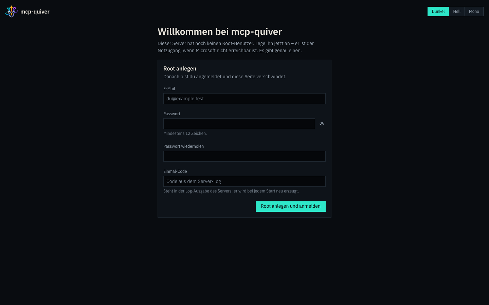
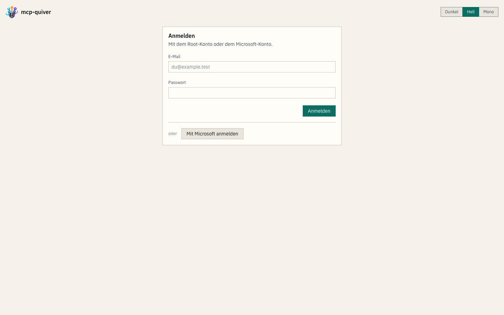
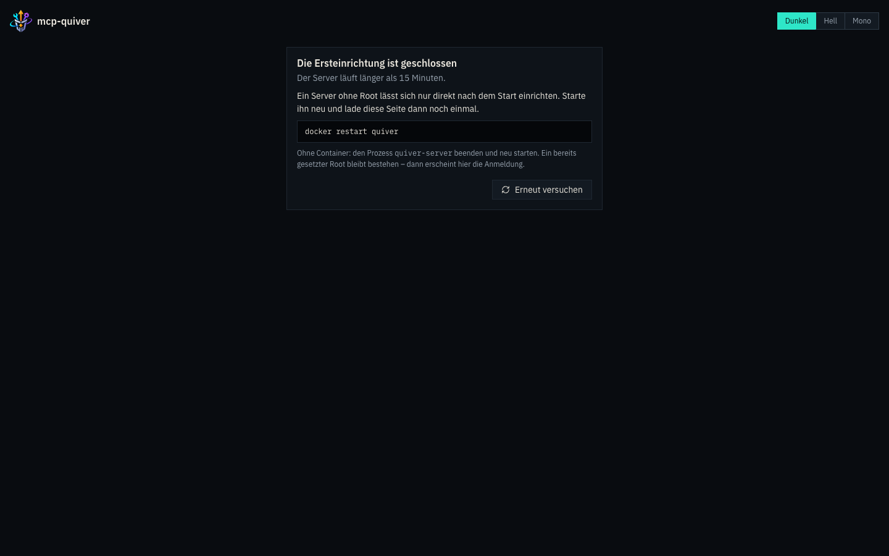
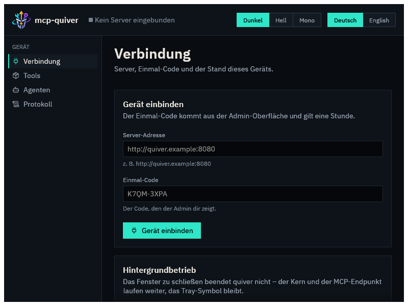
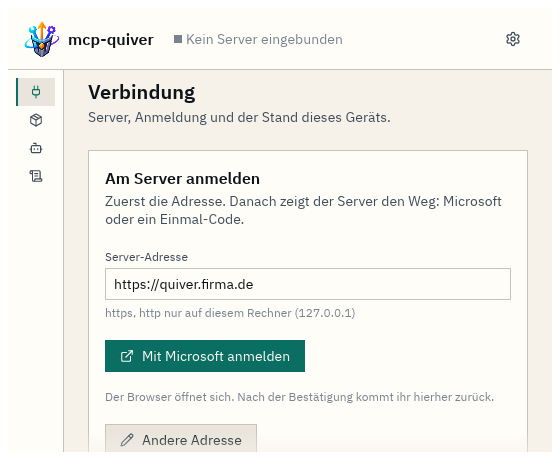
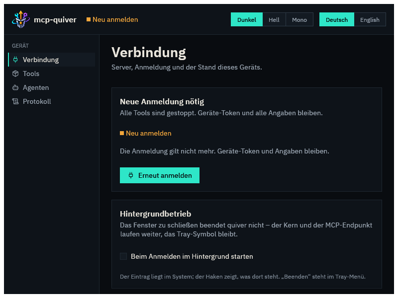
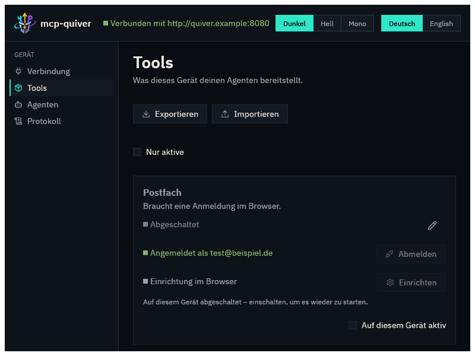

# mcp-quiver

**English:** [README.md](README.md)

> **Stand: MVP in Arbeit.** Server, Client und Admin-Oberfläche funktionieren Ende zu Ende;
> Umfang in [SPEC.md](SPEC.md) §0, bekannte Lücken in [docs/offen.md](docs/offen.md).

**Ein Köcher voller Tools für alle deine Agenten.** mcp-quiver ist eine zentrale
Bibliothek von [MCP](https://modelcontextprotocol.io/)-Tools und ein kleiner
Client auf jedem Gerät. Admins legen in einer Weboberfläche fest, welche Tools
eine Gruppe bekommt. Der Client installiert und konfiguriert sie, und jeder
Agent auf dem Gerät – pi, Hermes und weitere – spricht mit genau einem
Endpunkt. Anmeldungen passieren einmal, im Client. Agenten sehen nie ein
Passwort oder ein Token.

Reines Rust: Server, Client und das Client-Fenster. Die Admin-Oberfläche ist
Vue und sieht genauso aus wie der Client.

## Die Idee

```
 pi-agent ──┐                        ┌──────────── quiver-server ────────────┐
 Hermes   ──┼──► quiver (Client) ◄──►│ Bibliothek: MCP-Tools (eigene+fremde)│
 …        ──┘    ein Endpunkt        │ Zuweisung über Entra-ID-Gruppen       │
                 führt Tools aus     │ Admin-Oberfläche (Vue)                │
                 hält die Logins     └───────────────────────────────────────┘
```

- **Bibliothek auf dem Server.** Eigene Tools (in Rust geschrieben) und fremde
  MCP-Server in einem Katalog, versioniert, auf Basis des offiziellen
  `server.json`-Formats der MCP Registry.
- **Zuweisung über Gruppen.** Ein Admin weist Tool-Sätze Gruppen in Microsoft
  Entra ID zu. Jedes Gerät bekommt, was die Gruppen seines Users erlauben –
  automatisch installiert, aktualisiert und entfernt.
- **Konfiguration in Schichten.** Der Server pusht, was er weiß (Endpunkte,
  Tenant, Vorgaben). Der Client ergänzt, was nur das Gerät weiß (lokale Pfade,
  persönliche Geheimnisse im Tresor-Datei des Clients).
- **Authentifizierung an einer Stelle.** Agent → Client und Client → Server,
  sonst nichts. Der Client fügt Zugangsdaten bei jedem Tool-Aufruf ein. Der
  Agent sieht immer nur Tools.
- **Microsoft zuerst.** Der erste Tool-Satz deckt Microsoft 365 über Microsoft
  Graph ab und handelt mit den Rechten des angemeldeten Users. So gilt das
  Rollen- und Rechtemodell von Microsoft unverändert.
- **Jeder Agent.** Agenten, die MCP sprechen, verbinden sich direkt. Für alle
  anderen gibt es Plugins, geschrieben in Rust (pi über ein Node-Binding,
  Hermes über ein Python-Binding).

## Plattformen

- **Server:** ein Container-Image (Docker, Azure Container Apps, überall).
- **Client:** macOS, Windows und Linux.

## Server starten (Docker)

Das Abbild ist für den engen Betrieb gebaut: die Laufzeit besteht aus dem
Programm und sonst nichts – **keine Shell, keine Paketverwaltung** (distroless),
Benutzer `10001:999`, alle Basis-Abbilder auf einen Digest festgelegt. Im
Container gibt es keine Shell, über die sich etwas ausnutzen ließe.

```bash
docker build -t mcp-quiver-server .
docker run -d --name quiver -p 127.0.0.1:8740:8740 \
  -e QUIVER_OEFFENTLICH=http://localhost:8740 \
  --read-only --tmpfs /tmp:size=32m,mode=1777 \
  --cap-drop=ALL --security-opt=no-new-privileges:true \
  --memory 512m --pids-limit 256 \
  --log-driver json-file --log-opt max-size=10m --log-opt max-file=3 \
  -v quiver-daten:/daten mcp-quiver-server
```

Werte, Grenzen und Tests: [docs/haertung.md](docs/haertung.md).
`compose.yaml` ist derselbe Aufruf als Datei (`docker compose up -d`), und
`tools/container-pruefung.sh` startet genau so einen Container unter eigenem
Namen und Volume (`quiver-pruefung-*`) auf einem freien Port, prüft ihn und
räumt ihn wieder ab. Der Container meldet seine Gesundheit über
`quiver-server gesund`; der Unterbefehl fragt den Server nur über Loopback.
`docker exec quiver quiver-server …` geht ohne Shell weiterhin.

Vorhandene Volumes laufen weiter: der Datenordner gehört `10001:999` (UID
**und** GID), ein Volume aus einer früheren Fassung öffnet also ohne `chown`
von Hand. Im Volume ist der Datenordner `0700` und `quiver.db`, `-wal`, `-shm`,
die Sicherungen (`.vor-*`), `entra-*` und `schluessel` sind `0600`; von den
Sicherungen bleiben die letzten drei. Der Prozess setzt seine umask beim Start,
damit die Rechte von der ersten Sekunde an gelten; ein Neustart zieht Dateien
nach, deren Rechte von Hand verstellt wurden (Symlinks werden nicht verfolgt).

Danach `http://localhost:8740` öffnen. Die erste Seite ist die
**Ersteinrichtung**: sie fragt E-Mail und Passwort des einen Root-Benutzers ab
(12 bis 256 Zeichen, Argon2id) und meldet ihn gleich an. Die Einrichtung ist
nur 15 Minuten nach dem Start des Servers offen und nur mit einem Einmal-Code,
den der Server beim Start genau einmal ins Log schreibt – Pflicht, sobald der
Server nicht nur auf Loopback lauscht (im Container also immer), unabhängig von
der Basis-URL:

```
INFO quiver_server::einrichtung: Ersteinrichtung: Code für diesen Start: …
```

Das Fenster hängt an der Laufzeit des Servers, nicht an der Wanduhr; danach
hilft nur ein Neustart. `docker exec -it quiver quiver-server root-setzen
admin@example.test` bleibt der Weg für ein vergessenes Passwort. Einen
Admin-Token gibt es nicht mehr; `QUIVER_ADMIN_TOKEN` wird ignoriert und
`daten/admin-token` verschwindet, sobald ein Root-Benutzer gesetzt ist. Ohne
Docker-Hub-Login mit `--build-arg BASIS=public.ecr.aws/docker/library` bauen.

Der Container lauscht immer auf allen Adressen; das Veröffentlichen oben hält
ihn auf `127.0.0.1`. Deshalb darf die Basis-URL blankes `http` sein: mit einer
Basis-URL, die kein https ist, startet der Server nur, wenn der Host Loopback
ist. Der Einmal-Code bleibt trotzdem Pflicht, weil die Lauschadresse
entscheidet und nicht die Basis-URL. Nur ein ausdrückliches
`QUIVER_EINRICHTUNG=ohne-code` zusammen mit einer Loopback-Basis-URL hebt ihn
auf; der Start meldet das deutlich. Sonst könnte wer den Port in den ersten 15
Minuten erreicht den Root anlegen. Also auf `127.0.0.1` veröffentlichen (wie
oben) oder eine `https`-Basis-URL verwenden.

| Ersteinrichtung (dunkel) | Anmelden (hell) | Fenster zu (dunkel) |
| --- | --- | --- |
|  |  |  |

Die Anmeldung selbst: E-Mail und Passwort des Root und, sobald Entra
eingerichtet ist, **Mit Microsoft anmelden**. Die Sitzung liegt in einem
HttpOnly-Cookie (`SameSite=Lax`, `Secure` und `__Host-` bei https, 12 h
absolut, 60 min ohne Nutzung); im Speicher des Browsers steht nichts.

### Anmeldung über Entra ID (optional)

**Ausführliche Anleitung, Klick für Klick und mit Azure CLI, samt Fehlerhilfe:
[docs/entra.de.md](docs/entra.de.md).** Hier die Kurzfassung.

Ohne Entra erzeugt die Verwaltung Einmal-Codes für Geräte. Mit Entra melden
sich Geräte im Browser an, und die Gruppen kommen aus dem Token.

1. In der eigenen Entra-Mandantschaft eine Anwendung registrieren (ein
   Mandant). `<Basis-URL>/auth/callback` als Weiterleitungsadresse eintragen
   (Web-Plattform). Implizite ID- und Zugriffstoken bleiben **aus**.
2. Die Anwendung soll die ihr zugewiesenen Gruppen als `groups`-Claim
   ausgeben (nur Objekt-Ids, kein Verzeichnis-Leserecht). Sehr lange
   Gruppenlisten werden bewusst abgelehnt; dann die Zuweisung verkleinern.
3. Ausweis wählen – **genau einen** von beiden:
   * **Zertifikat (empfohlen, `private_key_jwt`):** `quiver-server
     entra-schluessel` erzeugt RSA 3072 und ein selbst signiertes Zertifikat
     für ein Jahr. Das Programm gibt **nur** das öffentliche Zertifikat, den
     Fingerabdruck und den Ablauf aus; den privaten Schlüssel
     (`<Daten>/entra-schluessel.pem`, Rechte 0600) bleibt am Server; das
     öffentliche Zertifikat steht zusätzlich in
     `<Daten>/entra-schluessel.crt.pem` und wird in Entra als Zertifikat der
     Anwendung hochgeladen. Kein Client-Geheimnis nötig – viele Mandanten
     verbieten es per Richtlinie.
   * **Geheimnis:** wie bisher in `<Daten>/entra-secret` (oder
     `QUIVER_ENTRA_SECRET_DATEI`).
4. Server starten mit `QUIVER_OEFFENTLICH=https://quiver.example.test`,
   `QUIVER_ENTRA_TENANT=<Mandanten-GUID>`, `QUIVER_ENTRA_CLIENT_ID=<App-Id>`
   und dem Schlüssel (Standard `<Daten>/entra-schluessel.pem`, oder
   `QUIVER_ENTRA_SCHLUESSEL_DATEI`) **oder** dem Geheimnis. Sind beide da,
   startet der Server nicht; fehlt eines der drei Stücke, auch nicht. Rechte
   offener als 0600 werden im Log angemahnt.
5. Kein Zuordnen mehr: jede im Token gesehene Gruppen-Id legt der Server
   **einmal** als Gruppe „Entra-Gruppe <erste 8 Zeichen>“ an, ohne Sätze –
   sie gibt also erst Tools, wenn ein Admin in der Verwaltung einen Satz
   zuordnet. Titel und Sätze bleiben danach seine; Entra ersetzt nur die
   Mitglieder. Wer keine zugeordnete Gruppe hat, bekommt keine Tools.
   Mit `QUIVER_ENTRA_GRUPPENNAMEN=an` holt der Server zusätzlich den
   Anzeigenamen der Gruppe über Graph (Lesebereich `GroupMember.Read.All`,
   die Anwendung braucht dafür die Zustimmung des Mandanten). Der Name ersetzt
   den automatischen Titel, solange der Admin keinen eigenen gesetzt hat, und
   steht in der Verwaltung klein unter dem Titel. Ohne den Schalter fragt der
   Server Graph nie; Rechte laufen in beiden Fällen nur über die Objekt-Id.
6. Root ernennt Admins; ein Entra-Benutzer muss sich einmal angemeldet haben,
   bevor `quiver-server admin-setzen --oid <Objekt-Id>` wirkt.

**Zertifikat wechseln, ohne Ausfall:** `quiver-server entra-schluessel
--erneuern` legt einen zweiten Schlüssel an (der aktive bleibt unberührt),
`--umschalten` macht ihn aktiv; der laufende Server lädt ihn ohne Neustart.
Beide Zertifikate sind in Entra hinterlegt, deshalb gibt es keine Lücke. Ab 30
Tagen vor dem Ablauf warnt der Server im Log, in der Verwaltung und in der
Prüfspur (je Tag einmal). Vorhandene Schlüssel werden nie überschrieben.

Der Server prüft das Token jedes Benutzers stündlich (mit Streuung) und beim
Verbinden eines Geräts nach mehr als einer Stunde nach. Ist Entra nicht
erreichbar, gilt der letzte Stand höchstens 24 Stunden. Wird ein Benutzer
gesperrt, ihm die Zuweisung entzogen oder das Token widerrufen, verlieren seine
Geräte bei der nächsten Prüfung ihre Tools. Löscht ein Admin eine aus Entra
angelegte Gruppe, bleibt sie gelöscht; die Verwaltung kann sie wieder
aufnehmen. Höchstens 200 Gruppen legt der Server auf diesem Weg an.

### Server-Konfiguration

| Variable | Bedeutung |
| --- | --- |
| `QUIVER_OEFFENTLICH` | Basis-URL (`https`, `http` nur auf Loopback; Standard `http://localhost:<Port aus QUIVER_ADRESSE>`) |
| `QUIVER_ADRESSE` | Adresse zum Lauschen (Standard `0.0.0.0:8740`) |
| `QUIVER_DATEN` | Datenordner (Standard `./daten`) |
| `QUIVER_ADMIN_DIST` | Gebaute Verwaltung (Standard `./admin/dist`) |
| `QUIVER_ENTRA_TENANT` | Mandanten-GUID (nie `common`/`organizations`) |
| `QUIVER_ENTRA_CLIENT_ID` | Anwendungs-Id (Client-Id) |
| `QUIVER_ENTRA_SECRET_DATEI` | Datei mit dem Client-Geheimnis (Standard `<Daten>/entra-secret`); genau eins von Geheimnis und Schlüssel |
| `QUIVER_ENTRA_SCHLUESSEL_DATEI` | Privater Schlüssel für `private_key_jwt` (Standard `<Daten>/entra-schluessel.pem`) |
| `QUIVER_EINRICHTUNG` | `mit-code` (Standard) oder `ohne-code` (nur mit Loopback-Basis-URL) |
| `QUIVER_ENTRA_AUTHORITY` | Alternative Authority, nur Loopback (Tests) |
| `QUIVER_ENTRA_GRUPPENNAMEN` | `an` holt die Gruppennamen über Graph; Standard `aus`, jeder andere Wert verhindert den Start |
| `QUIVER_ENTRA_GRAPH` | Basis für Graph, nur Loopback (Tests); im Betrieb fest `https://graph.microsoft.com` |
| `QUIVER_PROXIES` | CIDR-Liste, von der `X-Forwarded-For` geglaubt wird |
| `QUIVER_ALTGERAETE` | `gesperrt` (Standard, sobald Entra eingerichtet ist, sonst `erlaubt`) für Geräte ohne Benutzer |

## Client installieren

`quiver` ist das Programm auf dem Gerät: es richtet die Werkzeuge ein, führt sie
aus, behält die Zugangsdaten und ist der eine Endpunkt, mit dem jeder Agent
spricht. Fertige Pakete liegen unter
[Releases](https://github.com/patimweb-labs/mcp-quiver/releases):

| System | Datei | Installation |
| --- | --- | --- |
| macOS, Apple Silicon | `quiver-<version>-macos-arm64.dmg` | öffnen, `quiver.app` nach *Programme* ziehen |
| macOS, Intel | `quiver-<version>-macos-x86_64.dmg` | genauso |
| Windows x86_64 | `quiver-<version>-windows-x86_64.msi` | Doppelklick — installiert für den angemeldeten Benutzer, ohne Administrator |
| Windows x86_64, portabel | `quiver-<version>-windows-x86_64.zip` | entpacken, `quiver.exe` starten |
| Debian, Ubuntu | `mcp-quiver_<version>_<amd64\|arm64>.deb` | `sudo apt install ./mcp-quiver_<version>_amd64.deb` |
| Fedora, openSUSE | `mcp-quiver-<version>.<x86_64\|aarch64>.rpm` | `sudo dnf install ./mcp-quiver-<version>.x86_64.rpm` |
| jedes Linux | `quiver-<version>-linux-<x86_64\|aarch64>.AppImage` | `chmod +x`, starten |
| jedes Linux | `quiver-<version>-linux-<x86_64\|aarch64>.tar.gz` | entpacken, `bin/quiver` starten |

Die Pakete sind **unsigniert**, solange der Betreuer sie nicht signiert:
Gatekeeper und SmartScreen fragen beim ersten Start einmal nach (was das heißt
und wie man daran vorbeikommt: [docs/release.de.md](docs/release.de.md#was-unsigniert-bedeutet)).
Jedes Release trägt außerdem `SHA256SUMS` und einen Herkunftsnachweis, den man
mit `gh attestation verify` prüft.

Nach dem ersten Start sitzt der Client im Tray, und die Werkzeuge sind für
Agenten unter `http://127.0.0.1:8741/mcp` erreichbar. Ein Paket selbst bauen:
[docs/release.de.md](docs/release.de.md#ein-paket-lokal-bauen).

## Entwicklung

```bash
# alles prüfen (vor jedem Commit)
cargo fmt --all --check && cargo clippy --all-targets -- -D warnings && cargo test --workspace
# Lieferkette: Sicherheitslücken (auch eingestellte Kisten), Lizenzen, Herkunft
# (nur crates.io), keine doppelten Krypto-Kisten — Regeln in `deny.toml`
cargo deny check
npm --prefix admin audit --audit-level=high
```

Die Token-Dateien in `tokens/` sind die einzige Quelle für Farben, Maße und
Schriften — für das Client-Fenster (egui) und für die Admin-Oberfläche (Vue).
Das CSS der Admin-Oberfläche wird daraus erzeugt und eingecheckt, nie von Hand
geändert:

```bash
cargo run -p quiver-oberflaeche --bin tokens_css > admin/src/styles/tokens.css
# die Seiten, die der Server selbst ausliefert (Bestätigung, Fehler): dunkel
# als Vorgabe, hell über `prefers-color-scheme`
cargo run -p quiver-oberflaeche --bin tokens_seite_css > crates/server/seiten/system.css
```

### Admin-Oberfläche

```bash
git submodule update --init admin/vendor/weppelmann-ui
cd admin
npm ci
npm run dev     # Vite auf 5173, /api → 127.0.0.1:8740
npm run build   # nach admin/dist; der Server liefert sie unter / aus
npm run typecheck
npm test
```

Zwei Browser-Prüfungen laufen gegen den echten Server (gebautes `admin/dist`,
die CSP des Servers, Chrome headless mit eigenem temporären Profil, Loopback,
temporärer Datenordner – kein echter Mandant, kein echter Tresor):

```bash
cargo build -p quiver-server
npm run pruefung            # Einrichten → Abmelden → Anmelden → falsches
                            # Passwort → Übersicht → einen Satz ändern:
                            # 0 CSP-Verstöße, 0 Konsolenfehler
npm run pruefung:anmeldung  # Geräteanmeldung → Bestätigen → Rücksprung auf
                            # 127.0.0.1:<Port>/quiver mit Code, gegen einen
                            # Entra-Nachbau auf Loopback
```

Aufbau, Bausteine und Bildschirmfotos: [admin/README.md](admin/README.md).

### Client-Fenster

```bash
cargo run -p quiver-fenster                  # das Fenster
cargo run -p quiver-fenster -- --hintergrund # nur Tray und Kern, ohne Fenster
cargo run -p quiver-fenster -- --headless    # nur der Kern, bis Strg+C
```

Das Fenster zu schließen beendet quiver nicht: Kern, MCP-Endpunkt und Abgleich
laufen weiter, das Tray-Symbol bleibt. **Beenden** steht im Tray-Menü. Cmd+Q ist
ebenfalls kein Beenden — es legt das Fenster wie das Schließen in den Tray.
Strg+C und SIGTERM halten den Kern geordnet an. Jedes Ende und jedes
„in den Tray gelegt“ steht **mit Ursache** im Protokoll (Tray, Fenster, Cmd+Q,
Strg+C, SIGTERM, zweite Instanz, Abmelden des Systems); beenden lässt sich quiver
nur über das Tray. Ein zweiter Start (Doppelklick, während quiver im Tray sitzt)
zeigt das Fenster der laufenden Instanz und endet selbst — eine Instanz je Gerät.

#### Das Gerät anmelden

Die Seite *Verbindung* fragt zuerst **nur** nach der Server-Adresse (`https`
überall, `http` nur auf `127.0.0.1`, `::1` oder `localhost`). Die zuletzt
benutzte Adresse ist vorbelegt, auch nach dem Abmelden. **Weiter** fragt den
Server, welche Wege er anbietet (`GET /api/v1/anmeldearten`), und zeigt danach
**entweder** *Mit Microsoft anmelden* **oder** das Feld für den Einmal-Code —
nie beides. Ein Server, der beides nicht anbietet, sagt das deutlich.

Mit Entra öffnet sich der Browser; der Client selbst spricht nie mit Microsoft.
Der Server schickt genau einen Einmal-Code an einen Lauscher auf `127.0.0.1`
(Pfad `/quiver`, freier Port, fünf Minuten, eine Antwort, `zustand` in konstanter
Zeit verglichen), und der Client tauscht ihn mit seinem eigenen PKCE-Verifier.
Währenddessen steht dort *Im Browser fortfahren …* mit *Browser erneut öffnen*
und *Abbrechen*. Danach *Angemeldet als …* und das Gerät. Ein altes
Geräte-Token wird mitgeschickt, damit ein erneutes Anmelden **dasselbe** Gerät
weiterführt.

Lehnt der Server das Gerät ab, entscheidet der Grund: `gesperrt` und
`kein-zugriff` stoppen alle Tools, löschen das Token und sagen, was zu tun ist;
`neu-anmelden` (und jeder unbekannte Grund) stoppt alle Tools, **behält aber
Geräte-Token und alle Angaben** und bietet *Erneut anmelden*, mit Hinweis im
Tray. Ein 401 (Gerät entfernt oder Token ungültig) verlangt wie bisher eine neue
Anmeldung. *Abmelden* fragt nach, sagt, was passiert (Agenten verlieren alle
Tools, Angaben bleiben), löscht das Gerät **am Server** und behält die
Server-Adresse. Ist der Server nicht erreichbar, sagt der Client das. Ein Agent
kann nichts davon auslösen.





Das Tray-Menü zeigt den Zustand (`Verbunden · 4 Tools · 1 Agent`), öffnet das
Fenster, schaltet **Beim Anmelden starten** und beendet. Derselbe Schalter steht
auf der Seite *Verbindung*; ob er an ist, wird aus dem System gelesen
(LaunchAgent, Registry-Wert oder `.desktop`-Datei), nicht im Fenster gemerkt.
Der Autostart startet immer mit `--hintergrund`.

Agenten verbinden sich über den lokalen Endpunkt und werden **einmal** im
Fenster gekoppelt (*Agenten* → *Agent koppeln*). Die Art bestimmt den Schnipsel:
pi, Claude Code, OpenCode, GitHub Copilot und Hermes bringen jeweils ihren
fertigen Text mit; das Token lässt sich jederzeit erneuern — das alte gilt sofort
nicht mehr.


Auf der Admin-Seite lässt sich ein Eintrag abschalten, ohne ihn zu löschen
(*Aktiv* im Bearbeiten-Dialog oder der Schalter in der Zeile). Er bleibt in
Bibliothek und Sätzen, läuft aber auf keinem Gerät; der Client beendet ihn beim
nächsten Abgleich.

Manche Tools verwalten ihre Zugänge in **Profilen** (mehrere Wikis, Postfächer,
Hosts, SAP-Systeme). Solche Einträge tragen eine *Einrichtung*; die Tools-Karte
zeigt dann **Einrichten**. Der Client startet dafür dasselbe Programm mit
derselben Umgebung und denselben `${feld}`-Platzhaltern wie die Laufzeit und
wartet, bis der User die Seite im Browser abschließt: Exit 0 heißt eingerichtet
und der Eintrag startet neu (neue Profile wirken sofort), Exit 1 heißt
abgebrochen, alles andere steht als Fehler in der Karte. Während sie läuft,
steht **Abbrechen** daneben; nach 15 Minuten endet sie von selbst, und beim
Beenden des Clients wird sie aufgeräumt. Zugangsdaten
durchlaufen dabei nie einen Agenten. In der Verwaltung steht der Befehl im
Abschnitt *Einrichtung (optional)*, die Liste zeigt das Abzeichen *mit
Einrichtung*.


Ein Eintrag lässt sich **nur auf diesem Gerät abschalten**: jede Karte auf der
Seite *Tools* trägt rechts den Schalter *Auf diesem Gerät aktiv*, standardmäßig
an. Aus beendet den laufenden Prozess in unter einer Sekunde, nimmt seine
Werkzeuge aus `tools/list` und sagt jedem verbundenen Agenten Bescheid
(`list_changed`). Ein Aufruf danach antwortet „<Titel> ist auf diesem Gerät
abgeschaltet – im quiver-Fenster unter Tools einschalten“, nie „unbekannt“.
Angaben, Zugänge, Geheimnisse und die Anmeldung bleiben erhalten — nur
*Anmelden* und *Einrichten* sind gesperrt, solange der Eintrag aus ist. Die Wahl
überlebt Neustart, Abgleich, Änderung am Server und einen Import (**aus bleibt
aus**; die Sicherung nimmt sie mit), und die Verwaltung zeigt „am Gerät
abgeschaltet“ als neutralen Zustand, nicht als Problem. Agenten können nichts
schalten; dafür gibt es kein Werkzeug.



Manche Tools brauchen **mehrere gleichartige Zugänge**, die der User nach und
nach anlegt — etwa SSH-Verbindungen mit Name, Host, Port und Benutzer. Solche
Einträge tragen eine *Zugangsliste* (Verwaltung: *Mehrere Zugänge (optional)*
mit Überschrift, Bezeichnung und Feldern, Quelle nur *Gerät*); die Tools-Karte
zeigt dann „Verbindungen (2)“ mit **Verbindung hinzufügen** und der
aufklappbaren Liste: bearbeiten, löschen (mit Rückfrage) und je gesetztem
Geheimnis ein eigenes **Geheimnis löschen** — praktisch, wenn das
Anmelde-Passwort weg soll, sobald der Schlüssel eingerichtet ist. Geheimes
liegt in der Tresor-Datei, die übrigen Werte in der Client-Konfiguration. Beim
Start bekommt das Tool alle Zugänge als JSON in `QUIVER_ZUGAENGE`; ein Eintrag
ohne Zugang läuft trotzdem und meldet selbst „kein Zugang“.


Manche Felder bringen einen **Hilfe-Link** neben der Eingabe mit (Verwaltung:
*Link-Text* und *Link-Adresse*, Platzhalter `${feld}` erlaubt — zum Beispiel
`${url}/settings/api-and-access`). Der Knopf ist nur klickbar, wenn sich jeder
Platzhalter aus dem füllen lässt, was gerade im Dialog steht; sonst ist er
gesperrt und sagt, welches Feld noch fehlt. Ein Klick öffnet die Adresse im
Standardbrowser — sonst nichts, keine Anmeldung, kein Lauscher.


Felder tragen eine **Art** (Verwaltung: *Art* und *Titel*): Text, Passwort,
Zahl, Schalter (Häkchen), Adresse (mit `http(s)://`-Prüfung) oder Auswahl mit
festen Optionen. Ein *Titel* ersetzt den Feldnamen im Dialog — so steht
„SAP-Benutzer“ statt `benutzer`. Die Feldliste scrollt mit immer sichtbarer
Leiste; solange „Speichern“ gesperrt ist, steht der Grund daneben („Es fehlt:
SAP-Benutzer, ADT-Adresse“). Leere, nicht verpflichtende Felder sind erlaubt.

Die Angaben eines Geräts lassen sich **sichern und auf einem anderen Gerät
wieder einspielen**: Auf der Tools-Seite stehen dafür *Exportieren* und
*Importieren* in der Kopfzeile. Die Datei `quiver-einstellungen-<datum>.json`
enthält die Werte und die Zugangslisten aller Tools; auf Wunsch auch die
Geheimnisse — dann verschlüsselt mit XChaCha20-Poly1305 und einem Schlüssel aus
Argon2id (Passwort mit mindestens acht Zeichen, Dateirechte 0600). Geräte-Token,
Agent-Tokens und die Anmeldungen der Tools selbst sind nie dabei, die gehören zum
Gerät bzw. zur Anmeldung. Der Import zeigt erst eine Vorschau (neu, ändert,
übersprungen), mischt dann statt zu ersetzen — was nur am Gerät steht, bleibt —
und startet die betroffenen Einträge neu. Einträge, die es hier nicht gibt,
werden übersprungen; ein falsches Passwort ändert nichts. Die Wahl „auf diesem
Gerät abgeschaltet“ geht mit und steht in der Vorschau — aus bleibt aus.

Umgebung (alles optional):

| Variable | Bedeutung |
| --- | --- |
| `QUIVER_PROFIL` | Profilordner (Standard `~/Library/Application Support/mcp-quiver` und Entsprechungen) |
| `QUIVER_MCP_ADRESSE` | MCP-Endpunkt (Standard `127.0.0.1:8741`; ein zweiter Port lässt zwei Instanzen nebeneinander laufen) |
| `QUIVER_AUTOSTART_DIR` | Ordner für die Autostart-Datei (macOS und Linux; Tests und andere Sitzungen) |
| `QUIVER_TRESOR=speicher` | Geheimnisse im Arbeitsspeicher statt in der Tresor-Datei (Läufe ohne Spuren, zum Ausprobieren) |

## Protokoll und Datenschutz

Die Seite **Protokoll** im Fenster zeigt jeden Werkzeug-Aufruf eines Agenten
(Zeit, Agent, Eintrag, Werkzeug, Dauer, Ergebnis) und im Reiter *Tool-Logs*, was
das Tool auf stderr ausgegeben hat. Ein Klick auf eine Zeile öffnet die
Einzelheiten: Argumente, Fehlertext und eine Vorschau der Antwort. Filter
grenzen nach Eintrag, Werkzeug, Agent, Zeitraum (letzte Stunde, heute, 7 Tage)
und „nur Fehler“ ein.

Alles bleibt auf dem Gerät: `<profil>/protokoll/aufrufe-JJJJ-MM-TT.jsonl` und
`prozesse-JJJJ-MM-TT.jsonl`, nach 7 Tagen gelöscht und insgesamt höchstens
50 MB. Der Server bekommt keine Aufrufe.

**Wer es lesen darf.** Der Profilordner ist `0700`; alles darin – der Stand
(`zustand.json`), die Fenster-Einstellungen (`oberflaeche.json`), die
Protokolle, die Dateien des Tresors und die Sperrdatei – ist `0600`. Das gilt
beim Anlegen (atomar: eine Zwischendatei neben dem Ziel, dann umbenennen; nie
halb geschrieben, und ein Symlink am Ziel wird ersetzt statt verfolgt) und bei
jedem Start erneut, der von Hand verstellte Rechte nachzieht. Unter Windows
gibt es diese Bits nicht; dort hält die Vererbung der ACL des Benutzerprofils
andere Konten fern, deshalb liegt das Profil im eigenen `%APPDATA%`.

**Immer maskiert:** Schlüssel, deren Name `pass`, `token`, `secret`, `key`,
`pat`, `auth` oder `cookie` enthält, werden zu `<verborgen>`, und jeder Wert aus
dem Tresor wird ersetzt — auch als Teilstring, in Argumenten, Vorschau,
Fehlertext und Tool-Log-Zeilen. Gekürzt wird auf 200 Zeichen je Wert, 4 KB
Argumente, 500 Zeichen Vorschau und 2000 Zeichen Fehlertext.

Agenten können das Protokoll selbst lesen, über zwei lesende Werkzeuge:
`quiver__protokoll` und `quiver__tool_log`. Beide liefern **nur Metadaten**, bis
unter *Agenten* „Agenten dürfen Inhalte im Protokoll sehen“ eingeschaltet ist
(gespeichert in `zustand.json`); Fehlertexte bleiben in jedem Fall maskiert, und
die Aufrufe dieser beiden Werkzeuge stehen selbst nie im Protokoll.


Aufbau wie die Admin-Oberfläche: Kopf, Navigation links, Inhalt als Karten, drei
Themes aus denselben Tokens.

**Fenstergröße.** Unter 760 px schrumpft die Navigation auf Zeichen (der Name
steht im Hinweis), der Inhalt endet bei 1100 px und bleibt mittig, und Filter-
und Knopfleisten brechen um, statt seitlich hinauszuragen. Unter 700 px stellt
ein Formular die Beschriftung über das Feld und die Kopfzeile legt Farbschema
und Sprache in ein Menü; die Protokolltabelle lässt dann *Agent* und *Dauer*
weg (beide stehen im Detail-Dialog). Die Grenzen sind Tokens
(`breakpoint.*`) — die Verwaltung rechnet mit denselben Zahlen.

Die Bildschirmfotos erzeugt der Oberflächentest (mit Attrappe, ohne Server und
ohne Laufzeit) — jede Seite und jeder Dialog in 560 × 460, 800 × 600 und
1200 × 820, als `fenster-<thema>-<seite>-<breite>.png`:

```bash
QUIVER_BILDER=docs/bilder cargo test -p quiver-fenster --test oberflaeche
QUIVER_BILDER=docs/bilder cargo test -p quiver-oberflaeche --test muster
```

Der `muster`-Test zeichnet die Vergleichsseite, die es in der Verwaltung unter
`/muster` gibt (nur im Entwicklungsbau); beide lesen dieselben Token-Dateien,
deshalb unterscheiden sich die Bilder nur in der Schriftglättung:


## Lizenz

[MIT](LICENSE)
