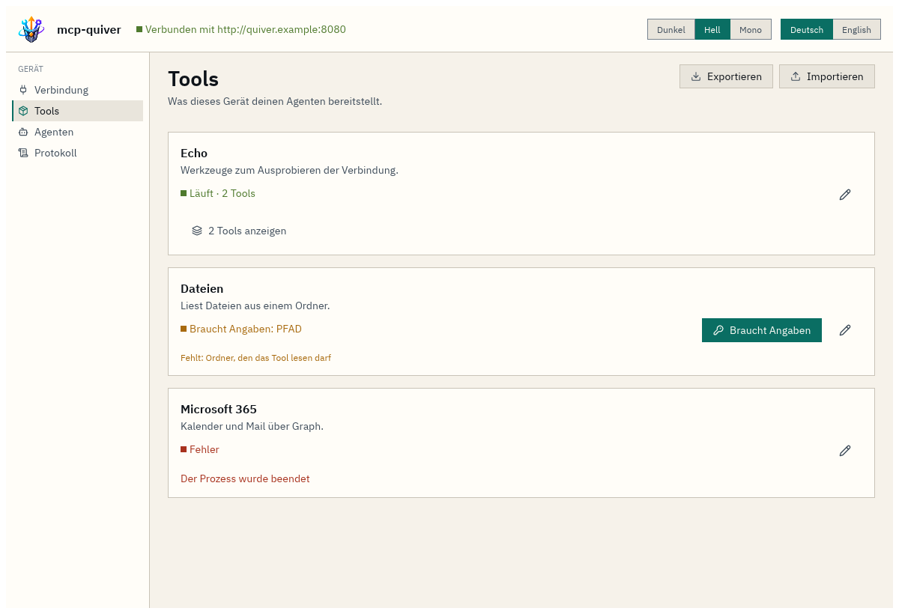
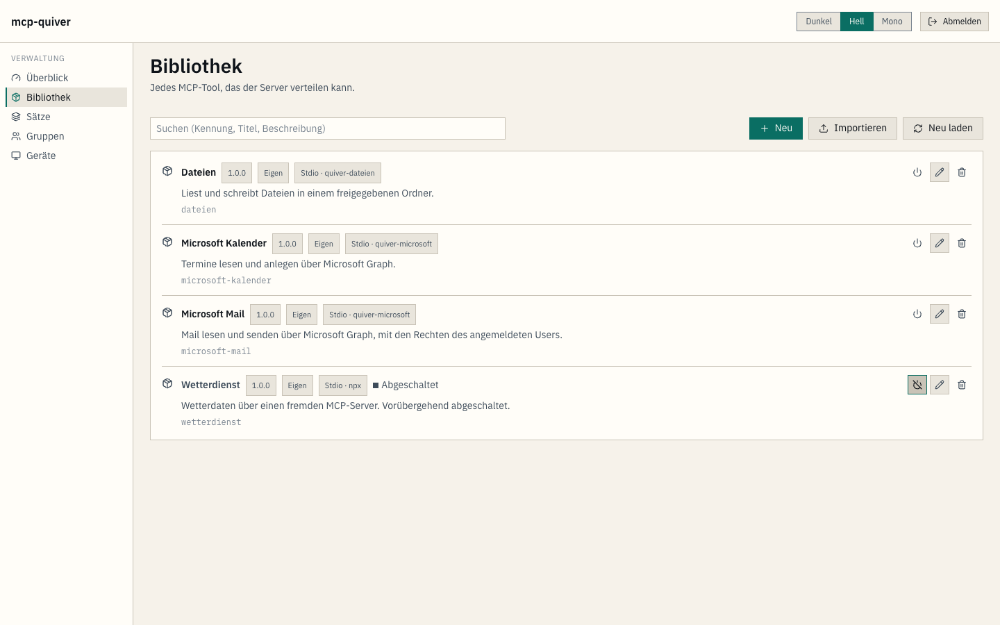
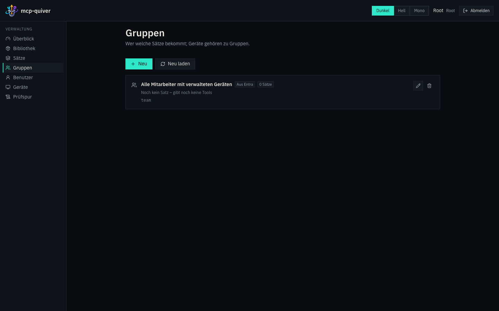

<p align="right">
  <picture>
    <source media="(prefers-color-scheme: dark)" srcset="assets/marke/logo-dunkel.png">
    
  </picture>
</p>

# mcp-quiver

[](https://github.com/patimweb-labs/mcp-quiver/actions/workflows/pruefen.yml)
[](https://github.com/patimweb-labs/mcp-quiver/releases/latest)
[](LICENSE)
[](https://hub.docker.com/r/smotherer/mcp-quiver-server)

**English:** [README.md](README.md)

**Ein Köcher voller Tools für jeden Agenten auf jedem Gerät.** mcp-quiver ist
eine zentrale Bibliothek von [MCP](https://modelcontextprotocol.io/)-Tools und
ein kleiner Client auf jedem Gerät: Admins weisen Tool-Sätze Gruppen zu, der
Client installiert und führt sie aus, und jeder Agent auf dem Gerät spricht mit
genau einem lokalen Endpunkt. Server und Client sind reines Rust; die Verwaltung
ist Vue, und beide Oberflächen entstehen aus denselben Tokens.




**Inhalt** · [Was es kann](#was-es-kann) · [Für wen](#für-wen) ·
[So sieht es aus](#so-sieht-es-aus) · [So funktioniert es](#so-funktioniert-es) ·
[Installation](#installation) · [Erste Schritte](#erste-schritte) ·
[Sicherheit und Daten](#sicherheit-und-daten) · [Betrieb](#betrieb) ·
[Fehlersuche](#fehlersuche) · [Stand heute](#stand-heute) ·
[Mitentwickeln](#mitentwickeln) · [Lizenz](#lizenz)

## Was es kann

- **Eine Bibliothek auf dem Server.** Eigene Tools und fremde MCP-Server in
  einem Katalog, auf Basis des offiziellen
  [`server.json`](https://github.com/modelcontextprotocol/registry)-Formats der
  MCP Registry. Jeder Eintrag trägt eine Version und lässt sich abschalten,
  ohne ihn zu löschen.
- **Zuweisung über Gruppen.** Ein Admin bündelt Einträge zu einem Satz und
  weist Sätze Gruppen zu — lokal oder in Microsoft Entra ID. Ein Gerät bekommt
  die Vereinigung der Sätze seines Benutzers, automatisch installiert,
  aktualisiert und entfernt. Widersprechen sich vorbelegte Werte, gewinnt die
  Priorität des Satzes.
- **Konfiguration in Schichten.** Der Server kennt Endpunkte, Tenant und
  Vorgaben. Der Client ergänzt, was nur das Gerät weiß: lokale Pfade,
  persönliche Werte und Geheimnisse. Fehlende Felder nennt die Karte, sie rät
  nicht.
- **Jede Laufzeit, die ein MCP-Server braucht.** Stdio-Prozesse (eigene
  Binaries, `npx`, `uvx`, `docker`) und entfernte MCP-Server über Streamable
  HTTP. Keine Shell, keine Paketverwaltung, und auf dem Server läuft kein Tool.
- **Ein Endpunkt für alle Agenten.** Der Client stellt alle Tools unter
  `http://127.0.0.1:8741/mcp` bereit. Agenten werden einmal im Fenster
  gekoppelt und bekommen einen fertigen Schnipsel für pi, Claude Code, OpenCode,
  GitHub Copilot oder Hermes. Jeder Agent hat sein eigenes Token, jederzeit
  erneuerbar.
- **Zugangsdaten bleiben am Gerät.** Tool-Passwörter und Token liegen in einer
  verschlüsselten Tresor-Datei, nie auf dem Server und nie in einem Agenten.
  Anmeldung und Einrichtung eines Tools laufen im Browser, gestartet vom Client.
- **Profile und Zugänge.** Einträge können mehrere Wikis, Postfächer, Hosts
  oder SAP-Systeme verwalten; der Client führt eine Liste, die der Nutzer nach
  und nach füllt, mit Geheimnissen je Eintrag, die sich einzeln löschen lassen.
- **Felder mit Zweck.** Text, Passwort, Zahl, Schalter, Adresse oder feste
  Auswahl, dazu ein optionaler Titel, eine Pflichtprüfung und ein Hilfe-Link,
  dessen Platzhalter aus dem Dialog gefüllt werden.
- **Schalter, die etwas bedeuten.** Ein Admin schaltet einen Eintrag ab, ohne
  ihn zu löschen; der Nutzer schaltet einen Eintrag auf einem Gerät aus, ohne
  die anderen zu berühren. Agenten können nichts schalten.
- **Angaben sichern und wiederherstellen.** Werte, Zugänge und — auf Wunsch,
  verschlüsselt mit XChaCha20-Poly1305 und Argon2id — Geheimnisse exportieren
  und auf einem anderen Gerät zusammenführen.
- **Ein Protokoll zum Lesen.** Jeder Agentenaufruf mit Zeit, Eintrag, Tool,
  Agent, Dauer und Ergebnis; die stderr-Ausgabe der Tools in einem zweiten
  Reiter. Geheimnisse sind maskiert. Das Protokoll verlässt das Gerät nie.
- **Klein, aber nicht schlicht.** Drei Farbschemata (`dark`, `light`, `mono`)
  aus einem Satz Tokens, deutsche und englische Texte im Client,
  Tastaturbedienung, sichtbarer Fokus, Rollen und Namen gesetzt. Client-Fenster
  und Verwaltung sehen gleich aus.

## Für wen

| Lage | Was mcp-quiver dafür tut |
| --- | --- |
| Team oder Firma mit Microsoft Entra ID und mehreren Agenten (pi, Hermes, weitere) | eine Bibliothek, eine Zuweisung je Gruppe, ein Endpunkt je Gerät |
| Admins, die MCP-Server nicht mehr von Hand installieren und einrichten wollen | Einträge, Sätze und Gruppen im Browser; den Rest macht der Client |
| Entwickler, die eigene MCP-Tools in Rust schreiben | das Tool wird ein Eintrag im selben Katalog wie fremde Server |
| Sicherheit und Betriebsrat, die fragen, wo Zugangsdaten liegen | nur am Gerät, verschlüsselt, nie auf dem Server, nie in einem Agenten |
| Gemischte Schreibtische mit macOS, Windows und Linux | Pakete für alle drei; der Server ist ein Container |

Nicht gedacht für: Telefone und Tablets, einen gehosteten Dienst, der die
Zugangsdaten der Tools speichert, oder das Ausführen von Tools zentral auf dem
Server. Der Server ist nur Bibliothek und Steuerung — mit Absicht.

## So sieht es aus

Client und Verwaltung teilen Layout, Schrift und Tokens; nur der Inhalt
unterscheidet sich.

| Client | Verwaltung |
| --- | --- |
|  |  |
|  |  |

Gruppen entscheiden, wer welchen Satz bekommt — lokal oder über Microsoft
Entra ID:



Eine Gruppe lässt sich auch von Hand zuordnen, von beiden Seiten — beim
Benutzer unter *Gruppen* oder bei der Gruppe unter *Mitglieder*. Woher eine
Zugehörigkeit kommt, ist sichtbar; was aus Entra kommt, ändert man nur dort:

| Gruppen eines Benutzers | Mitglieder einer Gruppe |
| --- | --- |
|  |  |

Weitere Bilder beider Oberflächen liegen in [`docs/bilder/`](docs/bilder/).
Sie sind **erzeugt**, nicht von Hand abgelegt: Die Oberflächentests zeichnen
jede Seite und jeden Dialog in drei Größen mit einem stehenden Kern,
Playwright macht dasselbe für die Verwaltung (siehe
[Entwicklung](docs/entwicklung.de.md#bilder)).

## So funktioniert es

```
 pi-Agent ──┐                        ┌──────────── quiver-server ────────────┐
 Hermes   ──┼──► quiver (Client) ◄──►│ Bibliothek: MCP-Tools (eigene+fremde) │
 …        ──┘    ein Endpunkt        │ Zuweisung über Gruppen (Entra ID)     │
                  führt Tools aus     │ Admin-Oberfläche (Vue)                │
                  hält die Logins     └───────────────────────────────────────┘
```

1. **Das Gerät meldet sich an.** Client → Browser → Server, über Entra oder
   einen Einmal-Code. Der Server gibt ein Geräte-Token zurück.
2. **Der Server rechnet den Soll-Zustand.** Gruppen des Benutzers → Sätze →
   Einträge und vorbelegte Werte.
3. **Der Client gleicht ab.** Soll gegen Ist: installieren, aktualisieren,
   entfernen.
4. **Der Client vervollständigt.** Er fragt nur Felder ab, die auf diesem Gerät
   fehlen, und legt Geheimnisse in den Tresor.
5. **Der Client stellt bereit.** Ein MCP-Endpunkt mit allen erlaubten Tools.
6. **Ein Aufruf passiert.** Agent → Client → Tool. Die Zugangsdaten fügt der
   Client ein; der Agent sieht immer nur Tools.

Die Begründung, das Datenmodell und der Preis jeder Festlegung stehen in
[SPEC.md](SPEC.md); die Entscheidungen als Aufzeichnungen in
[`docs/adr/`](docs/adr/).

## Installation

Zwei Teile: der **Server** (einmal, beim Betreiber) und der **Client** (auf
jedem Gerät).

### Server (Docker)

Das Abbild ist auf schlanken Betrieb gebaut: Die Laufzeit ist das Programm und
sonst nichts — **keine Shell, keine Paketverwaltung** (distroless), Benutzer
`10001:999`, alle Basis-Abbilder auf einen Digest festgelegt. Ein Port
(`8740`), ein Volume (`/daten`).

```yaml
# compose.yaml
services:
  quiver:
    image: smotherer/mcp-quiver-server:latest
    container_name: quiver
    restart: unless-stopped
    ports:
      - "127.0.0.1:8740:8740"   # nur Loopback; für https steht hier der TLS-Proxy
    environment:
      # für den Betrieb: https://quiver.example.test (dann steht ein Proxy davor)
      QUIVER_OEFFENTLICH: http://localhost:8740
    volumes:
      - quiver-daten:/daten
    read_only: true
    tmpfs:
      - /tmp:size=32m,mode=1777
    cap_drop: [ALL]
    security_opt:
      - no-new-privileges:true
    mem_limit: 512m
    pids_limit: 256

volumes:
  quiver-daten:
```

```bash
docker compose up -d
docker compose logs -f quiver          # zeigt den Einmal-Code der Ersteinrichtung
```

Dann die Basis-URL öffnen und den einen Root-Benutzer anlegen. Dieselbe Adresse
in `QUIVER_OEFFENTLICH` und im Browser verwenden, sonst antwortet der Server
mit `421`. `http` ist nur auf Loopback erlaubt; alles andere muss `https` sein.

Das Abbild ist
[`smotherer/mcp-quiver-server`](https://hub.docker.com/r/smotherer/mcp-quiver-server).
Härtung, die vollständige Liste der Umgebungsvariablen, Sicherungen und
Aktualisieren: [docs/betrieb.de.md](docs/betrieb.de.md). Die `compose.yaml` im
Repository ist derselbe Aufruf und kann lokal bauen:
`docker compose up -d --build`.

### Client

`quiver` ist das Programm auf dem Gerät. Fertige Pakete kommen aus den
[Releases](https://github.com/patimweb-labs/mcp-quiver/releases):

| System | Datei | Installation |
| --- | --- | --- |
| macOS, Apple Silicon | `quiver-<version>-macos-arm64.dmg` | öffnen, `quiver.app` nach *Programme* ziehen |
| macOS, Intel | `quiver-<version>-macos-x86_64.dmg` | dasselbe |
| Windows x86_64 | `quiver-<version>-windows-x86_64.msi` | Doppelklick — installiert für den aktuellen Benutzer, kein Administrator |
| Windows x86_64, portabel | `quiver-<version>-windows-x86_64.zip` | entpacken, `quiver.exe` starten |
| Debian, Ubuntu | `mcp-quiver_<version>_<amd64\|arm64>.deb` | `sudo apt install ./mcp-quiver_<version>_amd64.deb` |
| Fedora, openSUSE | `mcp-quiver-<version>-1.<x86_64\|aarch64>.rpm` | `sudo dnf install ./mcp-quiver-<version>-1.x86_64.rpm` |
| jedes Linux | `quiver-<version>-linux-<x86_64\|aarch64>.AppImage` | `chmod +x`, starten |
| jedes Linux | `quiver-<version>-linux-<x86_64\|aarch64>.tar.gz` | auspacken, `bin/quiver` starten |

Die Pakete sind **unsigniert**, solange der Betreiber sie nicht signiert:
Gatekeeper und SmartScreen fragen beim ersten Start einmal nach. Was das heißt
und wie man daran vorbeikommt:
[docs/release.de.md](docs/release.de.md#was-unsigniert-bedeutet). quiver
installiert sich nicht selbst: Aktualisiert wird über die Geräteverwaltung
(Intune) oder von Hand aus den Paketen des Releases —
[docs/intune.de.md](docs/intune.de.md); den Versionshinweis, den der Client
zeigt, beschreibt [docs/updates.de.md](docs/updates.de.md). Jedes Release trägt
außerdem `SHA256SUMS` und einen Herkunftsnachweis, den man prüfen kann:

```bash
sha256sum -c SHA256SUMS
gh attestation verify <datei> --repo patimweb-labs/mcp-quiver
```

Nach dem ersten Start sitzt der Client im Tray und stellt die Tools unter
`http://127.0.0.1:8741/mcp` bereit. Ein Paket selbst bauen:
[docs/release.de.md](docs/release.de.md#ein-paket-lokal-bauen).

## Erste Schritte

1. **Server einrichten.** Container starten, Basis-URL öffnen und den einen
   Root-Benutzer mit dem Einmal-Code aus dem Log anlegen. Das Fenster der
   Ersteinrichtung schließt nach 15 Minuten; danach setzt ein neues Passwort:

   ```bash
   read -rsp 'Neues Passwort: ' P; echo; printf '%s\n' "$P" | \
     docker exec -i quiver quiver-server root-setzen <E-Mail> --stdin; unset P
   ```

   Immer `--stdin` und `docker exec -i` (ohne `-t`): im Abbild fehlt `stty`,
   deshalb kann der Client die Eingabe nicht verbergen und bricht ab, statt
   das Passwort sichtbar zu lesen. Einzelheiten:
   [docs/betrieb.de.md](docs/betrieb.de.md#ersteinrichtung).
2. **Entra ID anbinden (optional).** Anwendung registrieren,
   `<Basis-URL>/auth/callback` eintragen, das Zertifikat hochladen, das
   `quiver-server entra-schluessel` ausgibt, und den Server mit Mandant und
   Client-Id starten. Vollständige Anleitung mit der Azure-CLI:
   [docs/entra.de.md](docs/entra.de.md). Ohne Entra werden Geräte mit
   Einmal-Codes aus der Verwaltung gekoppelt.
3. **Bibliothek füllen und zuweisen.** Unter *Bibliothek* einen Eintrag
   anlegen oder ein `server.json` importieren; Einträge zu einem *Satz*
   bündeln; unter *Gruppen* den Satz einer Gruppe zuweisen. Mit Entra
   erscheinen Gruppen, sobald sich ihr erstes Mitglied anmeldet — ohne Sätze,
   es wird also nichts versehentlich gewährt.
4. **Client verbinden.** Paket installieren, Fenster öffnen, Server-Adresse
   eintragen und anmelden. Mit Entra öffnet sich der Browser; ohne Entra den
   Einmal-Code aus der Verwaltung eingeben. Das Gerät wird im Browser
   bestätigt.
5. **Agent anbinden.** Unter *Agenten* *Agent koppeln* wählen, die Art
   aussuchen und den Schnipsel in die Konfiguration des Agenten einsetzen. Der
   Endpunkt bleibt `http://127.0.0.1:8741/mcp`; das Token gehört zu diesem
   Agenten und lässt sich jederzeit ersetzen.

Was der Client im Einzelnen tut — Anmelden, Tray, Zugänge, Einrichten, Export,
Protokoll: [docs/client.de.md](docs/client.de.md).

## Sicherheit und Daten

- **Der Server führt keine Tools aus.** Er speichert Bibliothek, Zuweisung und
  Benutzer. Er sieht nie ein Tool-Passwort, ein Tool-Token oder einen
  Tool-Aufruf.
- **Zugangsdaten liegen am Gerät.** Der Client hält sie in einer
  verschlüsselten Tresor-Datei (`XChaCha20-Poly1305`, Schlüsseldatei daneben,
  Ordner `0700`, Dateien `0600`). Das schützt vor versehentlichem Lesen —
  `cat`, `grep`, eine Sicherung nur einer Datei, ein Agent. Es ist **kein**
  Schutz gegen jemanden, der das Benutzerkonto hat; der kann die
  Schlüsseldatei ebenfalls lesen. Für einen Schlüsselbund des Systems gilt
  dasselbe ([ADR 0001](docs/adr/0001-tresor-datei-statt-schluesselbund.md)).
- **Agenten sehen Tools, keine Zugangsdaten.** Jeder Agent bekommt sein eigenes
  Token für den lokalen Endpunkt. Ein Tool-Passwort oder ein
  Microsoft-Token erreicht ihn nie; der Client fügt beides ein, wenn er das
  Tool startet oder aufruft.
- **Anmeldung passiert im Client und im Browser.** Der Client spricht nie mit
  Microsoft; das tut der Server. Die Sitzung der Verwaltung liegt in einem
  HttpOnly-Cookie, ändernde Anfragen tragen einen CSRF-Kopf und werden gegen
  die Basis-URL geprüft.
- **Das Protokoll bleibt lokal.** Jeder Aufruf steht als JSONL unter
  `<Profil>/protokoll/`, nach 7 Tagen gelöscht und auf 50 MB begrenzt.
  Geheimschlüssel und jeder Wert aus dem Tresor werden maskiert, bevor eine
  Zeile auf die Platte geht. Der Server bekommt keine Aufrufe und keine
  Zähler.
- **Der Server ist mit Absicht klein.** Distroless, nicht beschreibbares
  Dateisystem, `cap-drop=ALL`, `no-new-privileges`, Grenzen für Speicher und
  Prozesse. Der `Host`-Kopf muss zur Basis-URL passen, CSP ohne Inline, HSTS
  bei https, Grenzen für Rumpf und Zeit, gedrosselte Anmeldung, eine Prüfspur
  über 180 Tage. Jeder Wert steht in [docs/haertung.md](docs/haertung.md).
- **Ein Versionshinweis, mehr nicht.** Der Client fragt nur seinen eigenen
  Server, nie das Internet, und er installiert nichts. Der Server fragt die
  GitHub-Veröffentlichungen höchstens alle sechs Stunden, mit Streuung, ohne
  Kennung und ohne Nutzdaten; `QUIVER_UPDATES=aus` schaltet das ab. Der Client
  zeigt einen ruhigen Hinweis mit dem Text des Betreibers und einem Link auf die
  Änderungen. Installiert und aktualisiert wird über die Geräteverwaltung
  (Intune) oder von Hand: [docs/intune.de.md](docs/intune.de.md). Keine
  Analyse, kein Ruf nach Hause.
- **Der Server spricht weiterhin nur mit Microsoft, wenn Entra eingerichtet
  ist.**

## Betrieb

Ein Container, ein Volume, ein Port. `docker compose up -d` startet ihn,
`docker compose pull && docker compose up -d` aktualisiert ihn. Vor einer
Migration schreibt der Server eine Sicherung und prüft die Integrität von
Datenbank und Sicherung; die letzten drei Sicherungen bleiben im Datenordner.

Der Datenordner enthält `quiver.db` (mit WAL und SHM), den Schlüssel
`schluessel` für verschlüsselte Refresh-Token, optionales Entra-Schlüsselmaterial
und die Sicherungen. Das Volume sichern; `schluessel` **getrennt** von der
Datenbank aufbewahren, denn zusammen sind sie ein Zugangsdatum. Wiederherstellen
heißt: anhalten, Datenordner ersetzen, starten.

Gesundheit: `quiver-server gesund` fragt den Server über Loopback; das Abbild
nutzt denselben Weg. Logs gehen nach stdout und werden von Docker rotiert. Alle
Variablen, die Ersteinrichtung, der Proxy und jedes Betriebsdetail:
[docs/betrieb.de.md](docs/betrieb.de.md).

## Fehlersuche

| Symptom | Ursache und Abhilfe |
| --- | --- |
| `421` auf jeder Seite | `Host` und `QUIVER_OEFFENTLICH` sind verschieden. Genau diese Adresse öffnen; `localhost` ≠ `127.0.0.1`. Hinter einem Proxy den `Host` durchreichen. |
| Der Server startet nicht | Die Basis-URL ist nicht `https` und nicht Loopback, Entra ist nur halb eingerichtet, oder Geheimnis und Schlüssel sind beide da. Das Log nennt den Grund. |
| Die Ersteinrichtung sagt, das Fenster ist zu | Die ersten 15 Minuten sind vorbei: `docker restart quiver`, neu laden. Der Code steht im Log **dieses** Starts. |
| Gatekeeper oder SmartScreen blockiert den Client | Das Paket ist unsigniert. macOS: Rechtsklick → *Öffnen*. Windows: *Weitere Informationen → Trotzdem ausführen*. |
| Ein Gerät bekommt keine Tools | Die Gruppe hat keinen Satz, der Satz ist leer, oder der Eintrag ist abgeschaltet. Auch prüfen, ob der Benutzer direktes Mitglied der Entra-Gruppe ist. |
| Der Client sagt „Erneut anmelden“ | Das Geräte-Token ist zu alt, 60 Tage ungenutzt oder das Gerät wurde entfernt. Angaben und Geräte-Token bleiben. |
| Ein Agent sieht keine Tools | Er muss gekoppelt sein und sein Token unter `http://127.0.0.1:8741/mcp` nutzen; der Eintrag darf auf diesem Gerät nicht abgeschaltet sein. |
| Entra-Fehler `AADSTS…` | Siehe Tabelle in [docs/entra.de.md](docs/entra.de.md#wenn-es-klemmt). |

Weitere Symptome am Client: [docs/client.de.md](docs/client.de.md#fehlersuche).
Weitere am Server: [docs/betrieb.de.md](docs/betrieb.de.md#fehlersuche).

## Stand heute

Was läuft und geprüft ist:

- **Server, Verwaltung und Client Ende zu Ende** — Ersteinrichtung, Anmeldung,
  Bibliothek, Sätze, Gruppen, Geräteabgleich, der MCP-Endpunkt, stdio- und
  entfernte Tools, Schalter je Gerät, Export/Import, Protokoll.
- **Entra ID optional** — Zertifikat oder Geheimnis, Gruppen aus dem Token,
  stündliches Auffrischen, Zertifikatswechsel ohne Ausfall. Ohne Entra ist der
  Weg über Einmal-Codes vollständig nutzbar.
- **Ein Testlauf über den ganzen Arbeitsbereich** (`cargo test --workspace`),
  dazu Browser-Prüfungen gegen den echten Server und Oberflächentests, die jede
  Seite in drei Größen und beiden Bild-Farbschemata zeichnen.
- **Pakete für macOS, Windows und Linux** aus denselben Skripten, die die CI
  ausführt; `SHA256SUMS` und Herkunftsnachweise je Release.
- **Ein Container, der geprüft wird**: keine Shell, nicht beschreibbar, keine
  Rechte, und ein Skript, das ihn genau so startet.

Was noch nicht da ist, ehrlich:

- **Die Windows- und Linux-Pakete sind auf echten Geräten noch nicht gelaufen.**
  Das macOS-Bündel wurde lokal gebaut und gestartet; `.msi`, `.deb`, `.rpm` und
  AppImage entstehen aus denselben Skripten, haben aber noch keinen Feldtest.
- **Signieren ist unbewiesen.** Ohne Zertifikate ist jedes Paket unsigniert;
  der Weg zum Signieren und Notarisieren ist geschrieben, aber nie mit echten
  Geheimnissen gelaufen.
- **Kein Flatpak, keine Mobil-Apps, keine WASM-Laufzeit.** Das Datenmodell hält
  Platz für WASM; umgesetzt ist es nicht.
- **Keine zentrale Ausführung.** Der Server führt nie ein Tool aus
  ([SPEC.md](SPEC.md) §2); das ist eine Entscheidung, keine Lücke.
- **Noch keine Tool-Filterung je Agent.** Jeder gekoppelte Agent sieht alle
  Tools, die das Gerät ausführen darf ([docs/offen.md](docs/offen.md)).
- **Kein Export des Protokolls** — die JSONL-Dateien lassen sich von Hand lesen.
- **Manche Agenten-Schnipsel sind ungeprüft.** Die Texte für OpenCode, GitHub
  Copilot und die Header-Form von Hermes stammen aus deren Dokumentation, nicht
  aus einem Lauf gegen die CLI; pi, Claude Code und die Sitzungsform von Hermes
  sind geprüft.
- **Die Architekturdokumente fehlen noch** (`docs/architektur.md`,
  `docs/datenfluss.md`).
- **Die Verwaltung ist nur deutsch.** Das Client-Fenster spricht Deutsch und
  Englisch; die Verwaltung hat noch keinen Sprachumschalter.
- **Der Microsoft-365-Tool-Satz ist ein eigenes Projekt**
  ([quiver-tools](https://github.com/patimweb-labs/quiver-tools)); dieses
  Repository liefert Server, Client, Verwaltung und das Bibliotheksformat.

Die vollständige, laufend gepflegte Liste bekannter Lücken und bewusster Cheats
steht in [docs/offen.md](docs/offen.md).

## Mitentwickeln

Issues und Pull Requests sind willkommen. Die verbindlichen Regeln für Menschen
und Agenten stehen in [AGENTS.md](AGENTS.md); die Kurzfassung für den ersten
Pull Request in [CONTRIBUTING.md](CONTRIBUTING.md).

```bash
cargo fmt --all --check && cargo clippy --all-targets -- -D warnings && cargo test --workspace
```

`main` ist immer lauffähig; gearbeitet wird auf einem Branch und über einen Pull
Request. Commits folgen Conventional Commits, Releases bereitet release-please
aus diesen Zeilen vor.

Sicherheitslücken bitte **nicht** als öffentliches Issue, sondern über GitHub
Private Vulnerability Reporting — siehe [SECURITY.md](SECURITY.md).

## Lizenz

[MIT](LICENSE)
