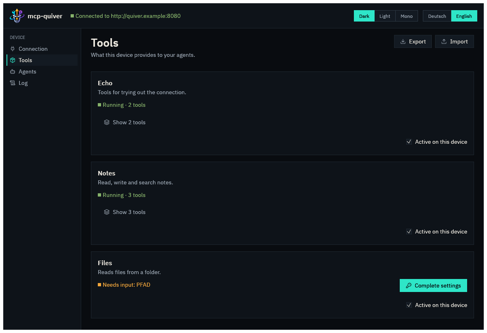
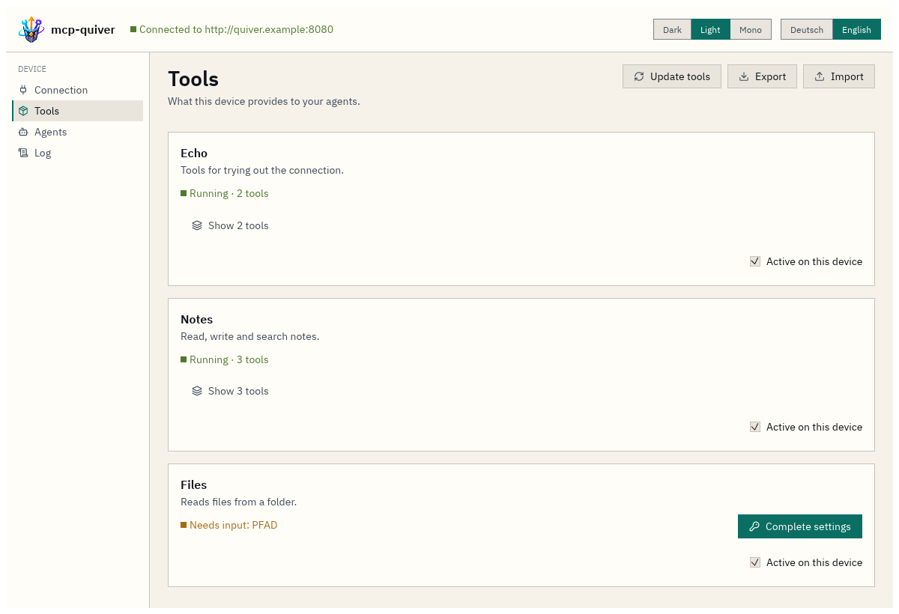
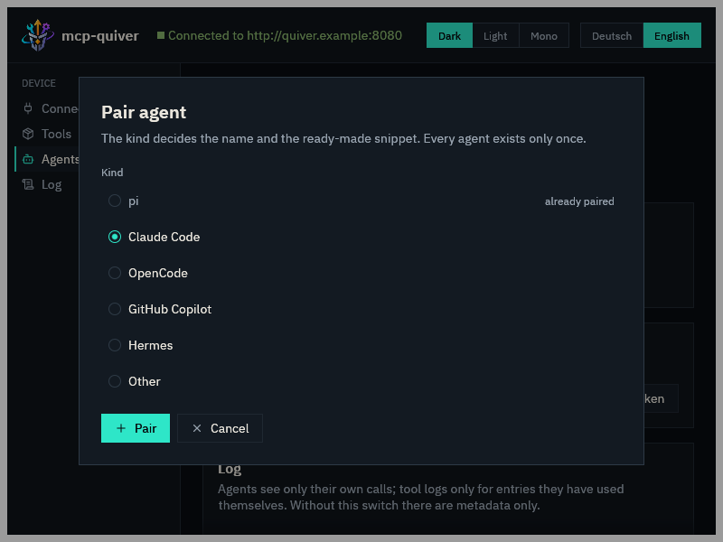
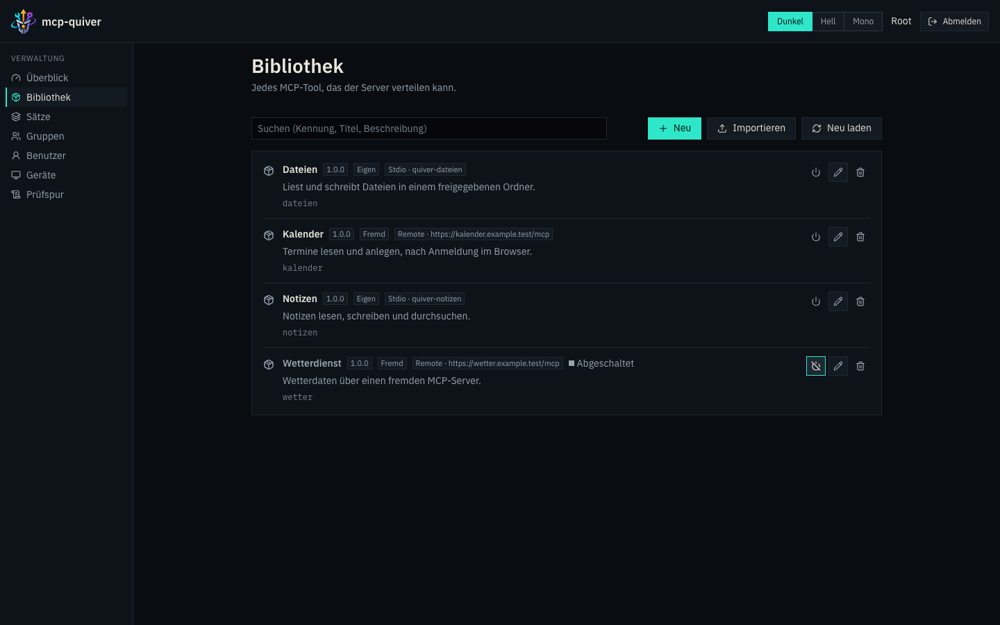
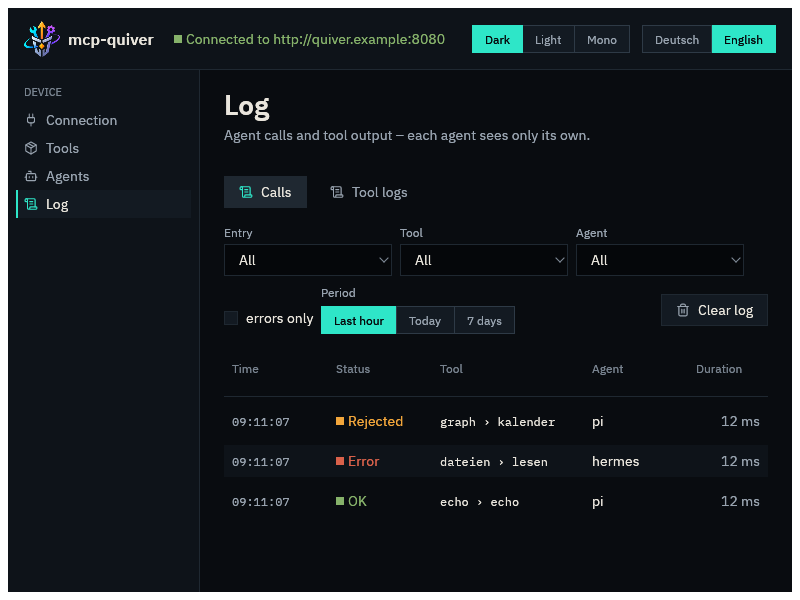
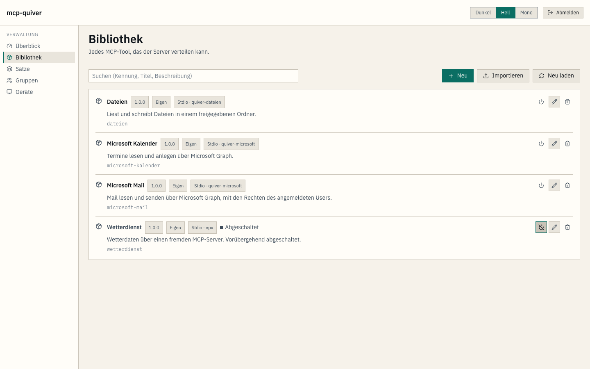
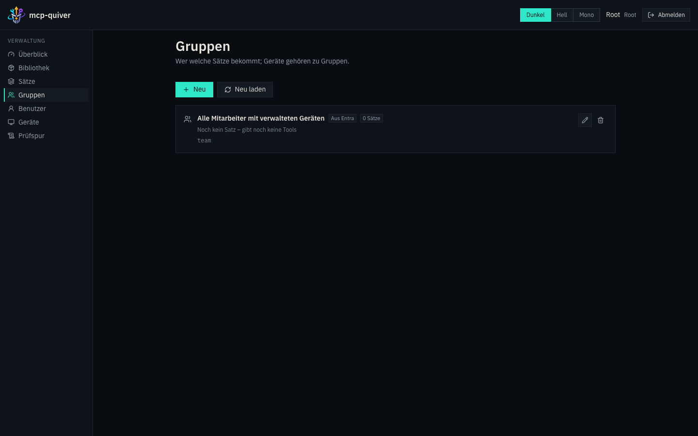
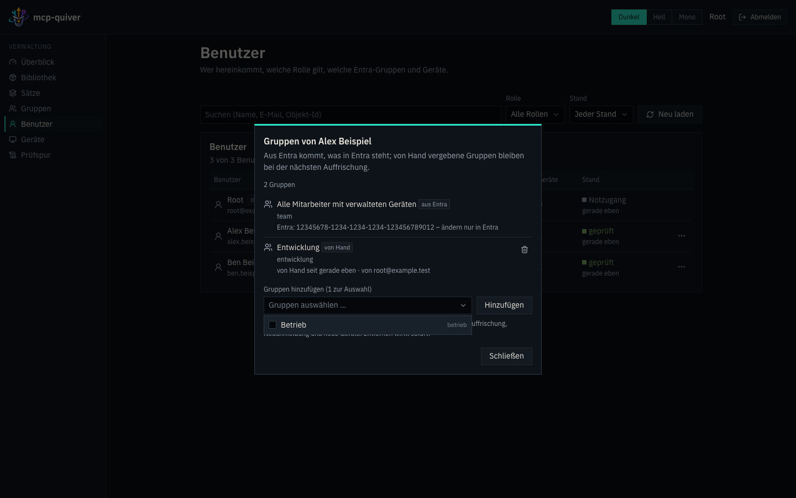
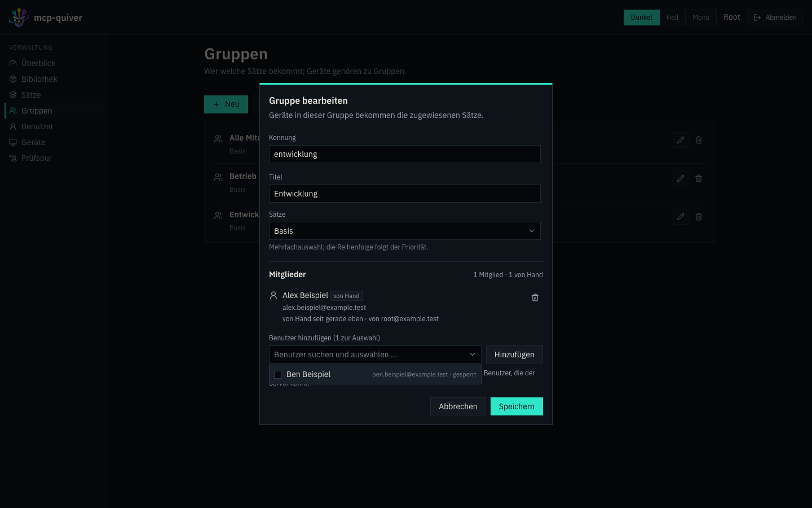

<p align="right">
  <picture>
    <source media="(prefers-color-scheme: dark)" srcset="assets/marke/logo-dunkel.png">
    
  </picture>
</p>

# mcp-quiver

[](https://github.com/patimweb-labs/mcp-quiver/actions/workflows/pruefen.yml)
[](https://github.com/patimweb-labs/mcp-quiver/releases/latest)
[](LICENSE)
[](https://hub.docker.com/r/smotherer/mcp-quiver-server)

**Deutsch:** [README.de.md](README.de.md)

**One quiver of tools for every agent on every device.** mcp-quiver is a central
library of [MCP](https://modelcontextprotocol.io/) tools plus a small client on
each device: admins assign tool sets to groups, the client installs and runs
them, and every agent on the device talks to exactly one local endpoint.
Server and client are pure Rust; the administration is Vue, and both surfaces
are built from the same tokens.





**Contents** · [What it does](#what-it-does) · [Who it is for](#who-it-is-for) ·
[What it looks like](#what-it-looks-like) · [How it works](#how-it-works) ·
[Installation](#installation) · [First steps](#first-steps) ·
[Security and data](#security-and-data) · [Operation](#operation) ·
[Troubleshooting](#troubleshooting) · [Today's state](#todays-state) ·
[Contributing](#contributing) · [License](#license)

## What it does

- **A library on the server.** Own tools and external MCP servers in one
  catalogue, based on the official [`server.json`](https://github.com/modelcontextprotocol/registry)
  format of the MCP Registry. Every entry carries a version and can be switched
  off without being deleted.
- **Assignment by group.** An admin bundles entries into a set and assigns
  sets to groups — local groups or Microsoft Entra ID groups. A device gets the
  union of its user's sets, installed, updated and removed automatically.
  Conflicts between pre-filled values are resolved by the set's priority.
- **Configuration in layers.** The server knows endpoints, tenant and defaults.
  The client fills in what only the device knows: local paths, personal values
  and secrets. Missing fields are named on the card, not guessed.
- **Any runtime an MCP server needs.** Stdio processes (own binaries, `npx`,
  `uvx`, `docker`) and remote MCP servers over Streamable HTTP. No shell, no
  package manager and no tool runs on the server.
- **One endpoint for all agents.** The client serves every tool at
  `http://127.0.0.1:8741/mcp`. Agents are paired once in the window and get a
  ready-made snippet for pi, Claude Code, OpenCode, GitHub Copilot or Hermes.
  Each agent has its own token, renewable at any time.
- **Credentials stay on the device.** Tool passwords and tokens live in an
  encrypted vault file, never on the server and never in an agent. Sign-in and
  setup for a tool run in the browser, started from the client.
- **Profiles and connections.** Entries can manage several wikis, mailboxes,
  hosts or SAP systems; the client keeps a list the user fills one by one, with
  per-entry secrets that can be deleted individually.
- **Fields with a purpose.** Text, password, number, switch, address or a fixed
  choice list, each with an optional title, a required check and a help link
  whose placeholders are filled from the dialog.
- **Switches that mean something.** An admin can deactivate an entry without
  deleting it; the user can switch an entry off on one device without touching
  the others. Agents cannot switch anything.
- **Backup and restore of settings.** Export values, connections and — if
  wanted, encrypted with XChaCha20-Poly1305 and Argon2id — secrets, then merge
  them on another device.
- **A protocol you can read.** Every agent call with time, entry, tool, agent,
  duration and result; tool stderr in a second tab. Secrets are masked. The log
  never leaves the device.
- **Small, but not plain.** Three themes (`dark`, `light`, `mono`) from one set
  of tokens, German and English client texts, keyboard operation, visible
  focus, roles and names set. The client window and the admin interface look
  the same.

## Who it is for

| Situation | What mcp-quiver does |
| --- | --- |
| A team or company with Microsoft Entra ID and several agents (pi, Hermes, more) | one library, one assignment per group, one endpoint per device |
| Admins who no longer want to install and configure MCP servers by hand | entries, sets and groups in the browser; the client does the rest |
| Developers who write their own MCP tools in Rust | the tool becomes one entry in the same catalogue as external servers |
| Security and works councils asking where credentials live | only on the device, encrypted, never on the server, never in an agent |
| Mixed macOS, Windows and Linux desktops | packages for all three; the server is one container |

Not built for: phones and tablets, a hosted service that stores your tool
credentials, or running tools centrally on the server. The server is a library
and a control plane only — by design.

## What it looks like

Client and administration share layout, type and tokens; only the content
differs.

| Client | Administration |
| --- | --- |
|  |  |
|  |  |

Groups decide who gets which set — local groups or Microsoft Entra ID:



A group can also be given to a user by hand, from either side — the user's
*Groups* or the group's *Members*. Where each membership comes from is visible;
what comes from Entra can only be changed in Entra:

| Groups of a user | Members of a group |
| --- | --- |
|  |  |

More screenshots of both surfaces are in [`docs/bilder/`](docs/bilder/). They
are **generated**, not taken by hand: the UI tests draw every page and dialog
at three sizes with a stand-in core, and Playwright does the same for the
administration (see [development](docs/entwicklung.md#screenshots)). The
English pictures come from the same run with the language switch set to
English.

## How it works

```
 pi agent ──┐                        ┌──────────── quiver-server ────────────┐
 Hermes   ──┼──► quiver (client) ◄──►│ library of MCP tools (own + external) │
 …        ──┘    one endpoint        │ assignment by groups (Entra ID)       │
                  runs the tools     │ admin interface (Vue)                 │
                  holds the logins   └───────────────────────────────────────┘
```

1. **The device signs in.** Client → browser → server, through Entra or a
   one-time code. The server returns a device token.
2. **The server computes the target.** Groups of the user → sets → entries and
   pre-filled values.
3. **The client syncs.** Desired state against actual state: install, update,
   remove.
4. **The client completes.** It asks only for fields that are missing on this
   device and stores secrets in the vault.
5. **The client serves.** One MCP endpoint with all allowed tools.
6. **A call happens.** Agent → client → tool. The client supplies the
   credentials; the agent only ever sees tools.

The reasoning, the data model and the price of every decision are in
[SPEC.md](SPEC.md); the decisions as records in [`docs/adr/`](docs/adr/).

## Installation

Two parts: the **server** (once, at the operator) and the **client** (on every
device).

### Server (Docker)

The image is built for lean operation: the runtime is the program and nothing
else — **no shell, no package manager** (distroless), user `10001:999`, all base
images pinned by digest. One port (`8740`), one volume (`/daten`).

```yaml
# compose.yaml
services:
  quiver:
    image: smotherer/mcp-quiver-server:latest
    container_name: quiver
    restart: unless-stopped
    ports:
      - "127.0.0.1:8740:8740"   # loopback only; for https a TLS proxy sits here
    environment:
      # for production: https://quiver.example.test (with a TLS proxy in front)
      QUIVER_OEFFENTLICH: http://localhost:8740
    volumes:
      - quiver-daten:/daten
    read_only: true
    tmpfs:
      - /tmp:size=32m,mode=1777
    cap_drop: [ALL]
    security_opt:
      - no-new-privileges:true
    mem_limit: 512m
    pids_limit: 256

volumes:
  quiver-daten:
```

```bash
docker compose up -d
docker compose logs -f quiver          # shows the one-time setup code
```

Then open the base URL and create the one root user. Use the **same** address
in `QUIVER_OEFFENTLICH` and in the browser, otherwise the server answers `421`.
`http` is only allowed on loopback; anything else must be `https`.

The image is [`smotherer/mcp-quiver-server`](https://hub.docker.com/r/smotherer/mcp-quiver-server).
Hardening details, the full environment table, backups and upgrades:
[docs/betrieb.md](docs/betrieb.md). The repository's `compose.yaml` is the same
call and can build locally: `docker compose up -d --build`.

### Client

`quiver` is the program on the device. Ready-made packages come from
[Releases](https://github.com/patimweb-labs/mcp-quiver/releases):

| System | File | Install |
| --- | --- | --- |
| macOS, Apple Silicon | `quiver-<version>-macos-arm64.dmg` | open, drag `quiver.app` to *Applications* |
| macOS, Intel | `quiver-<version>-macos-x86_64.dmg` | same |
| Windows x86_64 | `quiver-<version>-windows-x86_64.msi` | double click — installs for the current user, no administrator |
| Windows x86_64, portable | `quiver-<version>-windows-x86_64.zip` | unzip, run `quiver.exe` |
| Debian, Ubuntu | `mcp-quiver_<version>_<amd64\|arm64>.deb` | `sudo apt install ./mcp-quiver_<version>_amd64.deb` |
| Fedora, openSUSE | `mcp-quiver-<version>-1.<x86_64\|aarch64>.rpm` | `sudo dnf install ./mcp-quiver-<version>-1.x86_64.rpm` |
| any Linux | `quiver-<version>-linux-<x86_64\|aarch64>.AppImage` | `chmod +x`, run it |
| any Linux | `quiver-<version>-linux-<x86_64\|aarch64>.tar.gz` | unpack, run `bin/quiver` |

The packages are **unsigned** unless the maintainer signs them: Gatekeeper and
SmartScreen ask once on the first start. What that means and how to get past it:
[docs/release.md](docs/release.md#what-unsigned-means). quiver does not install
itself: updates are rolled out by device management (Intune) or by hand from the
packages in the release — [docs/intune.md](docs/intune.md), and the version
hint the client shows is described in [docs/updates.md](docs/updates.md). Every
release also carries `SHA256SUMS` and a build provenance you can verify:

```bash
sha256sum -c SHA256SUMS
gh attestation verify <file> --repo patimweb-labs/mcp-quiver
```

After the first start the client sits in the tray and serves the tools at
`http://127.0.0.1:8741/mcp`. Building a package yourself:
[docs/release.md](docs/release.md#building-a-package-locally).

## First steps

1. **Set up the server.** Start the container, open the base URL and create the
   one root user with the one-time code from the log. The setup window closes
   after 15 minutes; afterwards a new password is set with:

   ```bash
   read -rsp 'New password: ' P; echo; printf '%s\n' "$P" | \
     docker exec -i quiver quiver-server root-setzen <e-mail> --stdin; unset P
   ```

   Always `--stdin` and `docker exec -i` (no `-t`): the image has no `stty`, so
   the binary cannot hide the input and stops instead of reading the password
   while it is visible. Details:
   [docs/betrieb.md](docs/betrieb.md#first-setup).
2. **Connect Entra ID (optional).** Register an app, add
   `<base URL>/auth/callback`, upload the certificate that
   `quiver-server entra-schluessel` prints, and start the server with tenant and
   client id. Full guide with the Azure CLI:
   [docs/entra.md](docs/entra.md). Without Entra, devices are paired with
   one-time codes from the admin interface.
3. **Fill the library and assign it.** Under *Library* create an entry or
   import a `server.json`; bundle entries into a *Set*; under *Groups* assign
   the set to a group. With Entra, groups appear after their first member signs
   in — with no sets, so nothing is granted by accident.
4. **Connect the client.** Install the package, open the window, enter the
   server address and sign in. With Entra the browser opens; without it, enter
   the one-time code from the admin interface. The device is confirmed in the
   browser.
5. **Attach an agent.** Under *Agents* choose *Pair agent*, pick the kind and
   paste the snippet into the agent's configuration. The endpoint stays
   `http://127.0.0.1:8741/mcp`; the token belongs to this agent and can be
   replaced at any time.

What the client does in detail — sign-in, tray, connections, setup, export,
protocol: [docs/client.md](docs/client.md).

## Security and data

- **The server runs no tools.** It stores the library, the assignment and the
  users. It never sees a tool password, a tool token or a tool call.
- **Credentials live on the device.** The client keeps them in an encrypted
  vault file (`XChaCha20-Poly1305`, key file next to it, folder `0700`, files
  `0600`). This protects against accidental reading — `cat`, `grep`, a backup of
  one file, an agent. It is **not** a defence against someone who has the
  user's account; that person can read the key file too. The same is true for
  an OS keychain ([ADR 0001](docs/adr/0001-tresor-datei-statt-schluesselbund.md)).
- **Agents see tools, not credentials.** Each agent gets its own token for the
  local endpoint. It never receives a tool password or a Microsoft token; the
  client adds those when it starts or calls the tool.
- **Sign-in happens in the client and the browser.** The client never talks to
  Microsoft; the server does. The admin session lives in an HttpOnly cookie,
  changing requests carry a CSRF header and are checked against the base URL.
- **The protocol stays local.** Every call is logged as JSONL under
  `<profile>/protokoll/`, deleted after 7 days and capped at 50 MB. Secret keys
  and every vault value are masked before a line is written. The server receives
  no calls and no counters.
- **The server is small on purpose.** Distroless, read-only file system,
  `cap-drop=ALL`, `no-new-privileges`, memory and PID limits. The
  `Host` header must match the base URL, CSP without inline, HSTS on https,
  body and time limits, throttled sign-in, an audit trail that keeps 180 days.
  Every value is in [docs/haertung.md](docs/haertung.md) (German).
- **A version hint, nothing more.** The client asks only its own server, never
  the internet, and it installs nothing. The server asks the GitHub releases at
  most every six hours, with jitter, without an identifier and without payload;
  `QUIVER_UPDATES=aus` switches that off. What the client shows is a quiet hint
  with the operator's text and a link to the changes. Installation and updates
  are done by device management (Intune) or by hand:
  [docs/intune.md](docs/intune.md). No analytics, no call home.
- **The server still talks to Microsoft only when Entra is configured.**

## Operation

One container, one volume, one port. `docker compose up -d` starts it,
`docker compose pull && docker compose up -d` updates it. Before a migration
the server writes a backup and checks the integrity of database and backup;
the last three backups stay in the data folder.

The data folder holds `quiver.db` (with WAL and SHM), the key `schluessel` for
encrypted refresh tokens, optional Entra key material and the backups. Back up
the volume; keep `schluessel` **separate** from the database, because together
they are a credential. A restore is: stop, replace the data folder, start.

Health: `quiver-server gesund` asks the server over loopback; the image has the
same check. Logs go to stdout and are rotated by Docker. All variables, the
first setup, the proxy setup and every operational detail:
[docs/betrieb.md](docs/betrieb.md).

## Troubleshooting

| Symptom | Cause and remedy |
| --- | --- |
| `421` on every page | `Host` and `QUIVER_OEFFENTLICH` differ. Open exactly that address; `localhost` ≠ `127.0.0.1`. Behind a proxy, pass `Host` through. |
| The server does not start | The base URL is not `https` and not loopback, Entra is only half configured, or both secret and key are present. The log names the reason. |
| The setup page says the window is closed | The first 15 minutes are over: `docker restart quiver`, reload. The code is in the log of **this** start. |
| Gatekeeper or SmartScreen blocks the client | The package is unsigned. macOS: right click → *Open*. Windows: *More information → Run anyway*. |
| A device gets no tools | The group has no set, the set is empty, or the entry is inactive. Also check that the user is a direct member of the Entra group. |
| The client says "sign in again" | The device token is too old, unused for 60 days, or the device was removed. Settings and the device token stay. |
| An agent sees no tools | It must be paired and use its token at `http://127.0.0.1:8741/mcp`; the entry must not be switched off on this device. |
| Entra error `AADSTS…` | See the table in [docs/entra.md](docs/entra.md#when-it-gets-stuck). |

More client-side symptoms: [docs/client.md](docs/client.md#troubleshooting).
More server-side symptoms: [docs/betrieb.md](docs/betrieb.md#troubleshooting).

## Today's state

What works and is tested:

- **Server, administration and client end to end** — setup, sign-in, library,
  sets, groups, device sync, the MCP endpoint, running stdio and remote tools,
  per-device switches, export/import, protocol.
- **Entra ID optionally** — certificate or secret, groups from the token,
  hourly refresh, certificate rotation without downtime. Without Entra the
  one-time-code path is fully usable.
- **One test run over the whole workspace** (`cargo test --workspace`), plus
  browser checks against the real server and UI tests that draw every page at
  three sizes and in both screenshot themes.
- **Packages for macOS, Windows and Linux** from the same scripts the CI runs;
  `SHA256SUMS` and provenance attestations per release.
- **A container that is checked**: no shell, read-only, no capabilities, and a
  script that starts it exactly like that.

What is not there yet, honestly:

- **Windows and Linux packages have not run on real machines.** The macOS
  bundle was built and started locally; `.msi`, `.deb`, `.rpm` and AppImage are
  produced by the same scripts but have no field test yet.
- **Signing is unproven.** Without certificates every package is unsigned; the
  signing and notarisation path exists but has never run with real secrets.
- **No Flatpak, no mobile apps, no WASM runtime.** The data model has room for
  WASM; it is not implemented.
- **No central execution.** The server never runs a tool
  ([SPEC.md](SPEC.md) §2); this is a decision, not a gap.
- **No tool filtering per agent yet.** Every paired agent sees every tool the
  device is allowed to run ([docs/offen.md](docs/offen.md)).
- **No protocol export** — the JSONL files can be read by hand.
- **Some agent snippets are untested.** The texts for OpenCode, GitHub Copilot
  and the header form of Hermes come from their documentation, not from a run
  against the CLI; pi, Claude Code and the session form of Hermes are checked.
- **The architecture documents are still missing** (`docs/architektur.md`,
  `docs/datenfluss.md`).
- **The administration is German only.** The client window speaks German and
  English; the admin interface does not have a language switch yet.
- **The Microsoft 365 tool set is a separate project**
  ([quiver-tools](https://github.com/patimweb-labs/quiver-tools)); this
  repository ships server, client, admin and the library format.

The complete, continuously updated list of known gaps and deliberate cheats is
in [docs/offen.md](docs/offen.md) (German).

## Contributing

Issues and pull requests are welcome. The binding rules for people and agents
are in [AGENTS.md](AGENTS.md); the short version for your first pull request is
in [CONTRIBUTING.md](CONTRIBUTING.md).

```bash
cargo fmt --all --check && cargo clippy --all-targets -- -D warnings && cargo test --workspace
```

`main` is always runnable; work happens on a branch and through a pull request.
Commits follow Conventional Commits, releases are prepared by release-please
from those lines.

Please report security issues **not** as a public issue but through GitHub
Private Vulnerability Reporting — see [SECURITY.md](SECURITY.md).

## License

[MIT](LICENSE)
