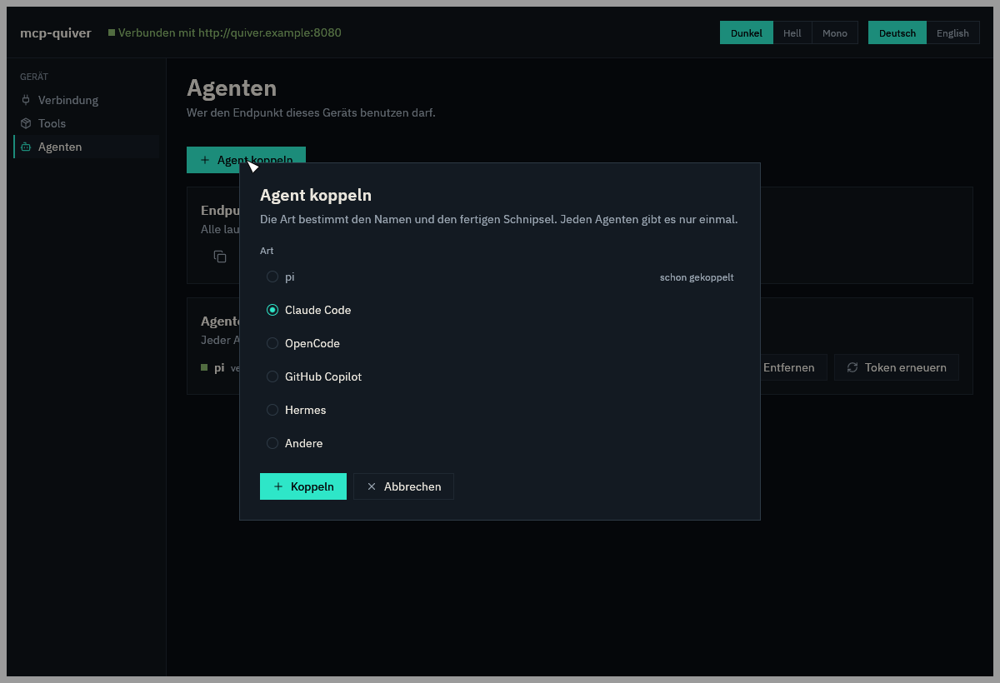
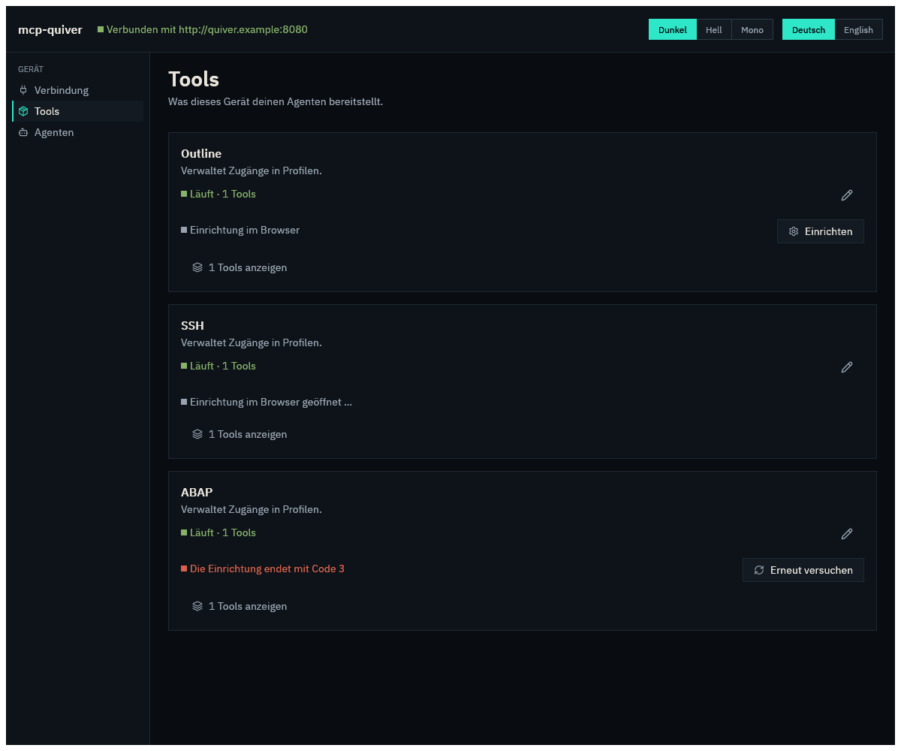
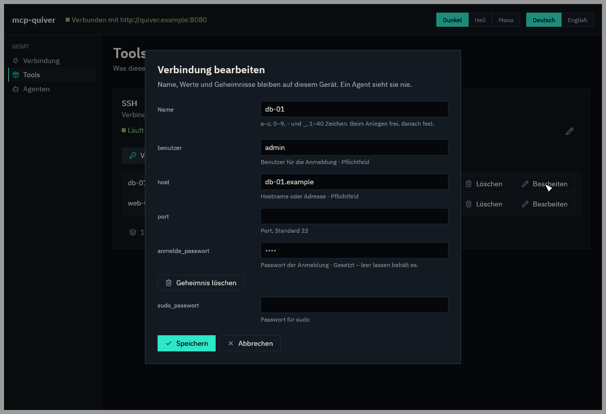
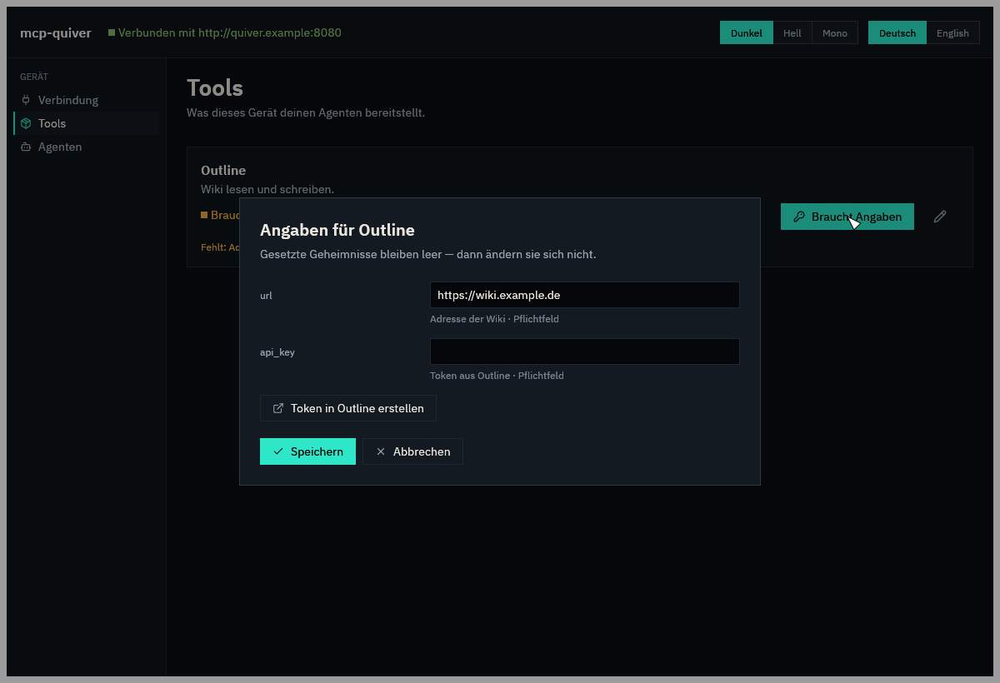
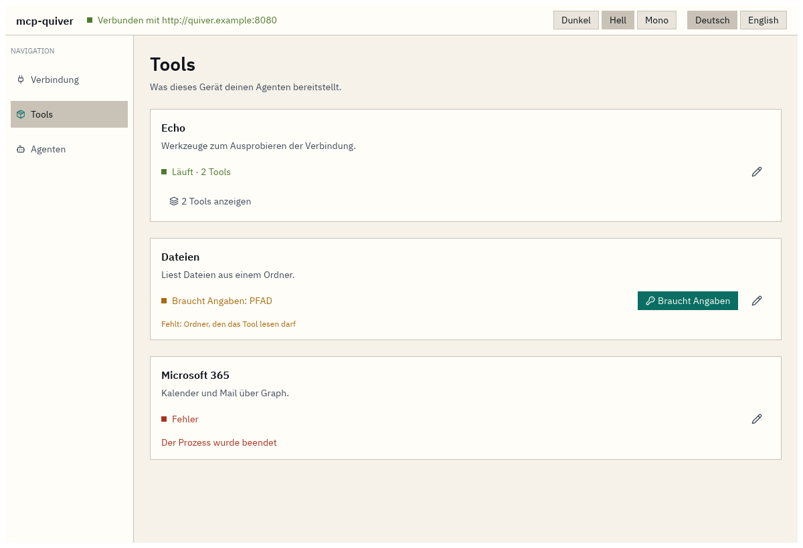

# mcp-quiver

**Deutsch:** [README.de.md](README.de.md)

> **Status: MVP in progress.** Server, client and admin interface work end to end;
> see [SPEC.md](SPEC.md) §0 for the scope and [docs/offen.md](docs/offen.md) for known gaps.

**One quiver of tools for all your agents.** mcp-quiver is a central library of
[MCP](https://modelcontextprotocol.io/) tools plus a small client on every
device. Admins decide in a web interface which tools a group gets, the client
installs and configures them, and every agent on the device – pi, Hermes and
more to come – talks to exactly one endpoint. Logins happen once, in the
client. Agents never see a password or a token.

Pure Rust: server, client and the client window. The admin interface is Vue
and looks exactly like the client.

## The idea

```
 pi-agent ──┐                        ┌──────────── quiver-server ────────────┐
 Hermes   ──┼──► quiver (client) ◄──►│ library of MCP tools (own + external)│
 …        ──┘    one endpoint        │ assignment by Entra ID groups         │
                 runs the tools      │ admin interface (Vue)                 │
                 holds the logins    └───────────────────────────────────────┘
```

- **Library on the server.** Own tools (written in Rust) and external MCP
  servers in one catalogue, versioned, based on the official `server.json`
  format of the MCP Registry.
- **Assignment by group.** An admin assigns tool sets to Microsoft Entra ID
  groups. Each device gets what its user's groups allow – installed, updated
  and removed automatically.
- **Configuration in layers.** The server pushes what it knows (endpoints,
  tenant, defaults). The client completes what only the device knows (local
  paths, personal secrets in an encrypted vault file).
- **Auth in one place.** Agent → client and client → server. Nothing else.
  The client adds credentials to each tool call. The agent only ever sees
  tools.
- **Microsoft first.** The first tool set covers Microsoft 365 via Microsoft
  Graph and acts with the signed-in user's own permissions, so Microsoft's
  role and permission model applies unchanged.
- **Any agent.** Agents that speak MCP connect directly. For others there are
  plugins, written in Rust (pi via Node binding, Hermes via Python binding).

## Platforms

- **Server:** one container image (Docker, Azure Container Apps, anywhere).
- **Client:** macOS, Windows and Linux.

## Run the server (Docker)

```bash
docker build -t mcp-quiver-server .
docker run -d --name quiver -p 8740:8740 -v quiver-daten:/daten mcp-quiver-server
docker exec quiver cat /daten/admin-token   # admin token, created on first start
```

Then open `http://localhost:8740` and sign in with the admin token. Without a Docker Hub
login, build with `--build-arg BASIS=public.ecr.aws/docker/library`.

## Development

```bash
# check everything (before every commit)
cargo fmt --all --check && cargo clippy --all-targets -- -D warnings && cargo test --workspace
```

The token files in `tokens/` are the single source of colours, sizes and fonts —
for the client window (egui) and for the admin interface (Vue). The admin CSS is
generated from them and checked in; never edit it by hand:

```bash
cargo run -p quiver-oberflaeche --bin tokens_css > admin/src/styles/tokens.css
```

### Admin interface

```bash
git submodule update --init admin/vendor/weppelmann-ui
cd admin
npm ci
npm run dev     # Vite on 5173, /api → 127.0.0.1:8740
npm run build   # to admin/dist; the server serves it at /
npm run typecheck
npm test
```

Layout, components and screenshots: [admin/README.md](admin/README.md).

### Client window

```bash
cargo run -p quiver-fenster                  # the window
cargo run -p quiver-fenster -- --hintergrund # tray and core only, no window
cargo run -p quiver-fenster -- --headless    # only the core, until Ctrl+C
```

Closing the window does not stop quiver: the core, the MCP endpoint and the
sync keep running, and the tray icon stays. **Quit** lives in the tray menu.
A second start (double click while quiver sits in the tray) shows the window of
the running instance and ends itself — one instance per device.

The tray menu shows the state (`Verbunden · 4 Tools · 1 Agent`), opens the
window, toggles **Start at login** and quits. The same switch sits on the
*Connection* page; whether it is on is read from the system (LaunchAgent,
registry value or `.desktop` file), not remembered by the window. Autostart
always starts with `--hintergrund`.

Agents connect through the local endpoint and are paired **once** in the
window (*Agents* → *Pair agent*). The kind decides the snippet: pi, Claude Code,
OpenCode, GitHub Copilot and Hermes each bring their own ready-made text, and
the token can be renewed at any time — the old one stops working immediately.



On the admin side an entry can be switched off without deleting it (*Aktiv* in
the edit dialog or the switch in the row). It stays in the library and in sets
but runs on no device; the client stops it on its next sync.

Some tools keep their credentials in **profiles** (several wikis, mailboxes,
hosts, SAP systems). Such entries carry a *setup*; the tools card then shows
**Set up**. The client runs the same program with the same environment and the
same `${feld}` placeholders as the runtime and waits **without a deadline**
until the user closes the page in the browser: exit 0 means done and the entry
restarts (new profiles take effect immediately), exit 1 means cancelled,
anything else is shown as an error on the card. Credentials never pass through
an agent. In the admin interface the command sits in the *Einrichtung
(optional)* section and the list shows a *mit Einrichtung* badge.



Some tools need **several similar credentials** that the user adds one by one —
SSH connections with a name, host, port and user, for instance. Such entries
carry a *list of connections* (admin: *Mehrere Zugänge (optional)* with a
heading, a singular label and fields, source only *device*); the tools card then
shows “Verbindungen (2)” with **Verbindung hinzufügen** and the expandable list:
edit, delete (with a confirmation) and, per stored secret, a separate **Geheimnis
löschen** — handy when the login password should go once the key is set up.
Secrets live in the encrypted vault file, the remaining values in the client configuration.
On start the tool receives all connections as JSON in `QUIVER_ZUGAENGE`; an
entry without any connection still runs and reports “no connection” itself.



Some fields carry a **help link** next to the input (admin: *Link text* and
*Link address*, `${feld}` placeholders allowed — for example
`${url}/settings/api-and-access`). The button is only clickable once every
placeholder can be filled from what stands in the dialog right now; otherwise
it is greyed out and says which field is still missing. A click opens the
address in the default browser — nothing else, no login, no listener.



Fields carry a **kind** (admin: *Art* and *Titel*): text, password, number,
switch (checkbox), address (checked for `http(s)://`) or a choice list with
fixed options. A *title* replaces the field name in the dialog — “SAP-Benutzer”
instead of `benutzer`. The field list scrolls with an always visible bar; while
“Speichern” is disabled, the reason stands next to it (“Es fehlt: SAP-Benutzer,
ADT-Adresse”). Empty, non-required fields are always allowed.

The settings of a device can be **backed up and restored on another device**:
the tools page carries *Exportieren* and *Importieren* in its header. The file
`quiver-einstellungen-<date>.json` holds the values and connection lists of all
tools; on request also the secrets — then encrypted with XChaCha20-Poly1305 and a
key derived with Argon2id (password of at least eight characters, file mode
0600). The device token, agent tokens and the tools' own sign-ins are never part
of it; they belong to the device and to the sign-in. An import first shows a
preview (new, changes, skipped), then merges instead of replacing — what exists
only on this device stays — and restarts the affected entries. Entries this
device does not have are skipped; a wrong password changes nothing.

Environment (all optional):

| Variable | Meaning |
| --- | --- |
| `QUIVER_PROFIL` | Profile folder (default `~/Library/Application Support/mcp-quiver` and equivalents) |
| `QUIVER_MCP_ADRESSE` | MCP endpoint (default `127.0.0.1:8741`; a second port lets two instances run side by side) |
| `QUIVER_AUTOSTART_DIR` | Folder for the autostart file (macOS and Linux; tests and other sessions) |
| `QUIVER_TRESOR=speicher` | Keep secrets in memory instead of the vault file (for trying things out without traces) |

Same layout as the admin interface: header, navigation on the left, content as
cards, three themes from the same tokens. The screenshots are produced by the UI
test (with a stand-in core, no server and no runtime):

```bash
QUIVER_BILDER=docs/bilder cargo test -p quiver-fenster --test oberflaeche
QUIVER_BILDER=docs/bilder cargo test -p quiver-oberflaeche --test muster
```

The `muster` test draws the comparison page that the admin interface also has
under `/muster` (development build only); both read the same token files, so
the two images differ only in font smoothing:





## License

[MIT](LICENSE)
