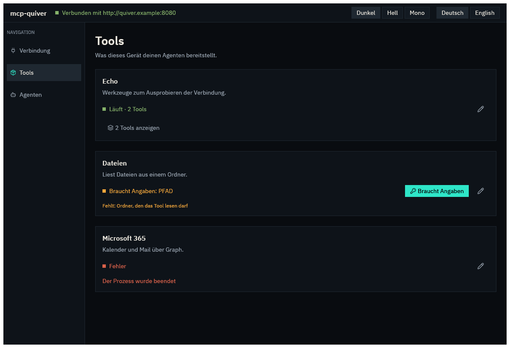

# mcp-quiver

**Deutsch:** [README.de.md](README.de.md)

> **Status: concept.** Nothing to install yet – this repository currently holds
> the specification ([SPEC.md](SPEC.md)).

**One quiver of tools for all your agents.** mcp-quiver is a central library of
[MCP](https://modelcontextprotocol.io/) tools plus a small client on every
device. Admins decide in a web interface which tools a group gets, the client
installs and configures them, and every agent on the device – pi, Hermes and
more to come – talks to exactly one endpoint. Logins happen once, in the
client. Agents never see a password or a token.

Pure Rust: server, client and the client window. The admin interface is Vue
and looks exactly like the client.

## The idea

```
 pi-agent ──┐                        ┌──────────── quiver-server ────────────┐
 Hermes   ──┼──► quiver (client) ◄──►│ library of MCP tools (own + external)│
 …        ──┘    one endpoint        │ assignment by Entra ID groups         │
                 runs the tools      │ admin interface (Vue)                 │
                 holds the logins    └───────────────────────────────────────┘
```

- **Library on the server.** Own tools (written in Rust) and external MCP
  servers in one catalogue, versioned, based on the official `server.json`
  format of the MCP Registry.
- **Assignment by group.** An admin assigns tool sets to Microsoft Entra ID
  groups. Each device gets what its user's groups allow – installed, updated
  and removed automatically.
- **Configuration in layers.** The server pushes what it knows (endpoints,
  tenant, defaults). The client completes what only the device knows (local
  paths, personal secrets in the OS keychain).
- **Auth in one place.** Agent → client and client → server. Nothing else.
  The client adds credentials to each tool call. The agent only ever sees
  tools.
- **Microsoft first.** The first tool set covers Microsoft 365 via Microsoft
  Graph and acts with the signed-in user's own permissions, so Microsoft's
  role and permission model applies unchanged.
- **Any agent.** Agents that speak MCP connect directly. For others there are
  plugins, written in Rust (pi via Node binding, Hermes via Python binding).

## Platforms

- **Server:** one container image (Docker, Azure Container Apps, anywhere).
- **Client:** macOS, Windows and Linux.

## Development

```bash
# check everything (before every commit)
cargo fmt --all --check && cargo clippy --all-targets -- -D warnings && cargo test --workspace
```

The token files in `tokens/` are the single source of colours, sizes and fonts —
for the client window (egui) and for the admin interface (Vue). The admin CSS is
generated from them and checked in; never edit it by hand:

```bash
cargo run -p quiver-oberflaeche --bin tokens_css > admin/src/styles/tokens.css
```

### Admin interface

```bash
git submodule update --init admin/vendor/weppelmann-ui
cd admin
npm ci
npm run dev     # Vite on 5173, /api → 127.0.0.1:8740
npm run build   # to admin/dist; the server serves it at /
npm run typecheck
npm test
```

Layout, components and screenshots: [admin/README.md](admin/README.md).

### Client window

```bash
cargo run -p quiver-fenster                # the window
cargo run -p quiver-fenster -- --headless  # only the core, until Ctrl+C
```

Same layout as the admin interface: header, navigation on the left, content as
cards, three themes from the same tokens. The screenshots are produced by the UI
test (with a stand-in core, no server and no runtime):

```bash
QUIVER_BILDER=docs/bilder cargo test -p quiver-fenster --test oberflaeche
```




## License

[MIT](LICENSE)
