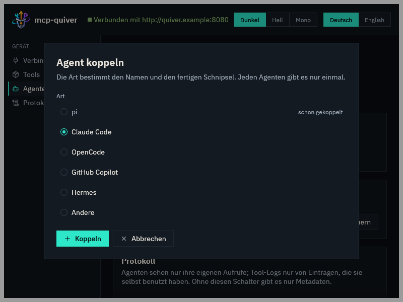
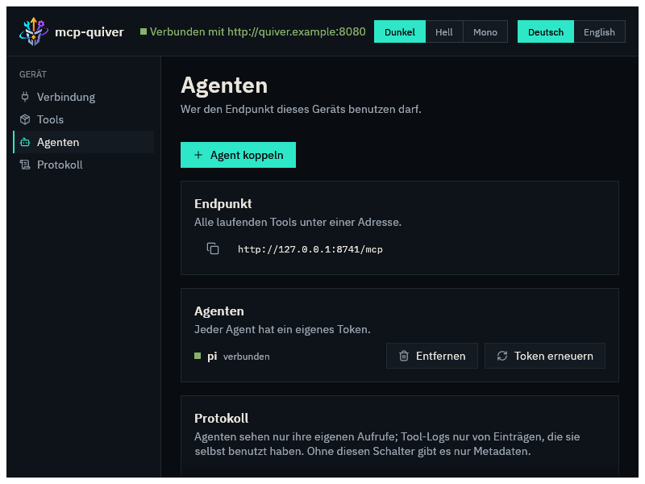
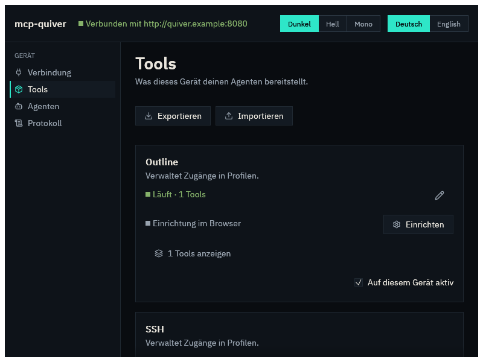
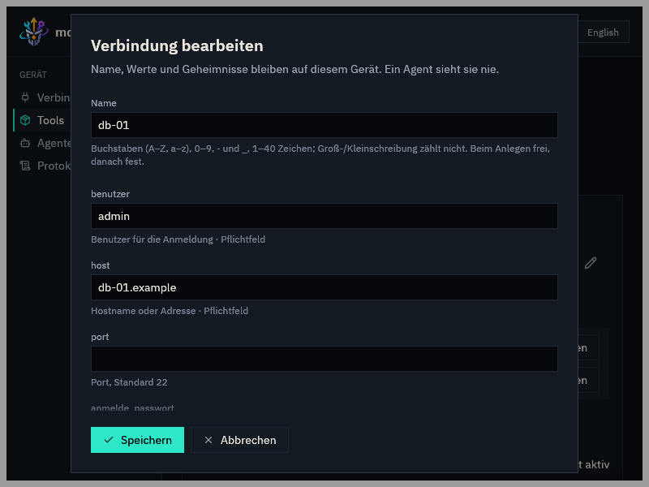
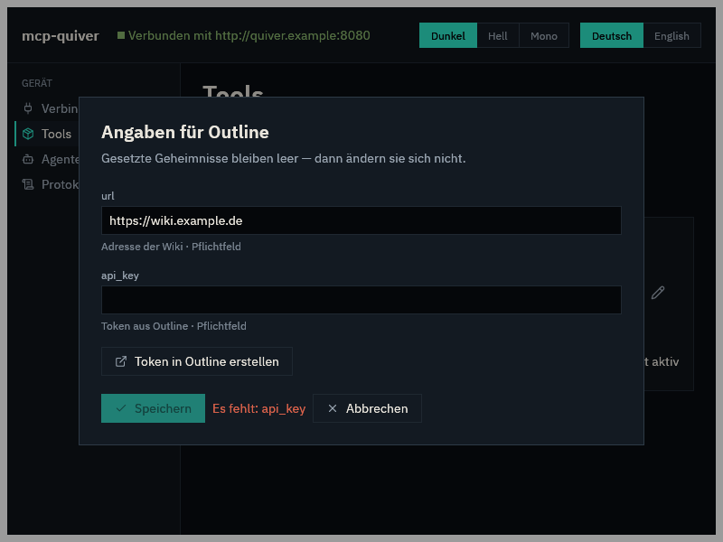
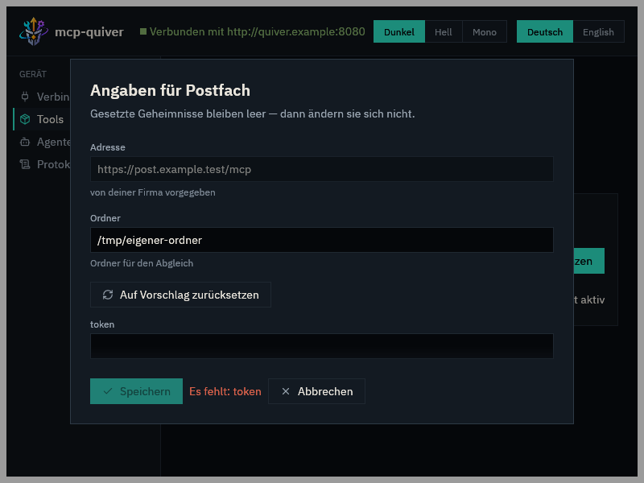
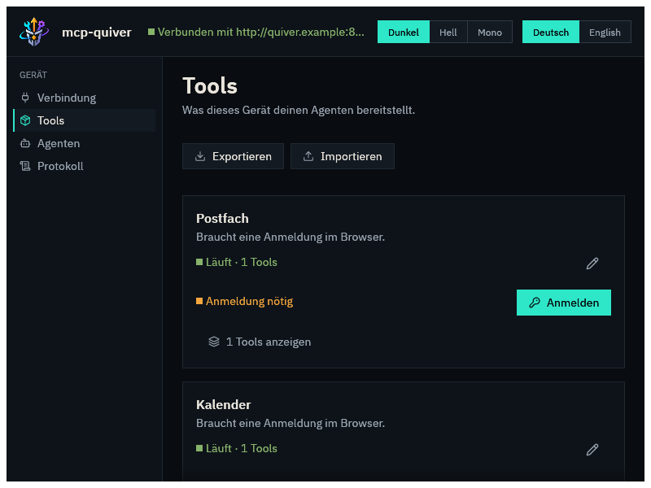
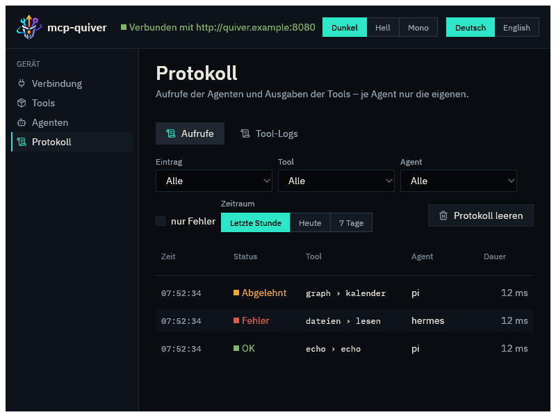

English: [client.md](client.md)

# Der Client quiver

`quiver` ist das Programm auf dem Gerät: Es installiert und führt die Tools aus,
verwahrt die Zugangsdaten und ist der eine Endpunkt, mit dem jeder Agent
spricht. Diese Seite beschreibt, was das Fenster tut, wo die Dateien liegen und
was privat bleibt. Die Installation je Plattform steht in der
[README](../README.de.md#installation).

**Inhalt** · [Start und Tray](#start-und-tray) · [Anmelden](#anmelden) ·
[Agenten](#agenten) · [Die Tools-Seite](#die-tools-seite) ·
[Protokoll und Datenschutz](#protokoll-und-datenschutz) ·
[Fenster und Layout](#fenster-und-layout) · [Umgebung](#umgebung) ·
[Fehlersuche](#fehlersuche)

## Start und Tray

Nach dem ersten Start sitzt der Client im Tray; Agenten erreichen die Tools
unter `http://127.0.0.1:8741/mcp`.

Das Fenster zu schließen beendet quiver nicht: Kern, MCP-Endpunkt und Abgleich
laufen weiter, das Tray-Symbol bleibt. **Beenden** steht im Tray-Menü. Cmd+Q ist
ebenfalls kein Beenden — es legt das Fenster wie das Schließen in den Tray.
Strg+C und SIGTERM halten den Kern geordnet an. Jedes Ende und jedes
„in den Tray gelegt“ steht **mit Ursache** im Protokoll (Tray, Fenster, Cmd+Q,
Strg+C, SIGTERM, zweite Instanz, Abmelden des Systems); beenden lässt sich quiver
nur über das Tray. Ein zweiter Start (Doppelklick, während quiver im Tray sitzt)
zeigt das Fenster der laufenden Instanz und endet selbst — eine Instanz je Gerät.

Das Tray-Menü zeigt den Zustand (`Verbunden · 4 Tools · 1 Agent`), öffnet das
Fenster, schaltet **Beim Anmelden starten** und beendet. Derselbe Schalter steht
auf der Seite *Verbindung*; ob er an ist, wird aus dem System gelesen
(LaunchAgent, Registry-Wert oder `.desktop`-Datei), nicht im Fenster gemerkt.
Der Autostart startet immer mit `--hintergrund`.

## Anmelden

Die Seite *Verbindung* fragt zuerst **nur** nach der Server-Adresse (`https`
überall, `http` nur auf `127.0.0.1`, `::1` oder `localhost`). Die zuletzt
benutzte Adresse ist vorbelegt, auch nach dem Abmelden. **Weiter** fragt den
Server, welche Wege er anbietet (`GET /api/v1/anmeldearten`), und zeigt danach
**entweder** *Mit Microsoft anmelden* **oder** das Feld für den Einmal-Code —
nie beides. Ein Server, der beides nicht anbietet, sagt das deutlich.

Mit Entra öffnet sich der Browser; der Client selbst spricht nie mit Microsoft.
Der Server schickt genau einen Einmal-Code an einen Lauscher auf `127.0.0.1`
(Pfad `/quiver`, freier Port, fünf Minuten, eine Antwort, `zustand` in konstanter
Zeit verglichen), und der Client tauscht ihn mit seinem eigenen PKCE-Verifier.
Währenddessen steht dort *Im Browser fortfahren …* mit *Browser erneut öffnen*
und *Abbrechen*. Danach *Angemeldet als …* und das Gerät. Ein altes
Geräte-Token wird mitgeschickt, damit ein erneutes Anmelden **dasselbe** Gerät
weiterführt.

Lehnt der Server das Gerät ab, entscheidet der Grund: `gesperrt` und
`kein-zugriff` stoppen alle Tools, löschen das Token und sagen, was zu tun ist;
`neu-anmelden` (und jeder unbekannte Grund) stoppt alle Tools, **behält aber
Geräte-Token und alle Angaben** und bietet *Erneut anmelden*, mit Hinweis im
Tray. Ein 401 (Gerät entfernt oder Token ungültig) verlangt wie bisher eine neue
Anmeldung. *Abmelden* fragt nach, sagt, was passiert (Agenten verlieren alle
Tools, Angaben bleiben), löscht das Gerät **am Server** und behält die
Server-Adresse. Ist der Server nicht erreichbar, sagt der Client das. Ein Agent
kann nichts davon auslösen.

## Agenten

Agenten verbinden sich über den lokalen Endpunkt und werden **einmal** im
Fenster gekoppelt (*Agenten* → *Agent koppeln*). Die Art bestimmt den Schnipsel:
pi, Claude Code, OpenCode, GitHub Copilot und Hermes bringen jeweils ihren
fertigen Text mit; das Token lässt sich jederzeit erneuern — das alte gilt sofort
nicht mehr.





Agenten können nichts abschalten, sich nicht anmelden und keine Einrichtung
auslösen. Dafür gibt es kein Werkzeug.

## Die Tools-Seite

Jede Karte zeigt den Eintrag, seinen Zustand und was fehlt. Auf der Admin-Seite
lässt sich ein Eintrag abschalten, ohne ihn zu löschen (*Aktiv* im
Bearbeiten-Dialog oder der Schalter in der Zeile). Er bleibt in Bibliothek und
Sätzen, läuft aber auf keinem Gerät; der Client beendet ihn beim nächsten
Abgleich.

Manche Tools verwalten ihre Zugänge in **Profilen** (mehrere Wikis, Postfächer,
Hosts, SAP-Systeme). Solche Einträge tragen eine *Einrichtung*; die Tools-Karte
zeigt dann **Einrichten**. Der Client startet dafür dasselbe Programm mit
derselben Umgebung und denselben `${feld}`-Platzhaltern wie die Laufzeit und
wartet, bis der User die Seite im Browser abschließt: Exit 0 heißt eingerichtet
und der Eintrag startet neu (neue Profile wirken sofort), Exit 1 heißt
abgebrochen, alles andere steht als Fehler in der Karte. Während sie läuft,
steht **Abbrechen** daneben; nach 15 Minuten endet sie von selbst, und beim
Beenden des Clients wird sie aufgeräumt. Zugangsdaten durchlaufen dabei nie
einen Agenten. In der Verwaltung steht der Befehl im Abschnitt *Einrichtung
(optional)*, die Liste zeigt das Abzeichen *mit Einrichtung*.



Ein Eintrag lässt sich **nur auf diesem Gerät abschalten**: jede Karte auf der
Seite *Tools* trägt rechts den Schalter *Auf diesem Gerät aktiv*, standardmäßig
an. Aus beendet den laufenden Prozess in unter einer Sekunde, nimmt seine
Werkzeuge aus `tools/list` und sagt jedem verbundenen Agenten Bescheid
(`list_changed`). Ein Aufruf danach antwortet „<Titel> ist auf diesem Gerät
abgeschaltet – im quiver-Fenster unter Tools einschalten“, nie „unbekannt“.
Angaben, Zugänge, Geheimnisse und die Anmeldung bleiben erhalten — nur
*Anmelden* und *Einrichten* sind gesperrt, solange der Eintrag aus ist. Die Wahl
überlebt Neustart, Abgleich, Änderung am Server und einen Import (**aus bleibt
aus**; die Sicherung nimmt sie mit), und die Verwaltung zeigt „am Gerät
abgeschaltet“ als neutralen Zustand, nicht als Problem. Agenten können nichts
schalten; dafür gibt es kein Werkzeug.

Manche Tools brauchen **mehrere gleichartige Zugänge**, die der User nach und
nach anlegt — etwa SSH-Verbindungen mit Name, Host, Port und Benutzer. Solche
Einträge tragen eine *Zugangsliste* (Verwaltung: *Mehrere Zugänge (optional)*
mit Überschrift, Bezeichnung und Feldern, Quelle nur *Gerät*); die Tools-Karte
zeigt dann „Verbindungen (2)“ mit **Verbindung hinzufügen** und der
aufklappbaren Liste: bearbeiten, löschen (mit Rückfrage) und je gesetztem
Geheimnis ein eigenes **Geheimnis löschen** — praktisch, wenn das
Anmelde-Passwort weg soll, sobald der Schlüssel eingerichtet ist. Geheimes
liegt in der Tresor-Datei, die übrigen Werte in der Client-Konfiguration. Beim
Start bekommt das Tool alle Zugänge als JSON in `QUIVER_ZUGAENGE`; ein Eintrag
ohne Zugang läuft trotzdem und meldet selbst „kein Zugang“.



Manche Felder bringen einen **Hilfe-Link** neben der Eingabe mit (Verwaltung:
*Link-Text* und *Link-Adresse*, Platzhalter `${feld}` erlaubt — zum Beispiel
`${url}/settings/api-and-access`). Der Knopf ist nur klickbar, wenn sich jeder
Platzhalter aus dem füllen lässt, was gerade im Dialog steht; sonst ist er
gesperrt und sagt, welches Feld noch fehlt. Ein Klick öffnet die Adresse im
Standardbrowser — sonst nichts, keine Anmeldung, kein Lauscher.



Ein Admin kann Werte **vom Server vorbelegen** (Satz-Dialog, je Feld
*Vorschlag* oder *Fest*; Geheimnisse stehen dort gar nicht zur Wahl). Ein
*Vorschlag* kommt ausgefüllt an und bleibt änderbar; sobald der Benutzer etwas
anderes einträgt, steht daneben **Auf Vorschlag zurücksetzen**. Ein *fester*
Wert ist ausgegraut und nicht änderbar — dabei steht „von deiner Firma
vorgegeben“. Ein vorbelegtes Pflichtfeld gilt als gesetzt. Feste Werte und
übernommene Vorschläge speichert das Gerät nicht, deshalb wirkt eine Änderung
des Admins beim nächsten Abgleich, ohne neue Anmeldung.



Felder tragen eine **Art** (Verwaltung: *Art* und *Titel*): Text, Passwort,
Zahl, Schalter (Häkchen), Adresse (mit `http(s)://`-Prüfung) oder Auswahl mit
festen Optionen. Ein *Titel* ersetzt den Feldnamen im Dialog — so steht
„SAP-Benutzer“ statt `benutzer`. Die Feldliste scrollt mit immer sichtbarer
Leiste; solange „Speichern“ gesperrt ist, steht der Grund daneben („Es fehlt:
SAP-Benutzer, ADT-Adresse“). Leere, nicht verpflichtende Felder sind erlaubt.

Die Angaben eines Geräts lassen sich **sichern und auf einem anderen Gerät
wieder einspielen**: Auf der Tools-Seite stehen dafür *Exportieren* und
*Importieren* in der Kopfzeile. Die Datei `quiver-einstellungen-<datum>.json`
enthält die Werte und die Zugangslisten aller Tools; auf Wunsch auch die
Geheimnisse — dann verschlüsselt mit XChaCha20-Poly1305 und einem Schlüssel aus
Argon2id (Passwort mit mindestens acht Zeichen, Dateirechte 0600). Geräte-Token,
Agent-Tokens und die Anmeldungen der Tools selbst sind nie dabei, die gehören zum
Gerät bzw. zur Anmeldung. Der Import zeigt erst eine Vorschau (neu, ändert,
übersprungen), mischt dann statt zu ersetzen — was nur am Gerät steht, bleibt —
und startet die betroffenen Einträge neu. Einträge, die es hier nicht gibt,
werden übersprungen; ein falsches Passwort ändert nichts. Die Wahl „auf diesem
Gerät abgeschaltet“ geht mit und steht in der Vorschau — aus bleibt aus.

## Woher die Programme kommen

Der Client bringt **keine** Werkzeuge mehr mit. Er bekommt sie vom Server
(Aufgabe 37): bei der Anmeldung, beim Start und bei jedem Abgleich vergleicht
er den Soll-Zustand mit dem, was im Profil liegt. Fehlt ein Programm oder
stimmt seine Prüfsumme nicht, lädt er es vom Server, prüft Größe und SHA-256
und startet es neu. Werkzeuge sind damit immer auf dem Stand des Servers.

Ablage im Profil: `tools/<name>/<sha256>/<programm>` — Ordner 0700, Datei 0700
(unter Windows: nur der Benutzer, über die Rechte des Profils). Geladen wird in
eine Zwischendatei im Zielordner, Größe und Prüfsumme werden beim Schreiben
mitgezählt, danach `fsync` und umbenennen; erst dann wird die Datei ausführbar.
Vor **jedem** Start wird sie erneut geprüft (dieselbe Datei, kein Verweis,
Größe und SHA-256); stimmt etwas nicht, wird sie neu geladen. Alte Fassungen
fallen nach dem ersten erfolgreichen Start weg.

Ein Eintrag nennt dazu nur den **Programmnamen**, etwa `quiver-devops`.
Verteilt werden nur die eigenen Programme (`quiver-*`); ein Eintrag mit `npx`,
`uvx`, `docker` oder einem festen Pfad funktioniert unverändert. Für welches
System der Server was hat:

| System | Angabe im Abruf |
| --- | --- |
| Windows x64 | `system=windows&arch=x64` |
| macOS arm64 | `system=macos&arch=arm64` |
| macOS x64 | `system=macos&arch=x64` |
| Linux x64 | `system=linux&arch=x64` |
| Linux arm64 | `system=linux&arch=arm64` |

Hat der Server ein Programm für das System des Geräts nicht, sagt die Karte
„Für dieses System gibt es das Tool nicht.“ — kein Fehler, kein roter Zustand.
Ein Eintrag mit einem **alten festen Pfad** heilt sich selbst: es zählt nur
noch der Programmname. Meldungen im Fenster nennen nie einen fremden
Dateipfad, nur den Namen und den Grund; der volle Pfad steht im Protokoll.

Wird ein Eintrag nicht mehr zugewiesen (aus der Gruppe, gesperrt, Zugang
entzogen), stoppt der Client das Tool und **löscht das Programm**; die
Konfiguration (Angaben, Zugänge, Geheimnisse, Anmeldung des Tools) bleibt und
gilt wieder, sobald der Eintrag zurückkommt. Beim Abmelden am Gerät werden
ebenso nur die Programme gelöscht. Die Karte zeigt während des Ladens „Wird
vom Server geladen …“ oder „Aktualisiert“. Ist der Server nicht erreichbar,
laufen die bereits geladenen Programme nach den bisherigen Regeln weiter.

`QUIVER_TOOLS_DIR` bleibt für die Entwicklung: ein Ordner, in dem die
Programme flach liegen (etwa ein ausgecheckter Stand). Er überschreibt die
Ablage im Profil, sodass sich ein Programm ohne Server ausprobieren lässt.

### Die Anzeige beim Laden

Solange abgeglichen oder geladen wird, steht am Kopf der Werkzeugseite ein
Satz mit Drehsymbol: „Verbinde mit dem Server …“, „Tools werden geladen (3 von
12)“, „Wird gestartet …“. Am Ende steht dort kurz „Alles aktuell“ (oder „2
Tools aktualisiert“) und verschwindet nach vier Sekunden. Auf der Karte steht
„Wird geladen … 42 %“ (der Anteil, sobald die Größe bekannt ist) oder
„Aktualisiert“; das Tray zeigt denselben Stand in kurzer Form.

Die Anzeige steht **nur, wenn es etwas zu tun gibt**: was unter 300 ms dauert,
erscheint nicht (kein Flackern), und solange nichts läuft, zeichnet das Fenster
nicht neu. Hat das System „weniger Bewegung“ eingestellt (egui ohne
Animationen), steht der Text ohne drehenden Ring.

Der Knopf **„Tools aktualisieren“** (auf der Seite und im Tray) fragt sofort
beim Server nach. Während einer läuft, ist er gesperrt. Danach meldet die
Anzeige „Alles aktuell“ oder wie viele Programme kamen; besteht keine
Verbindung (noch nicht eingebunden oder gerade getrennt), sagt der Client das
im Hinweis über den Karten, statt ins Leere zu fragen.

Geht beim Laden etwas schief, steht der Grund auf der Karte, und daneben gibt
es **„Erneut versuchen“**. Ein Programm, das nicht lädt, hält die anderen
nicht auf.

## Die Anmeldung eines Tools

Manche Werkzeuge melden sich für den Benutzer an (Microsoft 365, ZEP). Die
Anmeldung löst immer der Benutzer im Fenster aus, nie ein Agent; die Karte
zeigt dazu **einen** Satz und **einen** benannten Knopf. Kein Knopf besteht je
nur aus einem Zeichen, auch nicht im schmalen Fenster:

| Zustand | Satz auf der Karte | Knopf |
| --- | --- | --- |
| nicht angemeldet | „Nicht angemeldet“ | **Anmelden** |
| Prüfung läuft | „Prüfe Anmeldung …“ mit Drehsymbol | keiner (gesperrt) |
| Anmeldung im Browser | „Anmeldung im Browser läuft …“ | keiner |
| angemeldet | „Angemeldet als …“ | **Abmelden** |
| läuft ab | „Angemeldet als … – die Anmeldung läuft bald ab“ | **Anmelden** |
| fehlgeschlagen | der Grund in einem Satz | **Erneut prüfen** |

Die Prüfung ist ein Blick in den Tresor des Werkzeugs, kein Browser-Ablauf:
sie hat **10 s** Zeit. Antwortet das Werkzeug nicht, steht danach ein Satz und
**Erneut prüfen** da — kein Drehsymbol, das nie aufhört. „Erneut prüfen“
fragt nur den Status ab; es meldet niemanden an und startet den Eintrag nicht
neu, solange niemand angemeldet ist. Ein Werkzeug, das den Ablauf seines
Tokens kennt, meldet ihn mit **Exit 3**; dann bietet die Karte „Anmelden“ an,
bevor mitten in der Arbeit Schluss ist.



Fehlt das Programm auf diesem Gerät, steht auf der Karte **einmal** „Dieses
Tool ist auf diesem Gerät nicht installiert.“ — kein technischer Fehler, kein
Anmelde- und kein Einrichtungsknopf (es gäbe nichts zu starten). Den Hinweis
für den Admin („bitte auf dem Server bereitstellen“) schreibt der Client ins
Protokoll des Eintrags. Hat der Server das Programm für dieses System nicht,
steht dort „Für dieses System gibt es das Tool nicht.“ — ebenfalls ohne Knopf.

Unter **Windows** startet der Client die Werkzeuge und die Anmeldebefehle ohne
eigenes Konsolenfenster (`CREATE_NO_WINDOW`): es blitzt keine schwarze Konsole
auf, und ein Werkzeug ist ein Hintergrundprozess. Angemeldet wird im
Standardbrowser. Der Rückweg aus dem Browser läuft über `http://127.0.0.1:<port>`
— der Client und seine Werkzeuge binden dafür **nur** an 127.0.0.1, damit die
Windows-Firewall nicht dazwischenkommt und nichts von außen erreichbar ist.
Das Token des Werkzeugs liegt im Tresor des Werkzeugs unter `%APPDATA%`, nie
beim Agenten.

## Eine Karte, ein Knopf je Wirkung

Jede Karte trägt genau einen Knopf für die Angaben: fehlen Pflichtangaben,
**Angaben ergänzen**; ist alles da, den **Stift** („Bearbeiten“). Gibt es
nichts einzutragen, steht auch kein Stift da — bei einer Zugangsliste führt
**… hinzufügen** zur Liste. Was fehlt, steht in einer Zeile („Braucht Angaben:
Pfad“), nicht zusätzlich darunter. Jeder weitere Knopf einer Karte hat seine
eigene, benannte Wirkung: **Anmelden**, **Abmelden**, **Erneut prüfen**,
**Einrichten**, **Abbrechen**, **Exportieren**, **Importieren**.

## quiver aktualisieren

Der Client fragt nie das Internet. Alle sechs Stunden fragt er **seinen Server**,
ob eine neuere Fassung veröffentlicht ist (`GET /api/v1/geraet/updates`, mit dem
Geräte-Token). Ist es so, erscheint über der Seite und in der Tray-Zeile ein
Hinweis: die Version, der Text des Betreibers und ein Link auf die Änderungen.
Gibt es ein Paket für diese Installation, bietet der Hinweis **Jetzt
aktualisieren** und **Später** an.

**Jetzt aktualisieren** tut Folgendes, in dieser Reihenfolge:

1. laufende Werkzeuge werden beendet (laufende Aufrufe bekommen bis zu 10 s),
2. das Paket kommt vom eigenen Server nach `<profil>/updates/<version>/`; dabei
   werden `Content-Length` und die SHA-256 aus der Antwort des Servers schon
   beim Schreiben geprüft,
3. die neue Fassung wird entpackt und als `quiver --selbsttest` gestartet —
   Exit 0, ohne Fenster, ohne Profil; scheitert das, bleibt alles, wie es ist,
4. die alte Datei wird zu `<name>.alt`, die neue daneben gelegt; das Fenster
   sagt „Neue Version X ist eingespielt“ und schließt,
5. die neue Fassung startet, sobald das Profil freigegeben ist. Kommt sie nicht,
   stellt der zweite Start die alte wieder hin.

**Später** nimmt den Hinweis für diese Version bis zum nächsten Start weg. Die
Abfrage läuft weiter; nur das Angebot verschwindet.

Welches Paket gilt, erkennt der Client an seinem eigenen Pfad: portables ZIP und
MSI je Benutzer unter Windows, `.app` aus dem `.dmg` unter macOS, AppImage und
`tar.gz` unter Linux. Eine Installation aus `.deb`/`.rpm` (Systemordner) oder ein
Ordner ohne Schreibrecht bekommt nur den Hinweis — quiver fasst keinen
Programmordner an, der dem System gehört, und fragt nie nach root.

Das **Profil wird nicht angefasst**: Einstellungen, Tresor, Geräte-Token,
Angaben, Zugänge, Anmeldungen der Werkzeuge, Autostart und die geladenen
Programme bleiben, wie sie waren. Das prüft ein Test, der das Profil vor und nach
dem Tausch vergleicht.

`quiver --selbsttest` ist eine schlichte Prüfung: Es nennt die Version, endet mit
0 und fasst weder Profil noch Fenster an. Genau das startet das Selbst-Update vor
dem Tausch.

Hat der Betreiber das Angebot abgeschaltet (Vorgabe `UpdateAngebot`), bleibt der
Hinweis; eingespielt wird dann durch die Geräteverwaltung (Intune) oder von Hand
aus dem Release. Einzelheiten: [updates.de.md](updates.de.md).

## Protokoll und Datenschutz

Die Seite **Protokoll** im Fenster listet jeden Tool-Aufruf eines Agenten (Zeit,
Agent, Eintrag, Tool, Dauer, Ergebnis) und im Reiter *Tool-Logs*, was das Tool
auf stderr ausgegeben hat. Ein Klick auf eine Zeile öffnet die Einzelheiten:
Argumente, Fehlertext und eine Vorschau der Antwort. Filter grenzen nach
Eintrag, Tool, Agent, Zeitraum (letzte Stunde, heute, 7 Tage) und nur Fehler ein.

Alles bleibt auf dem Gerät: `<Profil>/protokoll/aufrufe-JJJJ-MM-TT.jsonl` und
`prozesse-JJJJ-MM-TT.jsonl`, nach 7 Tagen gelöscht und insgesamt nie mehr als
50 MB. Der Server bekommt keine Aufrufe.



**Wer es lesen darf.** Der Profilordner ist `0700`; alles darin — der
Profilzustand (`zustand.json`), die Fenstereinstellungen (`oberflaeche.json`),
die Protokolle, die Tresor-Dateien und die Sperrdatei — ist `0600`. Das gilt
beim Anlegen (atomar: eine Zwischendatei neben dem Ziel, dann umbenennen, damit
nie etwas halb geschrieben ist und ein Symlink am Ziel ersetzt statt verfolgt
wird) und wieder bei jedem Start, der von Hand verstellte Rechte nachzieht.
Unter Windows gibt es diese Modusbits nicht; dort hält die Vererbung der ACL des
Benutzerprofils andere Konten heraus, deshalb liegt das Profil im eigenen
`%APPDATA%` des Benutzers.

**Immer maskiert:** Schlüssel, deren Name `pass`, `token`, `secret`, `key`,
`pat`, `auth` oder `cookie` enthält, werden `<verborgen>`, und jeder Wert aus
dem Tresor wird ersetzt — auch als Teilzeichenkette, in Argumenten, Vorschau,
Fehlertext und Tool-Log-Zeilen. Kürzung: 200 Zeichen je Wert, 4 KB Argumente,
500 Zeichen Vorschau, 2000 Fehlertext.

Agenten können das Protokoll selbst über zwei nur lesende Werkzeuge lesen,
`quiver__protokoll` und `quiver__tool_log`. Beide geben **nur Metadaten** zurück,
solange „Agenten dürfen Log-Inhalte sehen“ unter *Agenten* nicht eingeschaltet
ist (steht in `zustand.json`); Fehlertexte bleiben so oder so maskiert, und
Aufrufe dieser beiden Werkzeuge erscheinen selbst nie im Protokoll.

## Fenster und Layout

Gleiches Layout wie die Verwaltung: Kopf, Navigation links, Inhalt als Karten,
drei Farbschemata aus denselben Tokens.

**Fenstergröße.** Unter 760 px schrumpft die Navigation auf Symbole (der Name
steht im Tooltip), der Inhalt endet bei 1100 px und bleibt mittig, und Filter-
und Knopfleisten brechen um, statt über den Rand zu laufen. Unter 700 px legt
ein Formular die Beschriftung über das Feld, und der Kopf verschiebt Theme und
Sprache in ein Menü; die Protokolltabelle lässt dann *Agent* und *Dauer* weg
(beides bleibt im Detaildialog). Die Umbruchpunkte sind Tokens
(`breakpoint.*`), die Verwaltung nutzt dieselben Zahlen.

Die Bilder entstehen im Oberflächentest (mit stehendem Kern, ohne Server und
ohne Laufzeit) — jede Seite und jeder Dialog bei 560 × 460, 800 × 600 und
1200 × 820, als `fenster-<theme>-<seite>-<breite>.png`:

```bash
QUIVER_BILDER=docs/bilder cargo test -p quiver-fenster --test oberflaeche
QUIVER_BILDER=docs/bilder cargo test -p quiver-oberflaeche --test muster
```

## Umgebung

Alles optional:

| Variable | Bedeutung |
| --- | --- |
| `QUIVER_PROFIL` | Profilordner (Standard `~/Library/Application Support/mcp-quiver` und Entsprechungen) |
| `QUIVER_MCP_ADRESSE` | MCP-Endpunkt (Standard `127.0.0.1:8741`; ein zweiter Port lässt zwei Instanzen nebeneinander laufen) |
| `QUIVER_AUTOSTART_DIR` | Ordner für die Autostart-Datei (macOS und Linux; Tests und andere Sitzungen) |
| `QUIVER_TRESOR=speicher` | Geheimnisse im Arbeitsspeicher statt in der Tresor-Datei (Läufe ohne Spuren, zum Ausprobieren) |
| `QUIVER_TOOLS_DIR` | Ordner mit flach liegenden Programmen statt der Ablage im Profil (Entwicklung) |

`--headless` startet nur den Kern (bis Strg+C); `--hintergrund` bringt das Tray
ohne Fenster.

## Fehlersuche

| Symptom | Ursache und Abhilfe |
| --- | --- |
| Gatekeeper / SmartScreen blockiert den ersten Start | Die Pakete sind unsigniert. macOS: Rechtsklick → *Öffnen* (oder *Systemeinstellungen → Datenschutz & Sicherheit → Dennoch öffnen*). Windows: *Weitere Informationen → Trotzdem ausführen*. |
| „Der Server ist nicht erreichbar“ | Adresse prüfen: `https` überall außer Loopback, kein Pfad am Ende. Die Verwaltung muss unter derselben Adresse erreichbar sein. |
| Der Client zeigt „Erneut anmelden“ | Der Server verlangt eine neue Anmeldung (Token zu alt, 60 Tage ungenutzt oder Gerät entfernt). Angaben und Geräte-Token bleiben. |
| Tools bleiben bei „fehlende Angaben“ | Die Karte nennt die Felder. Über den Stift ausfüllen; Geheimes geht in den Tresor. |
| „Für dieses System gibt es das Tool nicht.“ | Der Server hat das Programm für dieses Betriebssystem/diese Architektur nicht. Der Admin legt es auf dem Server ab (siehe *Betrieb*); kein Fehler am Gerät. |
| Karte bleibt auf „Wird vom Server geladen …“ | Der Server ist nicht erreichbar oder die Prüfsumme passt nicht. Das Protokoll des Eintrags nennt den Grund; die bereits geladenen Programme laufen weiter. |
| „Dieses Tool ist auf diesem Gerät nicht installiert.“ | Der Eintrag nennt ein fremdes Programm (`npx`, `uvx`, …), das der `PATH` nicht kennt. Als festen Pfad eintragen oder dafür sorgen, dass es im `PATH` liegt. Der Grund steht im Protokoll des Eintrags. |
| Die Karte bleibt auf „Anmeldung läuft …“ oder „Prüfe Anmeldung …“ stehen | Ein Werkzeug antwortet nicht. Nach 10 s (Prüfung) bzw. 5 min (Browser) endet es von selbst mit einem Satz und einem Knopf; hängt es weiter, das Protokoll des Eintrags ansehen und den Client neu starten. |
| Ein Tool meldet „Prozess wurde beendet“ | Im Protokoll den Reiter *Tool-Logs* öffnen; stderr steht dort (maskiert). |
| Ein Agent sieht keine Tools | Er muss gekoppelt sein und das Token aus *Agenten* nutzen. Endpunkt `http://127.0.0.1:8741/mcp` prüfen und ob der Eintrag auf diesem Gerät abgeschaltet ist. |
| Zwei Clients streiten um den Port | Dem zweiten `QUIVER_MCP_ADRESSE=127.0.0.1:8742` und ein anderes `QUIVER_PROFIL` geben. |
| Tresor-Passwort vergessen | Es gibt keinen Rückweg; die Geheimnisse müssen neu eingegeben werden. Die Werte außerhalb des Tresors bleiben. |
| Die Einrichtungsseite hängt | Sie endet nach 15 Minuten; abbrechen. Beim Beenden des Clients wird eine laufende Einrichtung aufgeräumt. |
