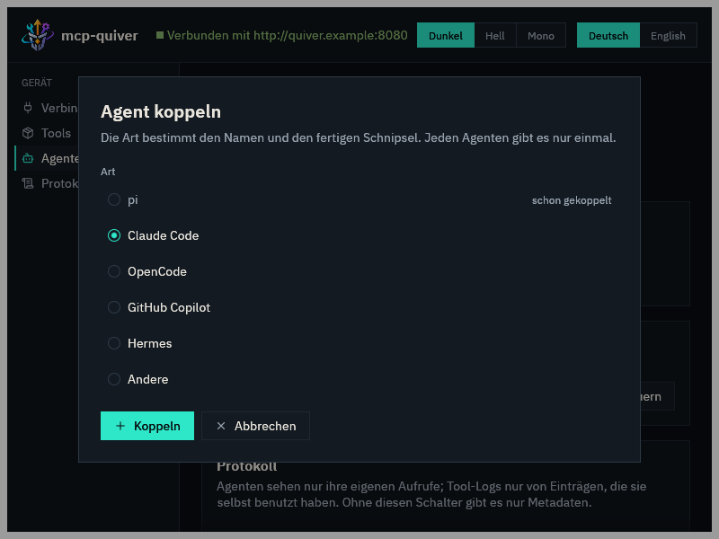
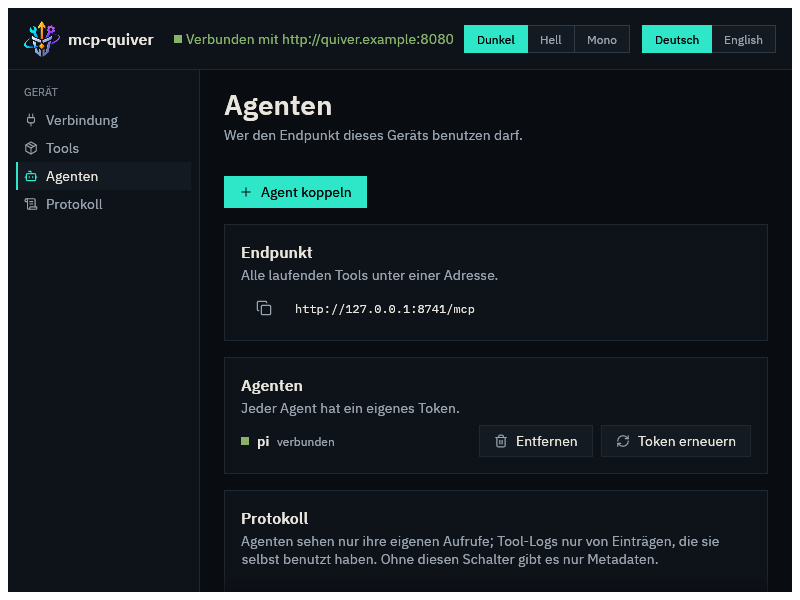
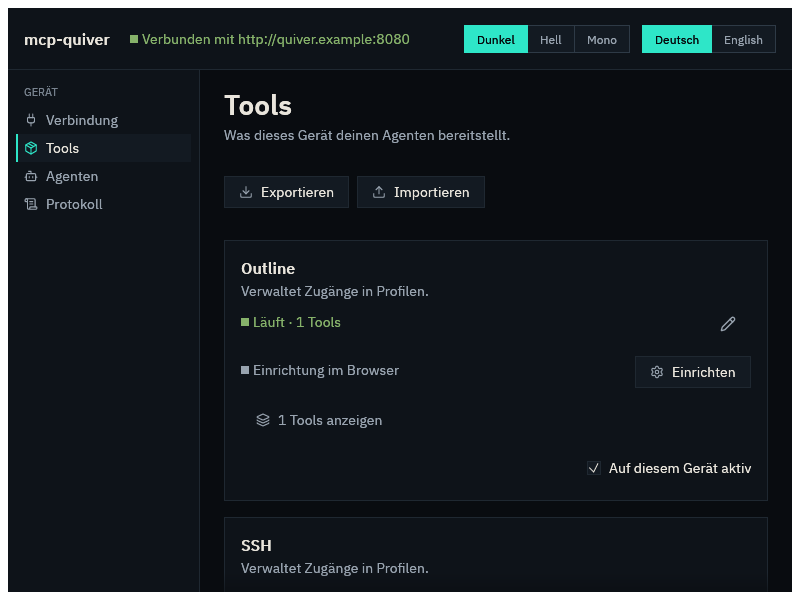
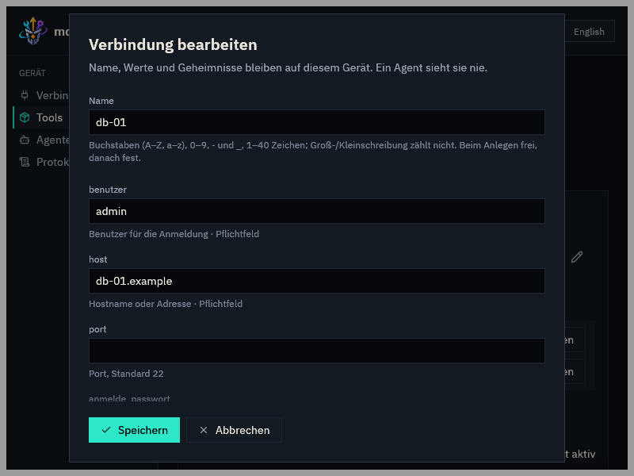
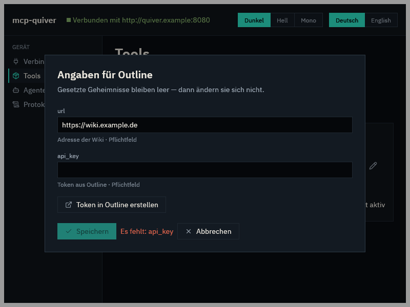
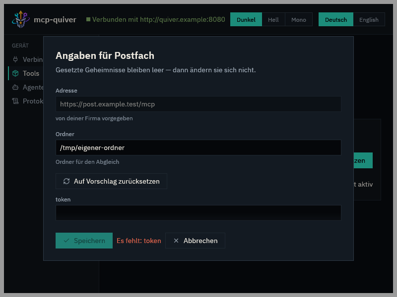
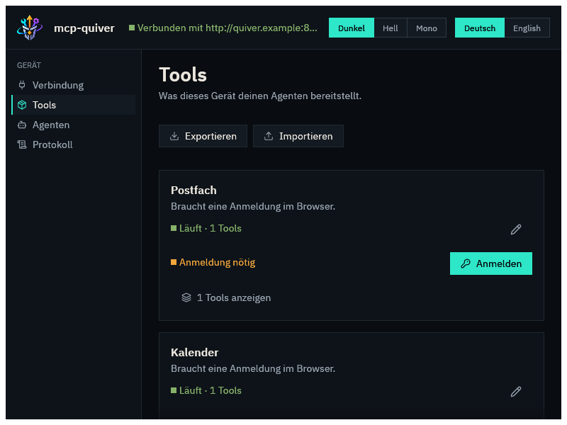
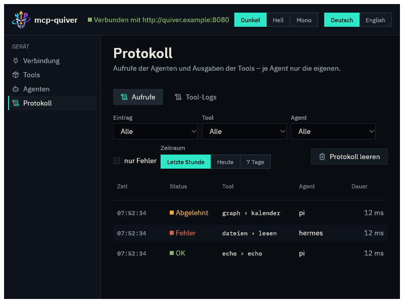

Deutsch: [client.de.md](client.de.md)

# The quiver client

`quiver` is the program on the device: it installs and runs the tools, keeps
the credentials and is the one endpoint every agent talks to. This page
describes what the window does, where the files are and what stays private.
Installation per platform is in the [README](../README.md#installation).

**Inhalt** · [Start and tray](#start-and-tray) · [Signing in](#signing-in) ·
[Agents](#agents) · [The tools page](#the-tools-page) ·
[Protocol and privacy](#protocol-and-privacy) · [Window and layout](#window-and-layout) ·
[Environment](#environment) · [Troubleshooting](#troubleshooting)

## Start and tray

After the first start the client sits in the tray; agents reach the tools at
`http://127.0.0.1:8741/mcp`.

Closing the window does not stop quiver: the core, the MCP endpoint and the
sync keep running, and the tray icon stays. **Quit** lives in the tray menu.
Cmd+Q is not a quit either — it puts the window into the tray like closing.
Ctrl+C and SIGTERM stop the core in order. Every end and every "left in the
tray" is written to the log **with its cause** (tray, window, Cmd+Q, Ctrl+C,
SIGTERM, second instance, system logout); only the tray really quits. A second
start (double click while quiver sits in the tray) shows the window of the
running instance and ends itself — one instance per device.

The tray menu shows the state (`Verbunden · 4 Tools · 1 Agent`), opens the
window, toggles **Start at login** and quits. The same switch sits on the
*Connection* page; whether it is on is read from the system (LaunchAgent,
registry value or `.desktop` file), not remembered by the window. Autostart
always starts with `--hintergrund`.

## Signing in

The *Connection* page first asks **only** for the server address (`https`
everywhere, `http` only on `127.0.0.1`, `::1` or `localhost`). The last address
is pre-filled, also after signing out. **Continue** asks the server which ways
it offers (`GET /api/v1/anmeldearten`) and then shows **either** *Sign in with
Microsoft* **or** the one-time code field — never both. A server that offers
neither says so in plain words.

With Entra the browser opens; the client itself never talks to Microsoft. The
server returns exactly one one-time code to a listener on `127.0.0.1` (path
`/quiver`, free port, five minutes, one answer, `zustand` compared in constant
time) and the client exchanges it with its own PKCE verifier. While waiting, the
page says *Continue in the browser …* and offers *Open browser again* and
*Cancel*. Afterwards it shows *Signed in as …* and the device. An old device
token is sent along, so a repeated sign-in keeps the **same** device.

If the server rejects the device, the reason decides what happens:
`gesperrt` and `kein-zugriff` stop every tool, remove the token and say what to
do; `neu-anmelden` (and any unknown reason) stops every tool but **keeps the
device token and all settings** and offers *Sign in again*, with a hint in the
tray. A 401 (device removed or token invalid) asks for a new sign-in as before.
*Sign out* asks first, says what happens (agents lose all tools, settings
remain), deletes the device **on the server** and keeps the server address. If
the server cannot be reached, the client says so. An agent cannot trigger any
of this.

## Agents

Agents connect through the local endpoint and are paired **once** in the
window (*Agents* → *Pair agent*). The kind decides the snippet: pi, Claude Code,
OpenCode, GitHub Copilot and Hermes each bring their own ready-made text, and
the token can be renewed at any time — the old one stops working immediately.





Agents cannot switch tools off, sign in or trigger a setup. There is no tool
for it.

## The tools page

Each card shows the entry, its state and what is missing. An entry can be
switched off by the admin without being deleted (*Aktiv* in the editor or the
switch in the row). It stays in the library and in sets but runs on no device;
the client stops it on its next sync.

Some tools keep their credentials in **profiles** (several wikis, mailboxes,
hosts, SAP systems). Such entries carry a *setup*; the tools card then shows
**Set up**. The client runs the same program with the same environment and the
same `${field}` placeholders as the runtime and waits until the user closes the
page in the browser: exit 0 means done and the entry restarts (new profiles take
effect immediately), exit 1 means cancelled, anything else is shown as an error
on the card. While it runs, **Cancel** sits next to it; after 15 minutes it ends
by itself, and quitting the client cleans it up. Credentials never pass through
an agent. In the admin interface the command sits in the *Einrichtung
(optional)* section and the list shows a *mit Einrichtung* badge.



An entry can be **switched off on this device alone**: every card on the *Tools*
page carries the switch *Active on this device* on the right, on by default.
Switching it off ends the running process within a second, drops its tools from
`tools/list` and tells every connected agent (`list_changed`). A call after that
answers “<title> is switched off on this device — switch it on in the quiver
window under Tools”, never “unknown”. Values, connections, secrets and the
sign-in are kept — only *Sign in* and *Set up* are locked while it is off. The
choice survives restarts, syncs, changes to the entry on the server and an
import (**off stays off**; the backup carries it), and the admin interface shows
“am Gerät abgeschaltet” as a neutral state, not a problem. Agents cannot switch
anything; there is no tool for it.

Some tools need **several similar credentials** that the user adds one by one —
SSH connections with a name, host, port and user, for instance. Such entries
carry a *list of connections* (admin: *Mehrere Zugänge (optional)* with a
heading, a singular label and fields, source only *device*); the tools card then
shows “Verbindungen (2)” with **Verbindung hinzufügen** and the expandable list:
edit, delete (with a confirmation) and, per stored secret, a separate **Geheimnis
löschen** — handy when the login password should go once the key is set up.
Secrets live in the encrypted vault file, the remaining values in the client
configuration.
On start the tool receives all connections as JSON in `QUIVER_ZUGAENGE`; an
entry without any connection still runs and reports “no connection” itself.



Some fields carry a **help link** next to the input (admin: *Link text* and
*Link address*, `${feld}` placeholders allowed — for example
`${url}/settings/api-and-access`). The button is only clickable once every
placeholder can be filled from what stands in the dialog right now; otherwise
it is greyed out and says which field is still missing. A click opens the
address in the default browser — nothing else, no login, no listener.



An admin can **pre-fill** values from the server (set dialog, per field
*Vorschlag* or *Fest*; secrets are not offered at all). A *suggestion* arrives
filled in and stays editable, with **Auf Vorschlag zurücksetzen** next to it as
soon as the user types something else. A *fixed* value is greyed out and cannot
be changed — the note says “von deiner Firma vorgegeben”. A required field that
is pre-filled counts as answered. Fixed values and adopted suggestions are not
stored on the device, so a change by the admin takes effect with the next sync,
without signing in again.



Fields carry a **kind** (admin: *Art* and *Titel*): text, password, number,
switch (checkbox), address (checked for `http(s)://`) or a choice list with
fixed options. A *title* replaces the field name in the dialog — “SAP-Benutzer”
instead of `benutzer`. The field list scrolls with an always visible bar; while
“Speichern” is disabled, the reason stands next to it (“Es fehlt: SAP-Benutzer,
ADT-Adresse”). Empty, non-required fields are always allowed.

The settings of a device can be **backed up and restored on another device**:
the tools page carries *Exportieren* and *Importieren* in its header. The file
`quiver-einstellungen-<date>.json` holds the values and connection lists of all
tools; on request also the secrets — then encrypted with XChaCha20-Poly1305 and a
key derived with Argon2id (password of at least eight characters, file mode
0600). The device token, agent tokens and the tools' own sign-ins are never part
of it; they belong to the device and to the sign-in. An import first shows a
preview (new, changes, skipped), then merges instead of replacing — what exists
only on this device stays — and restarts the affected entries. Entries this
device does not have are skipped; a wrong password changes nothing. The choice
“switched off on this device” travels with the file and shows up in the
preview — off stays off.

## Where the programs come from

The client no longer ships any tools. It receives them from the server
(task 37): on sign-in, at start-up and on every sync it compares the desired
state with what is in the profile. If a program is missing or its checksum does
not match, it downloads it, verifies size and SHA-256 and restarts it. Tools are
therefore always at the server's version.

Storage in the profile: `tools/<name>/<sha256>/<program>` — directory 0700,
file 0700 (on Windows: the user only, via the profile's permissions). It is
written to a temporary file in the target directory, size and checksum are
counted while writing, then `fsync` and rename; only then is the file made
executable. Before **every** start it is verified again (same file, no link,
size and SHA-256); if anything is off, it is downloaded again. Old versions are
removed after the first successful start.

An entry therefore names just the **program name**, such as `quiver-devops`.
Only our own programs (`quiver-*`) are distributed; an entry with `npx`, `uvx`,
`docker` or a fixed path works as before. What the server has for which system:

| System | Query |
| --- | --- |
| Windows x64 | `system=windows&arch=x64` |
| macOS arm64 | `system=macos&arch=arm64` |
| macOS x64 | `system=macos&arch=x64` |
| Linux x64 | `system=linux&arch=x64` |
| Linux arm64 | `system=linux&arch=arm64` |

If the server does not have the program for the device's system, the card says
“This tool does not exist for this system.” — not an error, no red state. An
entry with an **old fixed path** heals itself: only the program name counts.
Messages in the window never name someone else's file path, only the name and
the reason; the full path is in the log.

When an entry is no longer assigned (removed from the group, locked, access
withdrawn) the client stops the tool and **deletes the program**; the
configuration (settings, accounts, secrets, the tool's sign-in) stays and
applies again as soon as the entry comes back. Signing out on the device
likewise deletes only the programs. While loading, the card shows “Downloading
from the server …” or “Updated”. If the server cannot be reached, the programs
already downloaded keep running under the previous rules.

`QUIVER_TOOLS_DIR` remains for development: a folder with the programs lying
flat (for instance a checkout). It overrides the profile store so a program can
be tried without a server.

### The display while loading

While syncing or downloading, a sentence with a spinner sits at the top of the
tools page: “Connecting to the server …”, “Downloading tools (3 of 12)”,
“Starting …”. At the end it briefly says “Everything up to date” (or “2 tools
updated”) and disappears after four seconds. On the card it says “Downloading …
42 %” (the share, as soon as the size is known) or “Updated”; the tray shows the
same state in short form.

The display appears **only when there is something to do**: anything shorter
than 300 ms is not shown (no flicker), and while nothing runs the window does
not repaint. If the system asks for reduced motion (egui without animations),
the sentence appears without a spinning ring.

The **“Update tools”** button (on the page and in the tray) asks the server
immediately. It is disabled while a sync runs. Afterwards the display reports
“Everything up to date” or how many programs came; if there is no connection
(not yet bound or just disconnected), the client says so in the note above the
cards instead of asking into the void.

If something goes wrong while loading, the card names the reason and offers
**“Try again”** next to it. A program that fails to load does not hold up the
others.

## Signing a tool in

Some tools sign in on the user's behalf (Microsoft 365, ZEP). The sign-in is
always triggered by the user in the window, never by an agent; the card shows
**one** sentence and **one** named button. No button is ever just a symbol,
not even in a narrow window:

| State | Sentence on the card | Button |
| --- | --- | --- |
| not signed in | “Not signed in” | **Sign in** |
| check running | “Checking sign-in …”, spinner | none (disabled) |
| signing in | “Signing in via browser …” | none |
| signed in | “Signed in as …” | **Sign out** |
| expiring | “Signed in as … – the sign-in expires soon” | **Sign in** |
| failed | the reason in one sentence | **Check again** |

The check is a look into the tool's vault, not a browser round: it gets **10 s**.
If the tool does not answer, a sentence and **Check again** remain — not a
spinner that never stops. “Check again” only asks for the status; it signs
nobody in and does not restart the entry while nobody is signed in. A tool that
knows when its token expires reports it with **exit 3**; the card then offers
“Sign in” before work stops in the middle.



If the program is missing on this device, the card says **once**: “This tool is
not installed on this device.” — no technical error, no sign-in and no setup
button (there would be nothing to start). The hint for the admin (“please
provide it on the server”) goes to the entry's log. If the server does not have
the program for this system, the card says “This tool does not exist for this
system.” instead — also without a button.

On **Windows** the client starts tools and sign-in commands without a console
window of their own (`CREATE_NO_WINDOW`): no black console flashes up, and a
tool is a background process. Signing in happens in the default browser. The
way back from the browser runs over `http://127.0.0.1:<port>` — the client and
its tools bind **only** to 127.0.0.1, so the Windows firewall stays out of the
way and nothing is reachable from outside. A tool's token lives in the tool's
vault under `%APPDATA%`, never with an agent.

## One card, one button per effect

Every card carries exactly one button for the settings: if required values are
missing, **Complete settings**; otherwise the **pencil** (“Edit”). If there is
nothing to enter, there is no pencil either — with an access list, **Add …**
leads to the list. What is missing appears on one line (“Needs input: path”),
not once more underneath. Every further button on a card has its own named
effect: **Sign in**, **Sign out**, **Check again**, **Set up**, **Cancel**,
**Export**, **Import**.

## Updating quiver

The client never asks the internet. Every six hours it asks **its server**
whether a newer version is published (`GET /api/v1/geraet/updates`, with the
device token). If there is one, a hint appears above the page and in the tray
line: the version, the operator's text and a link to the changes. If a package
for this installation exists, the hint offers **Update now** and **Later**.

**Update now** does the following, in this order:

1. running tools are stopped (running calls get up to 10 s to finish),
2. the package is downloaded from the own server into
   `<profile>/updates/<version>/`, checking `Content-Length` and SHA-256 from the
   server's answer while streaming,
3. the new version is unpacked and started as `quiver --selbsttest` — exit 0, no
   window, no profile; if that fails nothing changes,
4. the old program is renamed to `<name>.alt`, the new one is put next to it,
   and the window says "Version X is installed" and closes,
5. the new version starts once the profile has been released. If it does not
   come up, the second start puts the old one back.

**Later** hides the hint for this version until the next start. The status
fetch keeps running; only the offer goes away.

Which packages are used is decided by the client from its own path: portable ZIP
and per-user MSI on Windows, `.app` from the `.dmg` on macOS, AppImage and
`tar.gz` on Linux. An installation from `.deb`/`.rpm` (system directories) or a
folder without write permission only gets the hint — quiver does not touch a
program folder that belongs to the system, and it never asks for root.

The **profile is not touched**: settings, vault, device token, entries, access
data, tool sign-ins, autostart and the downloaded tools stay as they are. That
is checked by a test that compares the profile before and after the swap.

`quiver --selbsttest` is a plain check: it prints the version, exits 0 and
touches neither the profile nor a window. It is what the self-update runs before
swapping.

If the operator switched the offer off (`UpdateAngebot` policy), the hint
remains; installing is then done by device management (Intune) or by hand from
the release. Details: [updates.md](updates.md).

## Protocol and privacy

The window's **Protocol** page lists every tool call an agent triggers (time,
agent, entry, tool, duration, result) and, in the *Tool logs* tab, what the tool
printed on stderr. A click on a row opens the details: arguments, error text
and a preview of the response. Filters narrow by entry, tool, agent, period
(last hour, today, 7 days) and errors only.

Everything stays on the device: `<profile>/protokoll/aufrufe-YYYY-MM-DD.jsonl`
and `prozesse-YYYY-MM-DD.jsonl`, deleted after 7 days and never more than 50 MB
in total. The server receives no calls.



**Who may read it.** The profile folder is `0700`; everything inside — the
profile state (`zustand.json`), the window settings (`oberflaeche.json`), the
protocols, the vault files and the lock file — is `0600`. That holds when the
files are created (atomic write: a temporary file next to the target, then a
rename, so nothing is ever half written and a symlink at the target is replaced
rather than followed) and again at every start, which corrects files that were
changed by hand. On Windows these mode bits do not exist; there the ACL
inheritance of the user profile is what keeps other accounts out, so the profile
lives in the user's own `%APPDATA%`.

**Masked, always:** keys whose name contains `pass`, `token`, `secret`, `key`,
`pat`, `auth` or `cookie` become `<verborgen>`, and every value from the vault
is replaced — also as a substring, in arguments, preview, error text and tool
log lines. Truncation: 200 characters per value, 4 KB of arguments, 500
characters of preview, 2000 of error text.

Agents can read the protocol themselves through two read-only tools,
`quiver__protokoll` and `quiver__tool_log`. Both return **only metadata** until
“Agents may see log contents” is switched on under *Agents* (stored in
`zustand.json`); error texts stay masked either way, and calls to these two
tools never appear in the protocol themselves.

## Window and layout

Same layout as the admin interface: header, navigation on the left, content as
cards, three themes from the same tokens.

**Window size.** Below 760 px the navigation shrinks to icons (the name sits in
the tooltip), the content stops at 1100 px and stays centred, and filter and
button bars wrap instead of running over the edge. Below 700 px a form puts its
label above the field and the header moves theme and language into a menu; the
protocol table then drops *Agent* and *Duration* (both stay in the detail
dialog). The breakpoints are tokens (`breakpoint.*`), so the admin interface
uses the same numbers.

The screenshots are produced by the UI test (with a stand-in core, no server and
no runtime) — every page and dialog at 560 × 460, 800 × 600 and 1200 × 820, as
`fenster-<theme>-<page>-<width>.png`:

```bash
QUIVER_BILDER=docs/bilder cargo test -p quiver-fenster --test oberflaeche
QUIVER_BILDER=docs/bilder cargo test -p quiver-oberflaeche --test muster
```

## Environment

All optional:

| Variable | Meaning |
| --- | --- |
| `QUIVER_PROFIL` | Profile folder (default `~/Library/Application Support/mcp-quiver` and equivalents) |
| `QUIVER_MCP_ADRESSE` | MCP endpoint (default `127.0.0.1:8741`; a second port lets two instances run side by side) |
| `QUIVER_AUTOSTART_DIR` | Folder for the autostart file (macOS and Linux; tests and other sessions) |
| `QUIVER_TRESOR=speicher` | Keep secrets in memory instead of the vault file (for trying things out without traces) |
| `QUIVER_TOOLS_DIR` | Folder with the programs lying flat instead of the profile store (development) |

`--headless` runs the core only (until Ctrl+C); `--hintergrund` brings the tray
without the window.

## Troubleshooting

| Symptom | Cause and remedy |
| --- | --- |
| Gatekeeper / SmartScreen blocks the first start | The packages are unsigned. macOS: right click → *Open* (or *System settings → Privacy & Security → Open anyway*). Windows: *More information → Run anyway*. |
| "The server cannot be reached" | Check the address: `https` everywhere except loopback, and no trailing path. The admin UI must be reachable under that address too. |
| The client shows "Sign in again" | The server asked for a new sign-in (token too old, unused for 60 days, or device removed). Settings and the device token are kept. |
| Tools stay "missing settings" | The card names the fields. Fill them under the pencil; secrets go into the vault. |
| “This tool is not installed on this device.” | The entry names a foreign program (`npx`, `uvx`, …) that `PATH` does not know. Enter a fixed path or make sure it is on `PATH`. The reason is in the entry's log. |
| “This tool does not exist for this system.” | The server does not have the program for this OS/architecture. The admin puts it on the server (see *Operations*); not an error on the device. |
| The card stays on “Downloading from the server …” | The server cannot be reached or the checksum does not match. The entry's log names the reason; programs already downloaded keep running. |
| The card stays on “Signing in via browser …” or “Checking sign-in …” | A tool is not answering. After 10 s (check) or 5 min (browser) it ends by itself with a sentence and a button; if it keeps hanging, look at the entry's log and restart the client. |
| A tool fails with "process ended" | Open *Tool logs* on the Protocol page; stderr is kept there (masked). |
| An agent sees no tools | It must be paired and use the token from *Agents*. Check the endpoint `http://127.0.0.1:8741/mcp` and that the entry is not switched off on this device. |
| Two clients fight over the port | Give the second one `QUIVER_MCP_ADRESSE=127.0.0.1:8742` and a different `QUIVER_PROFIL`. |
| Forgot the vault password | There is no recovery; the secrets must be entered again. The values outside the vault are kept. |
| Setup page hangs | It ends after 15 minutes; cancel it. Quitting the client cleans up a running setup. |
