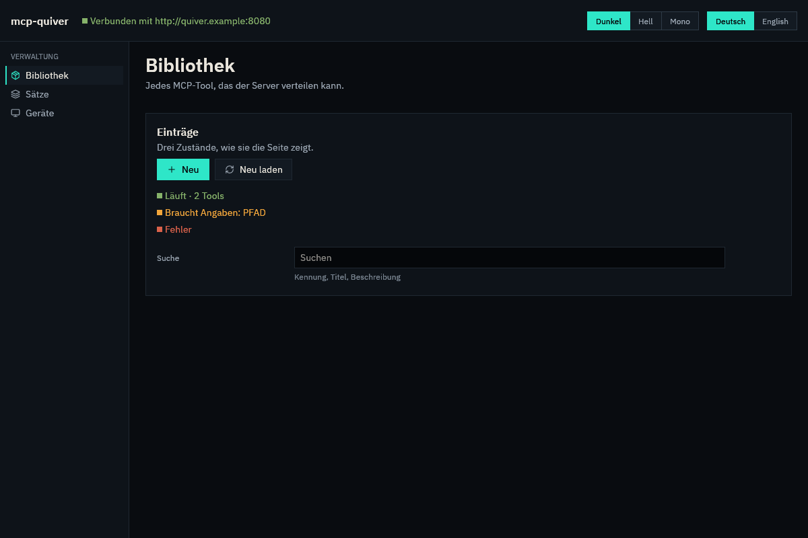
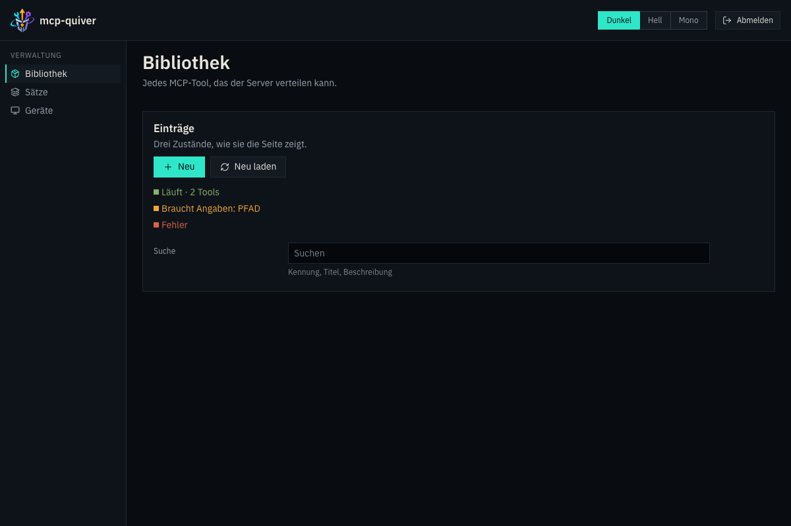

English: [entwicklung.md](entwicklung.md)

# Entwicklung

Alles läuft mit der Rust-Fassung aus `rust-toolchain.toml` und Node 22 für die
Verwaltung. Keine weitere Werkzeugkette, keine erzeugten Bindungen, keine
mitgelieferten Binärdateien.

**Inhalt** · [Prüfen vor jedem Commit](#prüfen-vor-jedem-commit) ·
[Lieferkette](#lieferkette) · [Tokens und CSS](#tokens-und-css) ·
[Verwaltung](#verwaltung) · [Browser-Prüfungen](#browser-prüfungen) ·
[Client-Fenster](#client-fenster) · [Bilder](#bilder) · [Pakete](#pakete) ·
[Aufbau](#aufbau) · [Dokumentation](#dokumentation)

## Prüfen vor jedem Commit

```bash
cargo fmt --all --check && cargo clippy --all-targets -- -D warnings && cargo test --workspace
```

`cargo test` **mit** `--workspace`: ohne das prüft Cargo nur das Wurzelpaket und
meldet „0 passed“. Dieselben Befehle laufen in der CI
(`.github/workflows/pruefen.yml`).

`admin/` braucht zusätzlich `npm run typecheck` (`vue-tsc`) und `npm test`.

## Lieferkette

```bash
# Sicherheitslücken (auch eingestellte Kisten), Lizenzen, Herkunft
# (nur crates.io), keine doppelten Krypto-Kisten — Regeln in `deny.toml`
cargo deny check
npm --prefix admin audit --audit-level=high
```

Jede Ausnahme in `deny.toml` hat einen Grund und einen Weg im Baum. Die CI
prüft dasselbe; eine neue Kiste ohne Begründung im Pull Request kommt nicht
durch.

## Tokens und CSS

Die Token-Dateien in `tokens/` sind die einzige Quelle für Farben, Maße und
Schriften — für das Client-Fenster (egui) und für die Verwaltung (Vue). Das CSS
der Verwaltung wird daraus erzeugt und eingecheckt; von Hand ändern ist ein
Fehler:

```bash
cargo run -p quiver-oberflaeche --bin tokens_css > admin/src/styles/tokens.css
# die Seiten, die der Server selbst ausliefert (Bestätigung, Fehler): dunkel
# als Vorgabe, hell über `prefers-color-scheme`
cargo run -p quiver-oberflaeche --bin tokens_seite_css > crates/server/seiten/system.css
```

Keine Hex-Werte, keine Pixel-Magie in Ansichten — nur semantische Tokens
([AGENTS.md](../AGENTS.md) §2.6). Es gibt drei Themes: `dark`, `light`, `mono`;
alle drei werden geprüft.

## Verwaltung

```bash
git submodule update --init admin/vendor/weppelmann-ui
cd admin
npm ci
npm run dev     # Vite auf 5173, /api → 127.0.0.1:8740
npm run build   # nach admin/dist; der Server liefert sie unter /
npm run typecheck
npm test
```

Für `npm run dev` muss der Server dieselbe Herkunft kennen, denn `/auth/stand`
und `/auth/einrichten` prüfen den `Host`-Kopf gegen `QUIVER_OEFFENTLICH`:

```bash
QUIVER_OEFFENTLICH=http://localhost:5173 cargo run -p quiver-server
```

Die Verwaltung liefert der Server unter `/` aus. Ihre Bausteine kommen aus
[weppelmann-ui](https://github.com/Smotherer007/weppelmann-ui), als
Git-Submodul unter `admin/vendor/weppelmann-ui`, mit Vite-Alias
`@weppelmann/components` → `vendor/weppelmann-ui/packages/components/src`.

Layout, Bausteine und die Musterseite (`/muster`, nur im Dev-Bau) stehen in
[admin/README.md](../admin/README.md).

## Browser-Prüfungen

Zwei Browser-Prüfungen laufen gegen den echten Server (gebaute `admin/dist`, die
CSP des Servers, Chrome headless mit eigenem temporären Profil, Loopback und
temporärem Datenordner — kein echter Mandant, kein echter Tresor):

```bash
cargo build -p quiver-server
npm run pruefung            # Ersteinrichtung → abmelden → anmelden → falsches
                            # Passwort → Überblick → einen Satz ändern →
                            # Auswahlliste im Dialog (über dem Dialog, Höhe
                            # unverändert) → Zuordnungen von beiden Seiten:
                            # 0 CSP-Verstöße, 0 Konsolenfehler
npm run pruefung:anmeldung  # Geräteanmeldung → Bestätigung → Weiterleitung auf
                            # 127.0.0.1:<Port>/quiver mit Code, gegen einen
                            # lokalen Entra-Nachbau
```

## Client-Fenster

```bash
cargo run -p quiver-fenster                  # das Fenster
cargo run -p quiver-fenster -- --hintergrund # nur Tray und Kern, ohne Fenster
cargo run -p quiver-fenster -- --headless    # nur der Kern, bis Strg+C
```

`--headless` startet nur den Kern. Ohne das kommen Fenster und Tray; 
`--hintergrund` bringt nur das Tray.

Das macOS-Bündel ohne das echte Profil ausprobieren:

```bash
profil=$(mktemp -d)
QUIVER_PROFIL="$profil" QUIVER_MCP_ADRESSE=127.0.0.1:0 QUIVER_TRESOR=speicher \
  ./dist/quiver.app/Contents/MacOS/quiver --headless
# Strg+C beendet; danach "rm -rf $profil"
```

Port `0` lässt das System einen freien Port wählen, damit eine zweite Instanz
nie mit der laufenden streitet.

## Bilder

Die Bilder entstehen im Oberflächentest (mit stehendem Kern, ohne Server und
ohne Laufzeit) — jede Seite und jeder Dialog bei 560 × 460, 800 × 600 und
1200 × 820:

```bash
QUIVER_BILDER=docs/bilder cargo test -p quiver-fenster --test oberflaeche
QUIVER_BILDER=docs/bilder cargo test -p quiver-oberflaeche --test muster
```

Der Client schaltet die Sprache um, deshalb entsteht jedes Bild auf Deutsch
(`fenster-<thema>-<seite>-<breite>.png`, das zeigt `README.de.md`) und die
Bilder, die `README.md` benutzt, zusätzlich auf Englisch (`…-en.png`).

Client und Verwaltung lesen dieselben Token-Dateien, deshalb unterscheiden sich
die beiden Musterseiten nur in der Schriftglättung:




Die Bilder der Verwaltung kommen aus Playwright: `npm run bilder` (Musterseite
und die Seiten vor der Anmeldung) und `npm run bilder:benutzer` (Bibliothek,
Gruppen, Benutzer, Prüfspur, Geräte mit Entra, gegen einen eigenen Server auf
einem freien Port). Sie entstehen aus einer temporären Datenbank und einem
erfundenen Katalog — `example.test`, Personen „Alex Beispiel“ und „Ben
Beispiel“ —, nie aus echten Daten und nie aus einem echten Profil.
`QUIVER_BILD_SEITEN=bibliothek,gruppen` schreibt nur diese Seiten und lässt die
übrigen unangetastet.

## Pakete

Die Skripte sind dieselben, die die CI aufruft; das Ergebnis landet in `dist/`
(nicht eingecheckt):

```bash
verteilung/macos/paket.sh                     # macOS: dist/quiver.app, dist/*.dmg
verteilung/linux/paket.sh                     # Linux: tar.gz, deb, rpm, AppImage
pwsh -File verteilung/windows/paket.ps1       # Windows: msi + zip
verteilung/version.sh                         # gibt die Version aus
```

`ARCH=arm64` (macOS) oder `ARCH=aarch64` (Linux) baut für die andere
Architektur, wenn die Maschine das kann. `CARGO_TARGET_DIR` wird beachtet, ein
eigenes Zielverzeichnis funktioniert also.

`verteilung/linux/paket.sh` holt `nfpm` und `appimagetool` nach
`dist/werkzeuge/`, mit fester Version **und** fester SHA-256; sonst wird nichts
heruntergeladen.

Wie ein Release entsteht, welche Geheimnisse das macOS-Bündel signieren und was
„unsigniert“ heißt: [release.de.md](release.de.md).

## Aufbau

```
crates/domain          Datenmodell: Eintrag, Satz, Zuweisung, Soll/Ist   → Unit-Tests
crates/bibliothek      server.json + quiver-_meta lesen, prüfen          → Unit-Tests
crates/protocol        Client ↔ Server: Soll-Zustand, Ereignisse         → Vertragstests
crates/server          Bibliothek, Zuweisung, Admin-API + `quiver-server`→ Integration
crates/client          Abgleich, Laufzeiten, MCP-Endpunkt, Tresor-Datei  → Integration
crates/oberflaeche     Bausatz: Themes aus Tokens, Texte, Schriften
crates/fenster         Client-Fenster (egui), dünn                       → Oberflächentests
admin/                 Verwaltung (Vue, weppelmann-ui)
tokens/                gemeinsame Token-Dateien für egui und Vue
verteilung/            Paket-Skripte für macOS, Windows, Linux
tools/                 Container-Prüfung
docs/                  diese Dokumentation, adr/, aufgaben/
```

Richtung der Abhängigkeiten: `domain ← bibliothek ← protocol ← client ← fenster`,
`domain ← protocol ← server`. Nie zurück. `fenster` kennt keine Domäne, nur
Aktionen, Meldungen und Zustände; `oberflaeche` kennt weder Client noch Server.

Die Regeln für Menschen und Agenten stehen in [AGENTS.md](../AGENTS.md); die
Begründung jeder Festlegung in [SPEC.md](../SPEC.md) und [docs/adr/](adr/).

## Dokumentation

| Datei | Inhalt |
| --- | --- |
| [README.de.md](../README.de.md) | Was es ist, Installation, erste Schritte |
| [betrieb.de.md](betrieb.de.md) | Server betreiben: Container, Konfiguration, Sicherung, Fehlersuche |
| [client.de.md](client.de.md) | Das Client-Fenster, seine Dateien und sein Datenschutz |
| [entra.de.md](entra.de.md) | Microsoft Entra ID anbinden, Schritt für Schritt |
| [release.de.md](release.de.md) | Releases, Pakete, Signieren |
| [haertung.md](haertung.md) | Härtung im Betrieb |
| [offen.md](offen.md) | Bekannte Lücken und bewusste Cheats |
| [adr/](adr/) | Entscheidungen mit Begründung und Preis |
