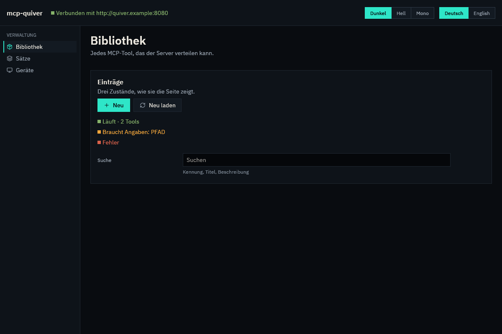
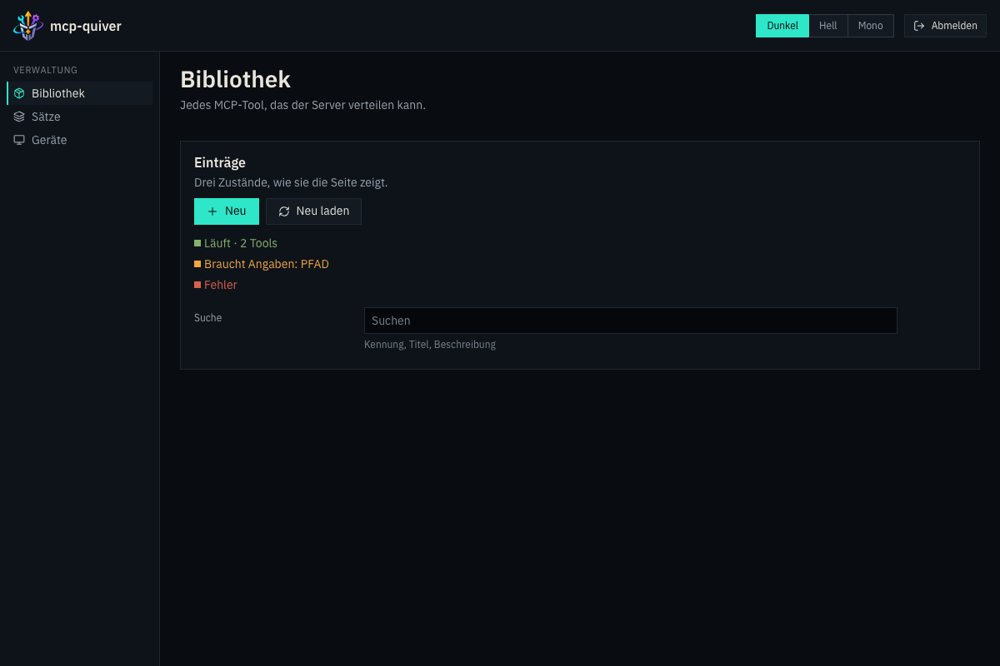

Deutsch: [entwicklung.de.md](entwicklung.de.md)

# Development

Everything runs with the Rust version from `rust-toolchain.toml` and Node 22 for
the admin interface. No other toolchain, no generated bindings, no vendored
binaries.

**Inhalt** · [Check before every commit](#check-before-every-commit) ·
[Supply chain](#supply-chain) · [Tokens and CSS](#tokens-and-css) ·
[Admin interface](#admin-interface) · [Browser checks](#browser-checks) ·
[Client window](#client-window) · [Screenshots](#screenshots) ·
[Packages](#packages) · [Structure](#structure) · [Documentation](#documentation)

## Check before every commit

```bash
cargo fmt --all --check && cargo clippy --all-targets -- -D warnings && cargo test --workspace
```

`cargo test` **with** `--workspace`: without it Cargo checks only the root
package and reports “0 passed”. The same commands run in CI
(`.github/workflows/pruefen.yml`).

`admin/` additionally needs `npm run typecheck` (`vue-tsc`) and `npm test`.

## Supply chain

```bash
# vulnerabilities (including unmaintained crates), licences, sources
# (crates.io only), no duplicate crypto crates — rules in `deny.toml`
cargo deny check
npm --prefix admin audit --audit-level=high
```

Every exception in `deny.toml` has a reason and a way out. CI runs the same
checks; a new crate without a reason in the pull request does not get in.

## Tokens and CSS

The token files in `tokens/` are the single source of colours, sizes and fonts —
for the client window (egui) and for the admin interface (Vue). The admin CSS is
generated from them and checked in; never edit it by hand:

```bash
cargo run -p quiver-oberflaeche --bin tokens_css > admin/src/styles/tokens.css
# the pages the server itself delivers (confirmation, errors): dark by
# default, light via `prefers-color-scheme`
cargo run -p quiver-oberflaeche --bin tokens_seite_css > crates/server/seiten/system.css
```

No hex values, no pixel magic in views — only semantic tokens
([AGENTS.md](../AGENTS.md) §2.6). Three themes exist: `dark`, `light`, `mono`;
all three are checked.

## Admin interface

```bash
git submodule update --init admin/vendor/weppelmann-ui
cd admin
npm ci
npm run dev     # Vite on 5173, /api → 127.0.0.1:8740
npm run build   # to admin/dist; the server serves it at /
npm run typecheck
npm test
```

For `npm run dev` the server must know the same origin, because `/auth/stand`
and `/auth/einrichten` compare the `Host` header with `QUIVER_OEFFENTLICH`:

```bash
QUIVER_OEFFENTLICH=http://localhost:5173 cargo run -p quiver-server
```

The admin UI is served by the server at `/`. Its components come from
[weppelmann-ui](https://github.com/Smotherer007/weppelmann-ui) as a git
submodule at `admin/vendor/weppelmann-ui`, with Vite aliases
`@weppelmann/components` → `vendor/weppelmann-ui/packages/components/src`.

Layout, components and the comparison page (`/muster`, development build only)
are described in [admin/README.md](../admin/README.md) (German).

## Browser checks

Two browser checks run against the real server (built `admin/dist`, the
server's own CSP, Chrome headless with a temporary profile, loopback and a
temporary data folder — no real tenant, no real vault):

```bash
cargo build -p quiver-server
npm run pruefung            # setup → sign out → sign in → wrong password →
                            # overview → change one set: 0 CSP violations,
                            # 0 console errors
npm run pruefung:anmeldung  # device sign-in → confirmation → redirect to
                            # 127.0.0.1:<port>/quiver with a code, against a
                            # local Entra stand-in
```

## Client window

```bash
cargo run -p quiver-fenster                  # the window
cargo run -p quiver-fenster -- --hintergrund # tray and core only, no window
cargo run -p quiver-fenster -- --headless    # only the core, until Ctrl+C
```

`--headless` runs the core only. Without it the window and the tray come up;
`--hintergrund` brings the tray alone.

To try the macOS bundle without touching the real profile:

```bash
profile=$(mktemp -d)
QUIVER_PROFIL="$profile" QUIVER_MCP_ADRESSE=127.0.0.1:0 QUIVER_TRESOR=speicher \
  ./dist/quiver.app/Contents/MacOS/quiver --headless
# Ctrl+C ends it; "rm -rf $profile" afterwards
```

Port `0` lets the system pick a free port, so a second instance never fights
with the one in use.

## Screenshots

The screenshots are produced by the UI test (with a stand-in core, no server and
no runtime) — every page and dialog at 560 × 460, 800 × 600 and 1200 × 820:

```bash
QUIVER_BILDER=docs/bilder cargo test -p quiver-fenster --test oberflaeche
QUIVER_BILDER=docs/bilder cargo test -p quiver-oberflaeche --test muster
```

The client can switch its language, so each picture is drawn in German
(`fenster-<theme>-<page>-<width>.png`, what `README.de.md` shows) and the ones
`README.md` uses additionally in English (`…-en.png`).

Both client and admin comparison page read the same token files, so the two
images differ only in font smoothing:




Admin screenshots come from Playwright: `npm run bilder` (comparison page and
the pages before sign-in) and `npm run bilder:benutzer` (library, groups,
users, audit trail, devices with Entra, against its own server on a free port).
They are generated from a temporary database and an invented catalogue —
`example.test`, people called "Alex Beispiel" and "Ben Beispiel" — never from
real data and never from a real profile. `QUIVER_BILD_SEITEN=bibliothek,gruppen`
writes only those pages and leaves the rest alone.

## Packages

The scripts are the same ones the CI calls; output goes to `dist/` (git-ignored):

```bash
verteilung/macos/paket.sh                     # macOS: dist/quiver.app, dist/*.dmg
verteilung/linux/paket.sh                     # Linux: tar.gz, deb, rpm, AppImage
pwsh -File verteilung/windows/paket.ps1       # Windows: msi + zip
verteilung/version.sh                         # prints the version
```

`ARCH=arm64` (macOS) or `ARCH=aarch64` (Linux) builds for the other
architecture when the machine can do it. `CARGO_TARGET_DIR` is honoured, so a
separate target directory works.

`verteilung/linux/paket.sh` fetches `nfpm` and `appimagetool` into
`dist/werkzeuge/`, with a pinned version **and** a pinned SHA-256; nothing else
is downloaded.

How a release is made, which secrets sign the macOS bundle and what “unsigned”
means: [release.md](release.md).

## Structure

```
crates/domain          data model: entry, set, assignment, target/actual   → unit tests
crates/bibliothek      server.json + quiver-_meta: read, validate          → unit tests
crates/protocol        client ↔ server: desired state, events              → contract tests
crates/server          library, assignment, admin API + `quiver-server`    → integration
crates/client          sync, runtimes, MCP endpoint, vault file             → integration
crates/oberflaeche     toolkit: themes from tokens, texts, fonts
crates/fenster         client window (egui), thin                           → UI tests
admin/                 admin interface (Vue, weppelmann-ui)
tokens/                shared token files for egui and Vue
verteilung/            package scripts for macOS, Windows, Linux
tools/                 container check
docs/                  this documentation, adr/, aufgaben/
```

Direction of dependencies: `domain ← bibliothek ← protocol ← client ← fenster`,
`domain ← protocol ← server`. Never back. `fenster` knows no domain, only
actions, messages and states; `oberflaeche` knows neither client nor server.

The rules for people and agents are in [AGENTS.md](../AGENTS.md); the reasoning
behind every decision is in [SPEC.md](../SPEC.md) and [docs/adr/](adr/).

## Documentation

| File | Content |
| --- | --- |
| [README.md](../README.md) | what it is, installation, first steps |
| [betrieb.md](betrieb.md) | running the server: container, configuration, backup, troubleshooting |
| [client.md](client.md) | the client window, its files and its privacy |
| [entra.md](entra.md) | connecting Microsoft Entra ID, step by step |
| [release.md](release.md) | releases, packages, signing |
| [haertung.md](haertung.md) | hardening in operation (German) |
| [offen.md](offen.md) | known gaps and deliberate cheats (German) |
| [adr/](adr/) | decisions with reason and price |
